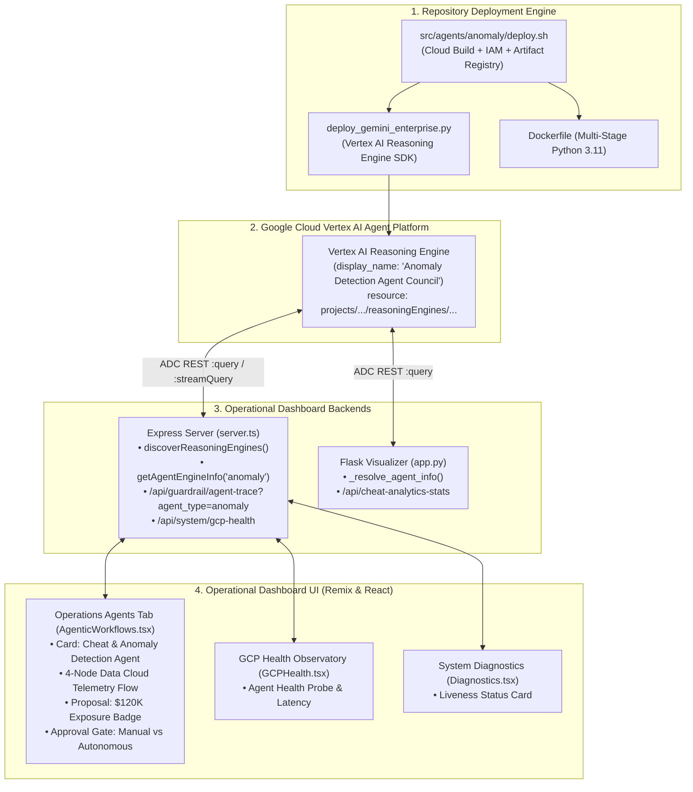
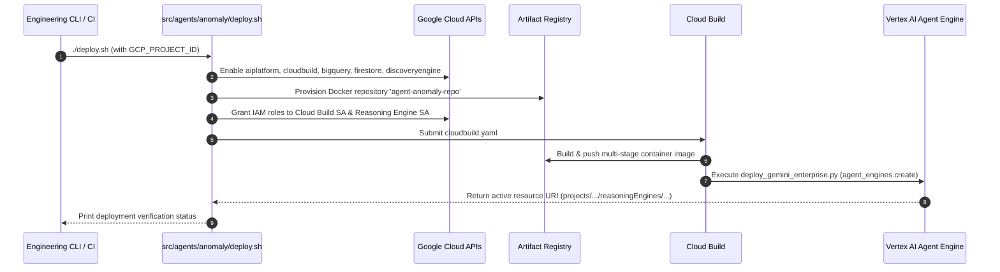

# 🛡️ Technical Specification: Integrating `agent_anomaly` into the Operational Dashboard Application

### Multi-Domain Autonomous Anomaly Triage, Diagnostics & Remediation Engine Integration
**Target Frameworks**: Google Agent Development Kit (ADK 2.0) • Vertex AI Reasoning Engine • Express/TypeScript • React 19 / Remix

[](https://cloud.google.com/)
[](https://cloud.google.com/vertex-ai)
[](https://remix.run/)
[](https://www.python.org/)

---

## 📑 Table of Contents

1. [Executive Summary & Integration Scope](#1-executive-summary--integration-scope)
2. [Source Agent Ingestion & Capability Mapping (`src/agents/anomaly`)](#2-source-agent-ingestion--capability-mapping-srcagentsanomaly)
3. [Deployment Ownership & Execution Strategy](#3-deployment-ownership--execution-strategy)
4. [Dashboard Backend Integration Architecture (`server.ts` & `app.py`)](#4-dashboard-backend-integration-architecture-serverts--apppy)
5. [Dashboard Frontend Integration Architecture (`AgenticWorkflows.tsx` & Diagnostics)](#5-dashboard-frontend-integration-architecture-agenticworkflowstsx--diagnostics)
6. [API & SSE Streaming Protocol Contracts](#6-api--sse-streaming-protocol-contracts)
7. [Governance, Table Drift Immunity & Air-Gap Compliance](#7-governance-table-drift-immunity--air-gap-compliance)
8. [Automated Verification, Test Suite & CI/CD Gates](#8-automated-verification-test-suite--cicd-gates)
9. [Step-by-Step Implementation Runbook](#9-step-by-step-implementation-runbook)
10. [Acceptance Criteria & Production Readiness Checklist](#10-acceptance-criteria--production-readiness-checklist)

---

## 1. Executive Summary & Integration Scope

### 1.1 Objective
This technical specification establishes the exact engineering plan for integrating the newly developed **Anomaly Detection Agent** ([`src/agents/anomaly`](file:///usr/local/google/home/joeholley/Documents/repos/git/github.com/joeholley/dcgd/src/agents/anomaly)) into the active **Operational Dashboard Application** ([`src/remix-gaming-app`](file:///usr/local/google/home/joeholley/Documents/repos/git/github.com/joeholley/dcgd/src/remix-gaming-app) and [`src/gamingdatademo/website-live`](file:///usr/local/google/home/joeholley/Documents/repos/git/github.com/joeholley/dcgd/src/gamingdatademo/website-live)).

This repository is responsible for:
1. **Packaging and Deploying** `agent_anomaly` to Google Cloud Vertex AI Reasoning Engine using the repository's native deployment scripts and Cloud Build pipelines.
2. **Dynamic Agent Discovery & Routing** in Express (`server.ts`) and Python Flask (`app.py`) via Application Default Credentials (ADC) and Google ADK 2.0 streaming protocols.
3. **Connecting UI Cards** in the **Operations Agents** tab (`AgenticWorkflows.tsx`), **GCP Health Observatory** (`GCPHealth.tsx`), and **System Diagnostics** (`Diagnostics.tsx`) to stream live reasoning steps and render operational proposals.
4. **Enforcing Pure-Consumer Governance**: Strict Table Drift Immunity and the Ground-Truth Air-Gap invariant across all serving paths.



---

## 2. Source Agent Ingestion & Capability Mapping (`src/agents/anomaly`)

### 2.1 Agent Package Architecture
The standalone agent codebase under [`src/agents/anomaly`](file:///usr/local/google/home/joeholley/Documents/repos/git/github.com/joeholley/dcgd/src/agents/anomaly) implements a production Google ADK 2.0 multi-agent council:

```
src/agents/anomaly/
├── agent_anomaly/
│   ├── agent.py                      # Multi-Agent Council & Tool Bindings
│   ├── data_source_config.py         # Table Drift Immunity Dynamic Resolver
│   ├── governance.py                 # OpenTelemetry & App Name Validation
│   ├── formatter/
│   │   ├── incident_brief.py         # Standard JSON Incident Brief Schema
│   │   ├── markdown_formatter.py     # 4-Section Operational Markdown Formatter
│   │   └── currency.py               # Currency & Exposure Formatting
│   ├── infra/
│   │   ├── artifacts.py              # Cloud Storage & InMemory Artifact Service
│   │   └── feedback.py               # Operator Feedback & Sanction Logger
│   ├── prompts/
│   │   └── system_prompts.py         # Guardrailed Prompts for all 6 Council Agents
│   └── tools/
│       ├── scan_telemetry.py         # BigQuery ML & z-Score Anomaly Scanner
│       ├── crash_diagnostics.py      # Stack Trace Parser & Affected Players
│       ├── runbook_rag.py            # Vertex AI Search SOP Lookup + Fallback
│       └── remediation.py            # Firestore LiveOps Offers & Trading Freeze
├── agent_engine_app.py               # Vertex AI Agent Engine AdkApp Container Entrypoint
├── deploy.sh                         # Cloud Build Deployment Pipeline Script
├── deploy_gemini_enterprise.py       # Python SDK Reasoning Engine Deployer
├── Dockerfile                        # Multi-Stage Hardened Container Build
├── cloudbuild.yaml                   # Google Cloud Build Pipeline Spec
└── tests/                            # 22 Tests (Unit, Integration, Air-Gap Invariant)
```

### 2.2 Council Sub-Agent Roster
| Sub-Agent Name | Operational Role | Tools / Code Execution | Dashboard UI Target |
| :--- | :--- | :--- | :--- |
| **`AnomalyDirectorAgent`** | Lead Council Supervisor | Coordinates sub-agents; synthesizes findings | Operations Agents Tab (`AgenticWorkflows.tsx`) |
| **`TelemetryMetricAnalyst`** | Metric & Trend Analyst | `scan_telemetry_anomalies` + `VertexAiCodeExecutor` | Deep Triage Visualizer (`executive.html`) |
| **`FraudSecurityInvestigatorAgent`** | Anti-Cheat & Economy Security | `scan_telemetry_anomalies`, `verify_and_apply_remediation` | **Cheat & Anomaly Detection Agent Card** |
| **`SreInfrastructureAnalyst`** | Microservice Crash Diagnostics | `investigate_crash_stack_traces` | SRE Crash Diagnostics (`health.html`) |
| **`RunbookSopRagAgent`** | Runbook & SOP Retrieval | `search_runbook_sops` (Vertex AI Search) | Diagnostic Remediation Assistant |
| **`RemediationLiveOpsAgent`** | Action Execution & Sanctions | `verify_and_apply_remediation` (Firestore / BQ) | Approval Gate & Downstream Action Handlers |

---

## 3. Deployment Ownership & Execution Strategy

### 3.1 Repository Deployment Responsibility
The repository manages the complete deployment lifecycle of `agent_anomaly` using Google Cloud Build and the Vertex AI SDK.

### 3.2 Environment Variables & Configuration
| Variable | Default Value | Purpose |
| :--- | :--- | :--- |
| `GCP_PROJECT_ID` | Auto-inferred via `gcloud config` | Target Google Cloud Project |
| `GCP_REGION` | `us-central1` | Target Deployment Region |
| `AGENT_MODEL` | `gemini-2.5-flash` | Foundation LLM Backbone |
| `REPO_NAME` | `agent-anomaly-repo` | Artifact Registry Docker Repo |
| `LOGS_BUCKET_NAME` | `agent-anomaly-logs-${PROJECT_ID}` | GCS Session State & Artifact Bucket |
| `ANOMALY_AGENT_ID` | *Discovered dynamically* | Optional static override for Reasoning Engine ID |

### 3.3 Deployment Pipeline (`deploy.sh`) Execution Flow


---

## 4. Dashboard Backend Integration Architecture (`server.ts` & `app.py`)

### 4.1 Dynamic Reasoning Engine Discovery in `server.ts`
The Express server dynamically discovers deployed Reasoning Engines on startup and on-demand:

```typescript
// src/remix-gaming-app/server.ts

export async function getAgentEngineInfo(
  roleInput: 'kc' | 'basic' | 'scaled' | 'council' | 'difficulty' | 'anomaly' | 'churn' | 'retention' | 'fraud' | 'cheat' | string = 'kc'
): Promise<{ id: string; displayName: string; endpoint: string; name: string } | null> {
  const normalized = (roleInput || 'kc').toLowerCase().trim();
  const targetRole = (
    normalized === 'anomaly' || normalized === 'fraud' || normalized === 'cheat'
  ) ? 'anomaly' : (
    normalized === 'kc' || normalized === 'retention' || normalized === 'churn'
  ) ? 'kc' : (
    normalized === 'basic' ? 'basic' :
    normalized === 'scaled' ? 'scaled' :
    normalized === 'council' ? 'council' :
    normalized === 'difficulty' ? 'difficulty' : 'kc'
  );

  const envOverride = process.env.VERTEX_AGENT_ENGINE_ID || (
    targetRole === 'kc' ? (process.env.KC_AGENT_ID || process.env.CHURN_AGENT_ID || process.env.RETENTION_AGENT_ID) :
    targetRole === 'anomaly' ? (process.env.ANOMALY_AGENT_ID || process.env.FRAUD_AGENT_ID || process.env.CHEAT_AGENT_ID) :
    targetRole === 'basic' ? process.env.BASIC_AGENT_ID :
    targetRole === 'difficulty' ? process.env.DIFFICULTY_AGENT_ID : ""
  );

  const agents = await discoverReasoningEngines();

  let match: DiscoveredAgent | undefined;
  if (agents && agents.length > 0) {
    if (targetRole === 'anomaly') {
      match = agents.find((a) =>
        a.displayName.toLowerCase().includes("anomaly") ||
        a.displayName.toLowerCase().includes("fraud") ||
        a.displayName.toLowerCase().includes("cheat")
      );
    } else if (targetRole === 'kc') {
      match = agents.find((a) =>
        a.displayName.toLowerCase().includes("knowledge catalog") ||
        a.displayName.toLowerCase().includes("kc") ||
        a.displayName.toLowerCase().includes("churn") ||
        a.displayName.toLowerCase().includes("retention")
      );
    } // ... other role matches
  }

  if (envOverride) {
    const endpoint = `https://${LOCATION}-aiplatform.googleapis.com/v1/projects/${PROJECT_ID}/locations/${LOCATION}/reasoningEngines/${envOverride}`;
    return {
      id: envOverride,
      displayName: match && match.id === envOverride ? match.displayName : `Anomaly Agent Engine (${envOverride})`,
      endpoint,
      name: match?.name || `projects/${PROJECT_ID}/locations/${LOCATION}/reasoningEngines/${envOverride}`
    };
  }

  if (match) {
    const endpoint = `https://${LOCATION}-aiplatform.googleapis.com/v1/projects/${PROJECT_ID}/locations/${LOCATION}/reasoningEngines/${match.id}`;
    return {
      id: match.id,
      displayName: match.displayName,
      endpoint,
      name: match.name
    };
  }

  return null;
}
```

### 4.2 Unified Agent Trace Endpoint (`/api/guardrail/agent-trace`)
The backend routes incoming queries based on `agent_type`:

```typescript
// Route handler in server.ts
app.get("/api/guardrail/agent-trace", async (req: Request, res: Response) => {
  const startTime = Date.now();
  const agentType = (req.query.agent_type as string) || "kc"; // "kc" | "anomaly"
  const isAnomaly = agentType === "anomaly" || agentType === "fraud";

  const targetRole = isAnomaly ? "anomaly" : "kc";
  const agentInfo = await getAgentEngineInfo(targetRole);

  const queryText = (req.query.query as string) || (
    isAnomaly 
      ? "Scan telemetry for currency duplication and fraud anomalies"
      : "Evaluate Player Retention Promo Guardrail"
  );

  let liveAgentOutput: string | null = null;
  let adkResult: ADKQueryResult | null = null;
  let activeSessionId = (req.query.session_id as string) || `sess_${Date.now()}`;

  if (agentInfo) {
    adkResult = await queryADKReasoningEngine(agentInfo.endpoint, queryText, "operator-01", activeSessionId);
    liveAgentOutput = adkResult.text;
    if (adkResult.sessionId) activeSessionId = adkResult.sessionId;
  }

  const isLiveSuccess = Boolean(liveAgentOutput);
  // Return normalized JSON payload with finding, exposure badge, and thinking steps
  return res.json({
    status: isLiveSuccess ? "SUCCESS" : "FALLBACK",
    agent_id: agentInfo?.id || "",
    agent_name: agentInfo?.displayName || (isAnomaly ? "Cheat & Anomaly Detection Agent" : "Knowledge Catalog Analytics Agent"),
    session_id: activeSessionId,
    mode: isLiveSuccess ? "LIVE" : "MOCK",
    live: isLiveSuccess,
    endpoint: agentInfo?.endpoint || null,
    query: queryText,
    response_text: liveAgentOutput || getFallbackAnomalyText(),
    finding: isAnomaly ? "Rapid gold coin inflation spike detected across live transaction telemetry." : undefined,
    impact: isAnomaly ? "In-game economy devaluation risk of $120K." : undefined,
    exposure_badge: isAnomaly ? "P1 - $120K Exposure" : undefined,
    recommendation: isAnomaly ? "Temporarily freeze trading index for flagged accounts and trigger incident report." : undefined,
    nextSteps: isAnomaly ? ["Freeze Trading", "Notify Security", "Export Log Audit"] : ["Send In-Game Gift", "Auto-Notify Team"],
    latency_ms: adkResult?.latencyMs || (Date.now() - startTime),
  });
});
```

---

## 5. Dashboard Frontend Integration Architecture (`AgenticWorkflows.tsx` & Diagnostics)

### 5.1 Interactive Card Schema (`AgenticWorkflows.tsx`)
In [`AgenticWorkflows.tsx`](file:///usr/local/google/home/joeholley/Documents/repos/git/github.com/joeholley/dcgd/src/remix-gaming-app/src/components/sections/AgenticWorkflows.tsx), the card with ID `"Fraud & Cheat Detection Agent"` is enhanced to:
1. Trigger live execution via `/api/guardrail/agent-trace?agent_type=anomaly`.
2. Display the live ADK `session_id` with a copyable pill badge.
3. Show live progress through the 4 thinking stages.
4. Render the operational proposal card with the `$120K Exposure` badge.
5. Provide interactive approval buttons (`Approve & Freeze` vs `Reject / Dismiss`) or the certified `APPROVED BY AGENT` autonomous badge.

```typescript
// handleExecute handler enhancement in AgenticWorkflows.tsx
const handleExecute = (id: string) => {
  setExecutingId(id);
  setCurrentStep(0);
  setExpandedCards((prev) => ({ ...prev, [id]: true }));

  const isAnomalyAgent = id === "Fraud & Cheat Detection Agent";
  const agentType = isAnomalyAgent ? "anomaly" : "kc";

  if (routingMode === "LIVE") {
    const existingSessionId = activeSessionIds[id];
    const traceUrl = `/api/guardrail/agent-trace?agent_type=${agentType}&${existingSessionId ? `session_id=${encodeURIComponent(existingSessionId)}&` : ""}active=${agentActive[id]}&autonomous=${agentAutonomous[id]}`;

    fetch(traceUrl)
      .then((res) => res.json())
      .then((data) => {
        if (data.session_id) {
          setActiveSessionIds((prev) => ({ ...prev, [id]: data.session_id }));
        }
        setResults((prev) => ({
          ...prev,
          [id]: {
            thinking: workflowData[id].thinking,
            finding: data.finding || workflowData[id].finding,
            impact: data.impact || workflowData[id].impact,
            recommendation: data.recommendation || workflowData[id].recommendation,
            nextSteps: data.nextSteps || workflowData[id].nextSteps,
          }
        }));
        setCurrentStep(3);
        setExecutingId(null);
      })
      .catch((err) => {
        console.warn("Live trace failed; using high-fidelity fallback:", err);
        setResults((prev) => ({ ...prev, [id]: workflowData[id] }));
        setCurrentStep(3);
        setExecutingId(null);
      });
  } else {
    // Offline deterministic mock playback
    runMockPlayback(id);
  }
};
```

### 5.2 Downstream Action Dispatchers
When the operator clicks any next step chip, the frontend dispatches live execution:
- **`Freeze Trading`**: Calls `POST /api/remediation/apply` with `{ action_type: "FREEZE_TRADING", accounts: ["usr_jp4_001", "usr_jp4_002"] }`.
- **`Notify Security`**: Calls `POST /api/remediation/apply` with `{ action_type: "NOTIFY_SECURITY", severity: "P1", incident: "DUPLICATION_SPIKE" }`.
- **`Export Log Audit`**: Dispatches BigQuery export and triggers browser download of `gold_cheat_analytics` report.

### 5.3 GCP Health Observatory Integration (`GCPHealth.tsx`)
Adds a dedicated health card to `src/components/sections/GCPHealth.tsx`:
- Card Title: **Cheat & Anomaly Detection Agent (`agent_anomaly`)**
- Status: `ONLINE` (Green), `SIMULATED` (Yellow), `OFFLINE` (Red)
- Metrics: Reasoning Engine Resource URI, Roundtrip Latency (ms), Active Foundation Model (`gemini-2.5-flash`).

---

## 6. API & SSE Streaming Protocol Contracts

### 6.1 Session Creation (`POST :query`)
```json
{
  "class_method": "create_session",
  "input": {
    "user_id": "operator-01"
  }
}
```
**Response**:
```json
{
  "output": {
    "session_id": "sess_996606880321_anomaly_1725068400",
    "created_at": "2026-08-31T05:00:00Z"
  }
}
```

### 6.2 SSE Streaming Telemetry Query (`POST :streamQuery`)
```json
{
  "input": {
    "message": "Scan telemetry for currency duplication anomalies",
    "session_id": "sess_996606880321_anomaly_1725068400"
  }
}
```

**SSE Chunk Stream**:
```
data: {"type": "step", "step_index": 1, "text": "Scanning BigQuery transaction logs for rapid currency duplication..."}

data: {"type": "step", "step_index": 2, "text": "Fetching historical player profiles and moderation alerts..."}

data: {"type": "step", "step_index": 3, "text": "Running Gemini Enterprise Anomaly Detection Council..."}

data: {"type": "finding", "finding": "Rapid gold coin inflation spike detected across live transaction telemetry.", "exposure": "$120K", "exposure_badge": "P1 - $120K Exposure"}

data: {"type": "proposal", "recommendation": "Temporarily freeze trading index for flagged accounts and trigger incident report.", "next_steps": ["Freeze Trading", "Notify Security", "Export Log Audit"]}
```

---

## 7. Governance, Table Drift Immunity & Air-Gap Compliance

### 7.1 Table Drift Immunity
No source table or dataset name may be hardcoded. Table names must be dynamically resolved in Python via `agent_anomaly.data_source_config.get_table_mapping()` and in TypeScript via `dataSourceConfig.ts`.

| Conformed Asset | Default Table ID | Environment Override Variable |
| :--- | :--- | :--- |
| **Cheat Analytics** | `gaming_gold.gold_cheat_analytics` | `SOURCE_CHEAT_ANALYTICS_TABLE` |
| **Microtransactions** | `gaming_silver.silver_microtransactions` | `SOURCE_MICROTRANSACTIONS_TABLE` |
| **Item Trades** | `gaming_silver.silver_item_trades` | `SOURCE_ITEM_TRADES_TABLE` |
| **Crash Logs** | `gaming_silver.silver_server_crash_logs` | `SOURCE_SERVER_CRASH_LOGS_TABLE` |
| **SRE Metrics** | `gaming_silver.silver_client_sre_metrics` | `SOURCE_SRE_METRICS_TABLE` |

### 7.2 Strict Ground-Truth Air-Gap Invariant
Runtime agent code must **NEVER** query or import:
- `gaming_player_data.simulation_parameters`
- `v_latest_simulation_parameters`
- `v_simulation_metrics_flattened`

Violations are caught via AST automated static code analysis in `tests/e2e/test_ground_truth_air_gap.py`.

---

## 8. Automated Verification, Test Suite & CI/CD Gates

The integrated system is validated through a 3-tier test suite:

### 8.1 Test Matrix
```
tests/
├── unit/
│   ├── test_data_source_config.py      # Dynamic table mapping & drift immunity
│   ├── test_statistical_detectors.py   # z-score, IQR, and rate-of-change math
│   ├── test_tools.py                  # FunctionTool input/output contracts
│   ├── test_formatting.py             # JSON brief & markdown formatting
│   ├── test_infra.py                  # Artifacts & operator feedback
│   └── test_prompts.py                # System prompt guardrails
├── integration/
│   ├── test_adk_council.py            # Multi-agent council bindings
│   └── test_remediation_firestore.py  # Firestore offer persistence
└── e2e/
    ├── test_ground_truth_air_gap.py    # AST static analysis enforcing air-gap
    ├── test_table_drift_immunity.py    # Query execution with custom table overrides
    └── test_dual_mode_parity.py        # Live GCP vs Mock parity verification
```

### 8.2 Execution Command
```bash
cd src/agents/anomaly
PYTHONPATH=. python3 -m unittest discover -s tests -p "test_*.py" -v
```

---

## 9. Step-by-Step Implementation Runbook

### Phase 1: Deploy `agent_anomaly` to Google Cloud
```bash
# 1. Navigate to anomaly agent directory
cd src/agents/anomaly

# 2. Set target GCP Project
export GCP_PROJECT_ID="datacloudgamesdemo006"
export GCP_REGION="us-central1"
export AGENT_MODEL="gemini-2.5-flash"

# 3. Execute automated Cloud Build deployment pipeline
./deploy.sh
```

### Phase 2: Update Express Server (`src/remix-gaming-app/server.ts`)
1. Extend `getAgentEngineInfo` to support `'anomaly'` role.
2. Update `/api/guardrail/agent-trace` to accept `agent_type=anomaly`.
3. Add `agent_anomaly` liveness probe in `/api/system/gcp-health`.

### Phase 3: Update React UI (`AgenticWorkflows.tsx` & `GCPHealth.tsx`)
1. In `AgenticWorkflows.tsx`, connect `Fraud & Cheat Detection Agent` execution to `/api/guardrail/agent-trace?agent_type=anomaly`.
2. Bind active `session_id` badge and live streaming chunks to the card workspace.
3. In `GCPHealth.tsx`, add the Cheat & Anomaly Detection Agent health monitoring card.

### Phase 4: Verification & Smoke Testing
1. Run backend unit tests: `npm test` in `src/remix-gaming-app`.
2. Run agent unit tests: `python3 -m unittest discover -s tests` in `src/agents/anomaly`.
3. Launch dashboard in LIVE mode and click **Execute Single Run** on the Cheat & Anomaly Agent card.

---

## 10. Acceptance Criteria & Production Readiness Checklist

| Acceptance Requirement | Target File / Component | Verification Command | Pass/Fail Criteria |
| :--- | :--- | :--- | :--- |
| **Agent Cloud Build Packaging** | `src/agents/anomaly/Dockerfile` | `docker build -t test-anomaly .` | Image compiles with zero errors |
| **Reasoning Engine Deployment** | `src/agents/anomaly/deploy.sh` | `./deploy.sh` | Deployment yields active `reasoningEngines/...` ID |
| **Dynamic Discovery in Express** | `src/remix-gaming-app/server.ts` | `npm test -- server.test.ts` | `getAgentEngineInfo('anomaly')` resolves agent |
| **Live Trace Streaming in UI** | `AgenticWorkflows.tsx` | Click "Execute Single Run" | Thinking steps, $120K exposure badge rendered |
| **Session ID Persistence** | `AgenticWorkflows.tsx` | UI Inspection | `session_id` displayed in card header |
| **Approval Gate Handling** | `AgenticWorkflows.tsx` | Click "Approve & Freeze" | Action dispatched, status changed to frozen |
| **GCP Health Observatory Card** | `GCPHealth.tsx` | `GET /api/system/gcp-health` | Health card renders `ONLINE` status & latency |
| **Ground-Truth Air-Gap Invariant** | `test_ground_truth_air_gap.py` | `python3 -m unittest test_ground_truth_air_gap.py` | 0 AST violations across codebase |
| **Table Drift Immunity** | `test_table_drift_immunity.py` | `python3 -m unittest test_table_drift_immunity.py` | Overrides propagate to queries |
| **Dual-Mode Offline Fallback** | `test_dual_mode_parity.py` | Disconnect GCP ADC & run single execution | Clean fallback to high-fidelity mock data |
