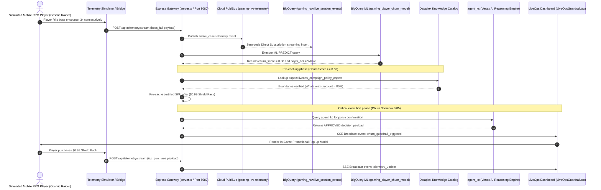

# Technical Architecture Plan: Unified Backend Architecture & System Topology

## Goal Description

This document establishes the comprehensive backend architecture and end-to-end system design for the **Data Cloud Games Demo (DCGD)** platform. The platform unifies the **Remix Gaming App (Jingle Games Player 360)** (`src/remix-gaming-app`), the **OmniArcade Gaming Knowledge Catalog Demo** (`src/gamingdatademo`), the **Retail Data & AI Reference Architecture** (`src/retail-data-and-ai-demo`), and upstream generative simulation engines (`eventsim` & `generator`).

The architecture fulfills the primary narrative of **The Real-Time Autonomous Guardrail Engine & Active Lakehouse**, showcasing sub-300ms predictive churn intervention, Dataplex Knowledge Catalog-guided multi-agent reasoning on Vertex AI Agent Engine, and Medallion Lakehouse analytics.

---

## User Review Required

> [!IMPORTANT]
> **Key Architecture Decisions for Approval:**
> 1. **Dual-Application Container Deployment**: Single Cloud Run container running Express (Node.js/TypeScript on `:8080`) as the outer gateway and Flask (`gunicorn` multi-threaded on `127.0.0.1:5000`) as an internal microservice, proxied via HTTP and WebSocket TCP net socket upgrade.
> 2. **Medallion Data Lakehouse Structure**: Standardizing on US Multi-Region BigQuery datasets: `gaming_player_data` (Upstream DNA), `gaming_raw` (Partitioned raw telemetry), `gaming_silver` (Conformed operational metrics), and `gaming_gold` (Curated feature marts and dimensional KPI tables).
> 3. **Explicit Scope Boundaries for Multi-Cloud & External Services**: AWS S3, Snowflake, BigQuery Omni federation, Google Ads API, and Looker Embedded are maintained as **Mock-Only / Synthetic Dev Mode** with transparent UI labeling, keeping live deployment focused entirely on core Google Cloud services (BigQuery, BQML, Pub/Sub, Dataplex, Vertex AI Agent Engine, Firestore/AlloyDB/Spanner).
> 4. **Live Telemetry & Game Simulator Microservice**: Generating realistic 24-hour sinusoidal CCU curves (1,200 to 18,500 CCU) and on-demand LiveOps anomaly injection (Level 2 bottleneck, high-churn whale boss deaths, toxic chat outbreak) streaming to Cloud Pub/Sub and BigQuery.

---

## Open Questions

> [!NOTE]
> 1. **Operational Database Target for High-Frequency CCU / Match State**: Should operational state (live CCU counters, lobby occupancy, chat moderation tickets) write directly to **AlloyDB for PostgreSQL (`pgvector`)** or **Cloud Spanner / Firestore Native Mode**? The plan supports a hybrid adapter with graceful local fallback.
> 2. **Agent Engine Deployment Model**: Do you prefer deploying only the primary `agent_kc` (Knowledge Catalog Guided Agent) or all 5 comparative agents (`agent_basic`, `agent_scaled`, `agent_kc`, `marketing_agent_swarm`, `agent_difficulty`) during automated provisioning?

---

## 🏗️ Comprehensive Backend Architecture Diagram

```mermaid
graph TD
    %% CLIENT & UI LAYER
    subgraph UI_LAYER ["1. Unified Frontend Presentation Shell (Cloud Run Port 8080)"]
        UI_HEADER["Shell Header: Region / Locale / Simulator Switch / Live CCU Gauge"]
        UI_EXEC["Executive and Analytics: Overview, Operations, Executive Portfolio"]
        UI_LIVEOPS["LiveOps and Automation: LiveOps Guardrail, Campaign Engine, Difficulty Balancer, Marketing Swarm"]
        UI_AGENTS["Agent Workspace: Agentic Workflows, Agent Comparison, Knowledge Catalog"]
        UI_OBS["Observability and Probes: IT Observatory, Trust and Safety, GCP Health, Diagnostics"]
        UI_DRAWER["Persistent PineCore AI Assistant Drawer (GamingAssistant.tsx)"]
        
        UI_HEADER --> UI_EXEC
        UI_HEADER --> UI_LIVEOPS
        UI_HEADER --> UI_AGENTS
        UI_HEADER --> UI_OBS
        UI_DRAWER -.-> UI_AGENTS
    end

    %% GATEWAY & PROXY LAYER
    subgraph GATEWAY_LAYER ["2. Serving Gateway and Application Reverse Proxy"]
        EXPRESS["Express API Gateway and SSE Hub (server.ts / Port 8080)"]
        FLASK["Internal Python Flask Engine (app.py / 127.0.0.1:5000)"]
        SSE_HUB["Server-Sent Events Hub (/api/guardrail/events)"]
        WS_PROXY["TCP Net Socket Upgrade Proxy (/api/ws)"]
        CACHE_PRECACHE["In-Memory LRU Pre-Cache (Under 300ms SLA Offer Cache)"]
        PROBE_GATEWAY["13-Service Parallel Diagnostic Probe Engine"]

        EXPRESS -->|"HTTP Reverse Proxy"| FLASK
        EXPRESS -->|"WebSocket Upgrade"| WS_PROXY
        EXPRESS --> SSE_HUB
        EXPRESS --> CACHE_PRECACHE
        EXPRESS --> PROBE_GATEWAY
    end

    %% SIMULATOR LAYER
    subgraph SIMULATOR_LAYER ["3. Live Game and Telemetry Simulator Microservice"]
        SIM_CORE["Simulator Engine (src/simulator/simulator.py)"]
        SIM_ANOMALY["Anomaly Injection Engine: Level 2 Bottleneck, Whale Boss Deaths, Toxic Chat"]
        SIM_CURVE["Sinusoidal 24h Diurnal CCU Generator (1.2K to 18.5K CCU)"]
        SIM_CORE --> SIM_ANOMALY
        SIM_CORE --> SIM_CURVE
    end

    %% INGESTION & MESSAGING
    subgraph INGESTION_LAYER ["4. Real-Time Ingestion and Streaming Layer"]
        PUBSUB_TOPIC["Cloud Pub/Sub Topic: gaming-live-telemetry"]
        PUBSUB_DIRECT_SUB["Direct BigQuery Subscription: gaming-live-telemetry-bq-sub"]
        PUBSUB_TOPIC --> PUBSUB_DIRECT_SUB
    end

    %% MEDALLION LAKEHOUSE STORAGE
    subgraph LAKEHOUSE_LAYER ["5. Google Cloud Medallion Lakehouse (BigQuery US Multi-Region)"]
        RAW_DNA[("gaming_player_data.player_dna (2M+ Profiles)")]
        RAW_EVENTS[("gaming_raw.live_session_events")]
        RAW_PLAYERS[("gaming_raw.gcp_players")]
        RAW_IAP[("gaming_raw.iap_transactions")]

        SILVER_LATENCY[("gaming_silver.server_latency")]
        SILVER_TX[("gaming_silver.silver_microtransactions")]
        SILVER_MATCH[("gaming_silver.silver_match_sessions")]
        SILVER_CHAT[("gaming_silver.silver_chat_moderation")]

        GOLD_P360[("gaming_gold.gold_player_360 (Feature Store)")]
        GOLD_KPIS[("gaming_gold.gold_regional_kpis")]
        GOLD_FUNNEL[("gaming_gold.gold_level_difficulty_funnel")]
        GOLD_MKT[("gaming_gold.gold_campaign_analytics")]
        GOLD_AUDIT[("gaming_agent_analytics.kc_agent_events")]

        RAW_EVENTS --> SILVER_LATENCY
        RAW_EVENTS --> SILVER_TX
        RAW_EVENTS --> SILVER_MATCH
        RAW_EVENTS --> SILVER_CHAT
        RAW_DNA --> GOLD_P360
        SILVER_LATENCY --> GOLD_KPIS
        SILVER_TX --> GOLD_P360
        SILVER_TX --> GOLD_MKT
        SILVER_MATCH --> GOLD_FUNNEL
    end

    %% IN-WAREHOUSE AI & BQML
    subgraph AI_LAYER ["6. In-Warehouse Machine Learning and Remote AI Models"]
        BQML_CHURN["BQML Model: gaming_raw.gaming_player_churn_model"]
        BQML_LTV["BQML Model: gaming_gold.gaming_predictive_ltv_model"]
        BQ_REMOTE_AI["BigQuery Remote Model: gemini_flash_remote_model (AI.GENERATE)"]
        SP_PREDICT["Stored Procedure: calculate_churn_risk(player_id)"]
        SP_TRAIN["Stored Procedure: train_churn_model()"]

        GOLD_P360 --> BQML_CHURN
        GOLD_P360 --> BQML_LTV
        BQML_CHURN --> SP_PREDICT
        SP_TRAIN --> BQML_CHURN
    end

    %% GOVERNANCE & METADATA
    subgraph GOV_LAYER ["7. Dataplex Knowledge Catalog and Security"]
        GLOSSARY["Business Glossary: gaming-studios-glossary-us (83+ Terms)"]
        ASPECTS["Custom Aspect Types: liveops_campaign_policy_aspect, gaming-certified-reward-sku-aspect"]
        LINEAGE["Dataplex Lineage API (datalineage.googleapis.com)"]
        GOV_RLS["BigQuery Row-Level Security and Policy Tags"]

        ASPECTS -.-> GOLD_P360
        GLOSSARY -.-> GOLD_P360
        LINEAGE -.-> RAW_EVENTS
    end

    %% VERTEX AI AGENTS
    subgraph AGENT_LAYER ["8. Conversational Analytics and Vertex AI Agent Engine"]
        ADK_KC["agent_kc: Knowledge Catalog Guided Agent (ADK 2.0)"]
        ADK_SWARM["Marketing Recovery Multi-Agent Swarm"]
        ADK_COUNCIL["Game Balancer and Tuning Council (4 Agents)"]
        REASONING_ENGINE["Vertex AI Reasoning Engines Hosting"]

        ADK_KC --> REASONING_ENGINE
        ADK_SWARM --> REASONING_ENGINE
        ADK_COUNCIL --> REASONING_ENGINE
    end

    %% OPERATIONAL STORAGE
    subgraph OP_STORAGE ["9. Operational Transactional Storage"]
        ALLOYDB[("AlloyDB for PostgreSQL (pgvector)")]
        SPANNER[("Cloud Spanner / Spanner Graph")]
        FIRESTORE[("Cloud Firestore Native Mode")]
    end

    %% CROSS-LAYER CONNECTIONS
    UI_EXEC --> EXPRESS
    UI_LIVEOPS --> EXPRESS
    UI_AGENTS --> EXPRESS
    UI_OBS --> EXPRESS

    SIM_CORE -->|"Publish Event Stream"| PUBSUB_TOPIC
    SIM_CORE -->|"Write Live CCU"| ALLOYDB
    PUBSUB_DIRECT_SUB --> RAW_EVENTS

    EXPRESS -->|"Pub/Sub SDK"| PUBSUB_TOPIC
    EXPRESS -->|"SQL Queries"| GOLD_P360
    EXPRESS -->|"SQL Queries"| GOLD_KPIS
    EXPRESS -->|"Execute ML.PREDICT"| SP_PREDICT
    EXPRESS -->|"ADC Query"| REASONING_ENGINE
    EXPRESS -->|"Aspect Lookup"| ASPECTS
    EXPRESS -->|"Campaign CRUD"| FIRESTORE

    FLASK -->|"SQL Analytics"| GOLD_FUNNEL
    FLASK -->|"SQL Analytics"| GOLD_MKT
    FLASK -->|"WebSocket Stream"| REASONING_ENGINE
    FLASK -->|"Dataplex REST"| GLOSSARY
    FLASK -->|"Moderate Bans"| SPANNER

    ADK_KC -->|"MCP Search"| GLOSSARY
    ADK_KC -->|"SQL Tool"| GOLD_P360
    ADK_KC -->|"Policy Tool"| ASPECTS
```



---

## ⚡ End-to-End Sequence Flow: Real-Time Churn Guardrail



---

## 🏛️ Detailed Architectural Layer Breakdown

### 1. Unified Frontend Shell & Navigation Hierarchy
* **Tech Stack**: React 19, TypeScript, Tailwind CSS, Vite, Recharts, Lucide Icons, Three.js (Point-Cloud visualizer).
* **Navigation Architecture**: Single cohesive shell across 4 executive operational groups:
  1. **Executive & Analytics**:
     - `Overview.tsx` (React): Cross-cloud lakehouse summary (BigQuery, S3, Snowflake), live KPI cards.
     - `Operations.tsx` (React): Server latency, active CCU, Diurnal 24h sine wave graph, difficulty bottleneck callouts.
     - `executive.html` (Flask): Executive Portfolio Insight Council (EPIC), cross-title revenue anomaly detection.
  2. **LiveOps & Automation**:
     - `LiveOpsGuardrail.tsx` (React): Split-screen RPG simulator, radial BQML churn gauge, <300ms offer interceptor.
     - `CampaignEngine.tsx` (React): Target cohort sizing, multi-lingual AI messaging (EN/JP/KR/ZH), Imagen 3 banner preview.
     - `difficulty.html` (Flask): Match-3 / puzzle game level difficulty funnel and 4-agent balancer council.
     - `marketing_swarm_visualizer.html` (Flask): 6-agent collaborative parallel swarm execution graph.
  3. **Agent & AI Workspace**:
     - `AgenticWorkflows.tsx` (React): Player retention promo agent, cheat detection, matchmaking queue balancer.
     - `agent-comparison` (Flask): 3-Tier agent comparison (Basic vs. Scaled vs. KC-Guided) with real-time WebSocket traces.
     - `KnowledgeCatalog.tsx` (React): Data catalog browser & Automatic Rule Discovery Sandbox.
  4. **Observability & Diagnostics**:
     - `ITObservatory.tsx` (React): Query unit economics ($/TB scanned), SPIFFE identity cards, audit query log.
     - `toxicity.html` (Flask): Trust & Safety Council, GIRA incident moderation, chat vector similarity.
     - `GCPHealth.tsx` (React): 6-service GCP resource status probe (ADC Auth, BigQuery, Pub/Sub, BQML, Dataplex, Vertex AI).
     - `Diagnostics.tsx` (React): Multi-service single-pane-of-glass matrix across all 15 app sections and 13 GCP probes.

---

### 2. Dual-Engine Container Runtime & Reverse Proxy Gateway
* **Container Entrypoint**: `entrypoint.sh` starts:
  1. Internal Python Flask backend on `127.0.0.1:5000` via `gunicorn --workers 2 --worker-class gthread --threads 8 --bind 127.0.0.1:5000 app:app`.
  2. Outer Node.js Express server on `0.0.0.0:8080`.
* **Express Gateway Responsibilities (`server.ts`)**:
  - **Reverse Proxy**: Routes `/agent-comparison`, `/difficulty.html`, `/executive.html`, `/toxicity.html`, `/graph_visualization.html`, `/marketing_swarm_visualizer.html`, and `/api/gamingdatademo/*` to Flask.
  - **WebSocket TCP Upgrade**: Intercepts HTTP `upgrade` requests on `/api/ws` and establishes a raw TCP net socket proxy to Flask port 5000.
  - **SSE Hub**: Publishes real-time Server-Sent Events (`/api/guardrail/events`, `/api/guardrail/agent-trace`) with sub-millisecond in-memory LRU pre-caching.
  - **GCP Client SDKs**: Direct integration with `@google-cloud/pubsub`, `@google-cloud/bigquery`, `@google-cloud/firestore`, and GoogleAuth ADC.
  - **13-Service Parallel Probes**: Asynchronously tests ADC Auth, Pub/Sub, Dataplex, Vertex AI Reasoning Engine, and 9 BigQuery Gold tables in `<100ms` with safe 2000ms timeout fallbacks.

---

### 3. Upstream Data Generation & SimTech Engine v4
* **Deterministic Population Generator (`generator`)**:
  - Stateless procedural generator in BigQuery SQL using `FARM_FINGERPRINT` and Acklam's probit algorithm.
  - Generates 2,000,000+ distinct player DNA profiles with demographic attributes (Region $\times$ Platform) and Dirichlet-normalized genre behavioral profiles (RPG, FPS, Strategy, Casual, Sports, Action).
  - Target Table: `gaming_player_data.player_dna`.
* **SimTech Engine v4 (`eventsim`)**:
  - Massively parallel in-database simulation running JavaScript UDFs (`udf_generate_cloudevents.js`).
  - Implements commercial revenue targets ($\mathbb{E}[R] = \text{Budget} \times \text{Hit Ratio}$), power-law player arrival, decaying B2P license pricing, remainder IAP spend allocation, and Weibull retention hazard curves ($k=1.5$ FPS, $k=1.0$ RPG, $k=0.7$ Casual) with LiveOps surges (+50% to +350%).
  - Output Table: `gaming_raw.raw_events` (CloudEvents v1.0 standard JSON).
* **Live Game & Telemetry Simulator Microservice (`src/simulator/`)**:
  - Continuous operational event generator (10–25 Hz) publishing real-time `snake_case` payloads to Pub/Sub topic `gaming-live-telemetry`.
  - Generates dynamic 24-hour sinusoidal CCU curves ($1,200$ to $18,500$ CCU).
  - On-demand anomaly injection triggers for demo presentations: Level 2 bottleneck (failure rate jumps to 82%), High-churn whale boss death, and toxic chat outbreak.

---

### 4. BigQuery Medallion Lakehouse Architecture
* **Medallion Dataset Hierarchy (US Multi-Region)**:
  - **`gaming_raw`**: Partitioned by `DATE(timestamp)`, clustered by `player_id, event_type`.
    - `live_session_events`: Ingested zero-code via direct subscription from Pub/Sub topic `gaming-live-telemetry`.
    - `gcp_players`: Player profiles and spend tiers (`Whale`, `Dolphin`, `Minnow`, `F2P`).
    - `iap_transactions`: Reconciled SKU purchase records.
  - **`gaming_silver`**: Conformed operational metrics.
    - `server_latency`: CCU, server region capacity, ping latency, frame rate drops.
    - `silver_microtransactions`, `silver_match_sessions`, `silver_chat_moderation`.
  - **`gaming_gold`**: Curated analytical marts & ML feature store.
    - `gold_player_360`: Unified player feature store (LTV, total sessions, consecutive deaths, churn risk score).
    - `gold_regional_kpis`: Aggregated DAU, MAU, ARPU, total revenue by region.
    - `gold_level_difficulty_funnel`: Level starts, completions, failures, resets, move limits.
    - `gold_campaign_analytics` / `gold_mobile_marketing_performance`: AdMob vs. AppLovin spend, conversion ROI.
    - `gold_cheat_analytics`: Flagged chat snippets, toxicity scores, offense severities.

---

### 5. In-Warehouse Machine Learning & Remote AI Models
* **BQML Churn Prediction Model**:
  - Model Name: `gaming_raw.gaming_player_churn_model` (Logistic Regression).
  - Training Procedure: `gaming_raw.train_churn_model()` trained on `gold_player_360` feature vectors (`consecutive_deaths`, `session_duration_seconds`, `payer_tier`, `total_iap_spend`, `days_since_last_login`).
  - Real-Time Point Inference: Stored procedure `gaming_raw.calculate_churn_risk(target_player_id)` executing `ML.PREDICT` in `<50ms`.
* **BQML Predictive LTV Model**:
  - Model Name: `gaming_gold.gaming_predictive_ltv_model` (Boosted Tree Regressor).
  - Predicts future 90-day player spend based on historical purchasing velocity.
* **BigQuery Remote Models (Gemini Enterprise)**:
  - Connection: `us.vertex_ai_gemini_connection` to Vertex AI `gemini-2.5-flash`.
  - Model: `gaming_gold.gemini_flash_remote_model` invoking `AI.GENERATE` directly inside SQL queries for dynamic localized marketing ad copy and natural language to SQL translation.

---

### 6. Dataplex Knowledge Catalog Governance & Security
* **Business Glossary**:
  - Glossary Name: `gaming-studios-glossary-us`.
  - 83+ Curated Terms: *Whale Spend*, *Idle Churn*, *ARPU*, *CCU*, *Toxicity Exposure*, *Autonomous Intervention Boundary*.
* **Custom Aspect Types**:
  - `liveops_campaign_policy_aspect`: Enforces maximum allowable promotional discount ratios per player spend tier (`Whale`: 80%, `Dolphin`: 50%, `Minnow`: 40%, `F2P`: 25%) and authorized studio titles.
  - `gaming-certified-reward-sku-aspect`: Certifies in-game reward packages (e.g. `frost_giant_shield_pack`).
  - `liveops-promo-catalog-aspect`: Taxonomical indexing for marketing campaigns.
* **Security & Lineage**:
  - Dataplex Policy Tags (`gaming_data_classification`) enforcing Column-Level Security (CLS) on PII/financial columns.
  - Dataplex Lineage API (`datalineage.googleapis.com`) tracking data provenance: Pub/Sub $\rightarrow$ Raw $\rightarrow$ Silver $\rightarrow$ Gold $\rightarrow$ BQML Model.

---

### 7. Conversational Analytics & Vertex AI Agent Engine
* **Agent Development Kit (ADK 2.0)**:
  - Core Agent: `src/agents/kc/` (`agent_kc`).
  - Hosting: Deployed to Vertex AI Reasoning Engine (`projects/.../locations/us-central1/reasoningEngines/{KC_AGENT_ID}`).
  - Built-in FunctionTools:
    1. `search_entries`: Queries Dataplex Knowledge Catalog Context API for schema and asset resolution.
    2. `get_context`: Extracts business glossaries, data quality scores, and custom aspect tag annotations.
    3. `run_sql`: Parameterized SQL execution against BigQuery Gold tables.
    4. `verify_intervention_policy`: Validates promotional discount boundaries against Dataplex aspect ceilings.
    5. `get_glossary_term`: Fetches governance definitions for business metrics.
    6. `verify_aspect_compliance`: Validates aspect certifications before offer dispatch.
* **3-Tier Agent Comparison Workspace**:
  - **Basic Agent**: 5 hardcoded Gold tables, naive SQL generation (fails on complex multi-domain queries).
  - **Scaled Agent**: 150+ raw table schemas without catalog context (suffers hallucinations and table confusion).
  - **KC-Guided Agent (`agent_kc`)**: Dataplex Context API navigation, 100% precision with metadata citations and governance compliance.

---

### 8. Operational & Low-Latency Data Stores
* **AlloyDB for PostgreSQL (`pgvector`)**:
  - Real-time sub-millisecond OLTP queries for live CCU counters, active match lobby concurrency, and ping latencies.
  - 768-dimensional vector embeddings of in-game chat messages with Cosine/Euclidean vector similarity search for real-time toxic chat filtering.
* **Cloud Spanner / Spanner Graph**:
  - Global transactional consistency for multi-region player state, ledger balances, and automated player ban enforcements.
  - Spanner Graph with ISO GQL queries traversing player social networks, guilds, and item trading topologies.
* **Cloud Firestore (Native Mode)**:
  - Administrative repository for LiveOps marketing campaigns (`/campaigns`) and promotional packages (`/offers`).
  - Auto-discovered as Dataplex catalog asset `firestore-database` and `firestore-schema`.

---

## 📋 Comprehensive 15-Section Frontend-to-Backend Integration Matrix

| # | Section Name | UI File | Target GCP Backend Products | Primary API / Data Flow | Data Mode |
|---|---|---|---|---|---|
| **1** | **Executive Overview** | `Overview.tsx` | BigQuery Gold (`gold_player_360`, `gold_regional_kpis`), BigQuery Omni (Mock) | BigQuery Client SDK -> `queryRegionalKPIs`, `queryPlayer360` | LIVE / Hybrid |
| **2** | **Game Operations** | `Operations.tsx` | Pub/Sub topic `gaming-live-telemetry`, AlloyDB (`live_ccu_counter`), BigQuery Silver | Pub/Sub event stream, `/api/operations/telemetry-metrics` | LIVE |
| **3** | **Executive Portfolio** | `executive.html` (Flask) | BigQuery Gold (`gold_regional_kpis`), Vertex AI Agent Engine | Reverse proxy to Flask `/api/executive/portfolio-metrics`, ADK multi-agent sweep | LIVE |
| **4** | **Knowledge Catalog** | `KnowledgeCatalog.tsx` | Dataplex REST API (`searchEntries`, `lookupContext`), BigQuery RLS, Gemini 2.5 Flash | `/api/catalog/search`, `/api/catalog/rules/discover` (compiles BQ RLS SQL) | LIVE |
| **5** | **LiveOps Guardrail** | `LiveOpsGuardrail.tsx` | Pub/Sub, BQML (`player_churn_model`), Dataplex Aspect (`liveops_campaign_policy_aspect`) | `/api/telemetry/stream` -> BQML `ML.PREDICT` -> Dataplex policy -> SSE push (<300ms) | LIVE |
| **6** | **AI Campaign Engine** | `CampaignEngine.tsx` | BigQuery `AI.GENERATE`, Imagen 3 on Vertex AI, Firestore (`campaigns`) | Firestore SDK CRUD, `/api/marketing/generate-creative`, BQ cohort sizing | LIVE |
| **7** | **Difficulty Balancer** | `difficulty.html` (Flask) | BigQuery Gold (`gold_level_difficulty_funnel`), Vertex AI ADK Council | Reverse proxy to Flask `/api/difficulty-stats`, `/api/simulate/difficulty-spike` | LIVE |
| **8** | **Marketing Swarm** | `marketing_swarm_visualizer.html` (Flask) | Vertex AI Agent Engine (6-Agent Swarm), Imagen 3, BigQuery Gold | Reverse proxy to Flask `/api/marketing/simulate-cluster` | LIVE |
| **9** | **Agentic Workflows** | `AgenticWorkflows.tsx` | Vertex AI Reasoning Engine (`agent_kc`), AlloyDB `pgvector`, Dataplex Policy | `/api/guardrail/agent-trace`, `/api/chat` | LIVE |
| **10** | **Agent Comparison** | `index.html` (Flask / `/agent-comparison`) | Vertex AI Agent Engine (Basic vs Scaled vs KC Agent), Dataplex Context API | `/api/ws` WebSocket TCP socket upgrade proxy streaming step events | LIVE |
| **11** | **Data Lineage Graph** | `graph_visualization.html` (Flask) | Dataplex Lineage API (`datalineage.googleapis.com`), Spanner Graph | Reverse proxy to Flask `/graph_visualization.html`, `/api/lineage` | LIVE |
| **12** | **IT Observatory** | `ITObservatory.tsx` | BigQuery Active Lakehouse (`INFORMATION_SCHEMA.JOBS_BY_PROJECT`), Audit Logs | BigQuery Client SDK query execution metrics & unit cost ($0.00042/query) | LIVE |
| **13** | **Trust & Safety** | `toxicity.html` (Flask) | AlloyDB `pgvector`, Cloud Spanner, Dataplex Business Glossaries | Reverse proxy to Flask `/toxicity.html`, `/api/simulate/toxicity-incident` | LIVE |
| **14** | **GCP System Health** | `GCPHealth.tsx` | GCP Service Usage API, IAM Service Accounts, Pub/Sub, BigQuery, Dataplex, Vertex AI | `/api/system/gcp-health` running 6 direct service probes | LIVE |
| **15** | **Data Diagnostics** | `Diagnostics.tsx` | BigQuery Agent Analytics, Dataplex Scan Results, Cloud Run Simulator | `/api/system/diagnostics` running 13 parallel probe checks across all 15 sections | LIVE |
| **P** | **PineCore AI Assistant** | `GamingAssistant.tsx` | Vertex AI Reasoning Engine (`agent_kc`), Dataplex MCP Tools, BigQuery Gold | Persistent floating drawer calling `POST /api/chat` with 3-step execution stepper | LIVE |

---

## 🚀 Master Deployment Orchestration Runbook (`deploy-demo.sh`)

The end-to-end backend architecture is deployed reproducibly via `deploy-demo.sh` across 8 sequential stages:

```
+---------------------------------------------------------------------------------------------------+
| MASTER DEPLOYMENT RUNBOOK (bash deploy-demo.sh --steps 0,1,2,3,4,5,6,7,8)                         |
+---------------------------------------------------------------------------------------------------+
  │
  ├─► STEP 0: Pre-flight Verification & Environment Sanity Check (gcloud, terraform, bq, python3, APIs)
  │
  ├─► STEP 1: Core Terraform Infrastructure Provisioning (Medallion Datasets, Pub/Sub, Tables, IAM)
  │
  ├─► STEP 2: Auto-Generate Dataplex Governance Configuration (scripts/config.json)
  │
  ├─► STEP 3: Dataform Medallion Pipeline Execution (Cloud Build executing Bronze -> Silver -> Gold)
  │
  ├─► STEP 4: Dataplex Aspect Tags & Business Glossary Registration (Parallel python scripts 01, 07, 08, 09)
  │
  ├─► STEP 5: In-Warehouse BQML Churn Prediction Model Training (CALL gaming_raw.train_churn_model())
  │
  ├─► STEP 6: Vertex AI Agent Engine Deployment (src/agents/kc deployed to Reasoning Engine)
  │
  ├─► STEP 7: Cloud Build Container Compilation (Compiles unified container -> Artifact Registry)
  │
  └─► STEP 8: Public Cloud Run Service Deployment (Deploys gaming-demo-app on Port 8080 with --allow-unauthenticated)
```

---

## 🔍 Verification & Test Plan

### Automated Pre-Commit & Syntax Tests
```bash
# Verify shell script syntax
bash -n entrypoint.sh && bash -n deploy-demo.sh

# Verify TypeScript compilation and Vite build
cd src/remix-gaming-app && npx tsc --noEmit && npx vite build

# Run unit tests for agent_kc
cd src/agents/kc && pytest tests/
```

### Manual Verification Steps
1. **GCP Health & Diagnostics Probe Validation**:
   - Navigate to `/diagnostics` and verify that all 13 GCP probes report `LIVE` (Green) with <50ms response latencies.
2. **LiveOps Churn Guardrail Live Walkthrough**:
   - Open LiveOps Guardrail tab, click "Fail Boss Encounter" 3x.
   - Verify Pub/Sub message ID is published to `gaming-live-telemetry`.
   - Verify BQML churn score spikes > 0.85.
   - Verify Dataplex policy verification pre-caches certified offer.
   - Verify in-game pop-up offer ($0.99 Frost Giant Shield Pack) renders in `<300ms`.
3. **Agent Comparison Workspace Trace**:
   - Navigate to `/agent-comparison`, submit a complex glossary query (e.g. *"What is the 30-day retention rate for VIP Whales in Japan?"*).
   - Verify Basic Agent fails/hallucinates, Scaled Agent struggles with 150+ tables, and KC Agent dynamically queries Dataplex Knowledge Catalog and executes precise BigQuery SQL.
4. **Game Telemetry Simulator Controls**:
   - Toggle **Live Game Telemetry Simulator [ON/OFF]** in the header.
   - Inject **Level 2 Bottleneck Anomaly** and verify that the Operations dashboard and Difficulty Balancer reflect the failure rate spike from 15% to 82%.
