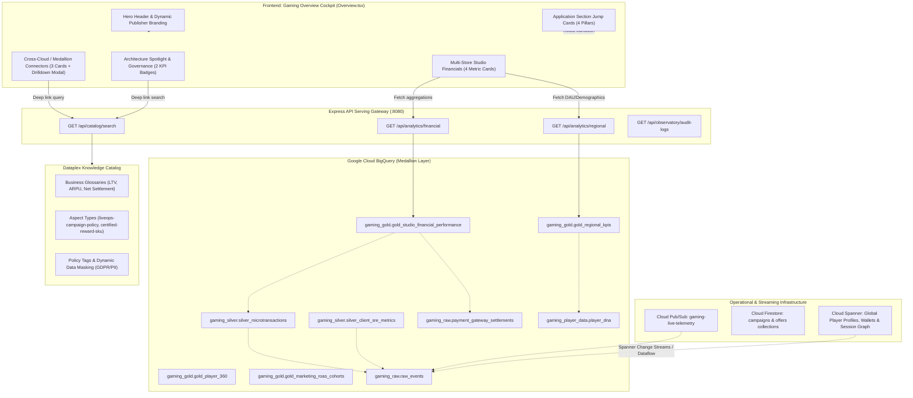

# Gaming Overview Architecture & Card-by-Card Technical Specification

This document provides a comprehensive technical audit of the **Gaming Overview** tab ([`Overview.tsx`](file:///usr/local/google/home/joeholley/Documents/repos/git/github.com/joeholley/dcgd/src/remix-gaming-app/src/components/sections/Overview.tsx)) within the executive gaming platform. It explains what each card represents, how it functions in the current implementation, and how an ideal Google Cloud architecture connects it to live backend systems.

---

## 1. System Topology & Data Flow Diagram



---

## 2. Card-by-Card Architectural & Functional Breakdown

---

### Card Group 1: Studio Branding & Executive Hero Header

```
+-----------------------------------------------------------------------------------+
| [EBK games Customer 360]  [Powered by Gemini Enterprise]                          |
|                                                                                   |
| Intelligent Player Analytics for                                                 |
| EBK games.                                                                        |
| Unifying AWS S3 cold logs, Snowflake player economic data, and Cloud Spanner live |
| session concurrency into a singular cognitive interface...                        |
+-----------------------------------------------------------------------------------+
```

> [!NOTE]
> The current prototype UI retains legacy subtitle copy mentioning "AlloyDB live session concurrency". In the conformed architecture and target specification, this operational pillar is powered by **Cloud Spanner**, providing external consistency (TrueTime) across global regions, Spanner Graph for player social topologies, and Spanner Change Streams for zero-data-loss CDC ingestion.

#### A. Current Implementation & Behavior
- **Component**: Header section in [`Overview.tsx`](file:///usr/local/google/home/joeholley/Documents/repos/git/github.com/joeholley/dcgd/src/remix-gaming-app/src/components/sections/Overview.tsx#L210-L232).
- **Branding Binding**: Reads `publisherName` dynamically from `usePublisher()` context (defaults to `"Jingle Games"`, overridable to `"EBK games"` via CLI `--publisher-name` or container env `PUBLISHER_NAME`).
- **Internationalization**: Localized via `OVERVIEW_TRANSLATIONS` dictionary supporting Japanese, Korean, and Chinese based on active country setting.

#### B. Business & Analytical Meaning
- Establishes executive ownership and tenancy for the game studio.
- Positions the dashboard as an AI-augmented "Customer 360" cognitive cockpit for Studio Heads, Executive Producers, and VP of Operations.

#### C. Ideal Production Architecture
- **Tenant Context**: Backed by a Publisher Registry table (`gaming_reference_data.ref_publisher_registry`) resolving studio metadata, supported platforms (iOS, Android, Steam, WebGL), and active monetization currencies.
- **Dynamic AI Context**: Gemini Enterprise generates a real-time executive morning briefing summarizing overnight revenue anomalies, critical server latency spikes, and top churn risks.

---

### Card Group 2: Multi-Store Studio Financials & Population Banner

```
+-----------------------------------------------------------------------------------+
| Multi-Store Studio Financial Performance                      [● LIVE gold_mart]  |
| Reconciled against payment gateway settlements in BigQuery Gold layer             |
|                                                                                   |
| [ Gross In-App Spend ]  [ Net Realized Cash ]  [ Storefront Fees ]  [ Conformed ] |
|      $7,157,765              $4,983,435           -$2,147,329          50.0M      |
|  From Apple, Google...    Disbursed Clearing    Platform Deduct...    Global DNA  |
+-----------------------------------------------------------------------------------+
```

#### 2.1 Gross In-App Spend
- **Current Behavior**:
  - Displays formatted currency `${financialData.grossRevenue.toLocaleString()}`.
  - Sourced from `GET /api/analytics/financial?limit=30`, summing `gross_revenue_usd`.
  - Fallback: `$7,157,765`.
- **Business Meaning**:
  - Total player gross top-line spend across all in-game microtransactions, battle passes, and virtual currency bundles before platform storefront commissions and payment processor fees.
- **Ideal Backend Architecture**:
  - **Source Table**: `gaming_gold.gold_studio_financial_performance` (aggregated from `gaming_silver.silver_microtransactions` and `gaming_raw.raw_events`).
  - **SQL Query**:
    ```sql
    SELECT SUM(gross_revenue_usd) AS total_gross_spend
    FROM `datacloudgamesdemo006.gaming_gold.gold_studio_financial_performance`
    WHERE transaction_date >= DATE_SUB(CURRENT_DATE(), INTERVAL 30 DAY);
    ```
  - **Cadence**: Near-real-time streaming buffer into BigQuery with 60-second micro-batch rollup.

#### 2.2 Net Realized Cash
- **Current Behavior**:
  - Displays `${financialData.netPayout.toLocaleString()}` (e.g. `$4,983,435`).
  - Sourced from `GET /api/analytics/financial?limit=30`, summing `cleared_payout_usd` (or `net_revenue_usd`).
  - Fallback: `$4,983,435`.
- **Business Meaning**:
  - The actual liquidity that enters the studio's corporate bank accounts after platform commission withholdings (30%), payment processor interchange fees, merchant penalties, and refund holdbacks.
- **Ideal Backend Architecture**:
  - **Source Table**: `gaming_raw.payment_gateway_settlements` (`SOURCE_PAYMENT_SETTLEMENTS_TABLE`).
  - **Reconciliation Engine**: Reconciles client purchase receipt tokens against merchant settlement clearing batches (Apple Financial Reports, Google Play Disbursal Feeds, Stripe Payouts). Transactions that have occurred but not yet cleared are classified as "Unsettled In-Transit".

#### 2.3 Storefront Fees (30%)
- **Current Behavior**:
  - Displays `-${financialData.storefrontFees.toLocaleString()}` (e.g. `-$2,147,329`).
  - Sourced from `GET /api/analytics/financial?limit=30`, summing `storefront_fees_usd`.
  - Fallback: `-$2,147,329`.
- **Business Meaning**:
  - Direct margin deduction captured by platform gatekeepers (Apple 30%, Google Play 15–30%, Steam 30%).
  - Provides executive visibility into channel profitability, justifying business cases for direct-to-consumer (D2C) web webshops.
- **Ideal Backend Architecture**:
  - Derived from contractual rate cards in `gaming_reference_data.ref_storefront_agreements` evaluated per storefront channel:
    ```sql
    SELECT 
      storefront_name,
      SUM(gross_revenue_usd) AS gross,
      SUM(storefront_fees_usd) AS fees,
      ROUND(SAFE_DIVIDE(SUM(storefront_fees_usd), SUM(gross_revenue_usd)) * 100, 1) AS effective_fee_pct
    FROM `datacloudgamesdemo006.gaming_gold.gold_studio_financial_performance`
    GROUP BY storefront_name;
    ```

#### 2.4 Conformed Global Players
- **Current Behavior**:
  - Displays `50.0M Players` with subtitle "US, EMEA, APAC, LATAM DNA".
  - Sourced from `GET /api/analytics/regional?limit=10`, dynamically pulling live `dau` (`1,250,000`).
  - Fallback: `50,000,000`.
- **Business Meaning**:
  - Total deduplicated, conformed player population registered in the studio's Customer 360 data lakehouse across all titles, platforms, and geographies.
- **Ideal Backend Architecture**:
  - **Source Table**: `gaming_player_data.player_dna` (`SOURCE_PLAYER_DNA_TABLE`) joined with `gaming_gold.gold_regional_kpis`.
  - **Scalability**: Capable of indexing hundreds of millions of player profiles using BigQuery BI Engine in-memory partition caches.

---

### Card Group 3: Data Federation & Governance Connectors (`CONNECTORS`)

```
+-----------------------------+-----------------------------+-----------------------------+
| [History]            AWS S3 | [Trending]        Snowflake | [Radio]       Cloud Spanner |
| Player Telemetry Archive    | Monetization & LTV          | Global Player State & Graph |
| Data fetched from AWS S3... | Data fetched from Snowf...  | Data fetched from Spanne... |
+-----------------------------+-----------------------------+-----------------------------+
```

Each card is interactive and opens an inspection modal displaying industry definition, dataset inclusions, core metrics, and a "Search Archives" deep link routing to `/catalog`.

#### 3.1 AWS S3 ("Player Telemetry Archive")
- **Current Implementation**:
  - Orange card with `History` icon. Modal cites "1.2 PB Managed Gameplay Data", "99.999% Read Availability", "Sub-second SQL Federation".
  - Includes: Legacy Daily Telemetry Logs, Old Game Build Binaries (2018-2025), Archived Server Tick Logs, Historic Match Traces.
  - Action: Triggers `onSectionChange({ id: "catalog", search: "AWS S3" })`.
- **What it Represents**:
  - Cold-tier archive for immutable historical player sessions, legacy build logs, and compliance records that do not require millisecond active serving but must remain queryable.
- **Ideal Backend Architecture**:
  - **Option 1: BigQuery Omni Cross-Cloud Federation**:
    - Uses BigQuery Omni AWS connection profile (`aws-us-east-1`).
    - Queries S3 Parquet/JSON data in-place without moving bytes across cloud boundaries:
      ```sql
      SELECT COUNT(*) 
      FROM `aws-us-east-1.omni_gaming_archive.session_ticks_2022`
      WHERE _PARTITIONDATE >= '2022-01-01';
      ```
  - **Option 2: Cloud Storage Archive Tier**:
    - Google Cloud Storage bucket (`gs://studio-telemetry-coldline/`) mapped to a BigLake external table with metadata caching enabled.
  - **Governance**: Registered in Dataplex Knowledge Catalog with automatic lifecycle expiration tags and storage tier classifications.

#### 3.2 Snowflake ("Monetization & LTV Analytics")
- **Current Implementation**:
  - Blue card with `TrendingUp` icon. Modal cites "Real-time ARPU Updates", "Cohort Spending Variance", "Ad Placement Performance".
  - Includes: Lifetime Value (LTV) Forecasts, Monthly Active User (MAU) Trends, In-App Store Conversion Mixes, In-Game Ad Revenue Yields.
  - Action: Triggers `onSectionChange({ id: "catalog", search: "Snowflake" })`.
- **What it Represents**:
  - Analytical data mart traditionally maintained by publishing finance or external ad monetization networks to evaluate player cohort ROAS and ad fill rates.
- **Ideal Backend Architecture**:
  - **Option 1: BigQuery Omni / Data Transfer Service**:
    - Federated connection directly into Snowflake data warehouse shares.
  - **Option 2: Native BigQuery Gold Analytical Mart**:
    - In this repository's conformed architecture, this capability is fulfilled by **`gaming_gold.gold_player_360`** and **`gaming_gold.gold_marketing_roas_cohorts`**, where BQML (`gaming_raw.player_churn_model`) generates live churn and LTV inferences.
  - **Governance**: Tagged with Dataplex aspect types: `certified-reward-sku-aspect` (SKU pricing guidelines) and `liveops-campaign-policy-aspect` (maximum discount guardrails).

#### 3.3 Cloud Spanner ("Global Player State, Wallets & Session Graph")
- **Current Implementation**:
  - Emerald card with `Radio` icon (currently labeled "AlloyDB" in the legacy prototype UI). Modal cites "<10ms Transaction Latency", "99.99% Database Nodes Uptime", "GDPR-Compliant Player Privacy Masking".
  - Includes: Active Match Lobby Concurrency, Live Session Ping Monitoring, Real-Time Microtransaction Logs, Active Virtual Server Allocation.
  - Action: Triggers `onSectionChange({ id: "catalog", search: "Spanner" })` (or `/catalog?search=AlloyDB`).
- **What it Represents**:
  - The mission-critical, globally distributed operational database tier hosting real-time player account profiles, inventory entitlements, virtual currency wallets, and player relationship graphs.
  - Unlike traditional relational databases, Cloud Spanner guarantees **external consistency (TrueTime)** across global regions, preventing currency duplication and double-spend exploits across mobile and PC clients.
- **Ideal Backend Architecture**:
  - **Operational Database**: **Cloud Spanner** (multi-region instance `gaming-db`, database `player-360`).
  - **Primary Relational Schemas**:
    ```sql
    CREATE TABLE player_profiles (
      player_id STRING(64) NOT NULL,
      display_name STRING(128),
      country_code STRING(3),
      created_timestamp TIMESTAMP NOT NULL OPTIONS (allow_commit_timestamp=true),
      last_login_timestamp TIMESTAMP OPTIONS (allow_commit_timestamp=true),
      payer_tier STRING(16) DEFAULT ('Free'),
      reputation_score INT64 DEFAULT (100)
    ) PRIMARY KEY (player_id);

    CREATE TABLE player_wallets (
      player_id STRING(64) NOT NULL,
      currency_sku STRING(32) NOT NULL,
      balance INT64 NOT NULL,
      updated_timestamp TIMESTAMP NOT NULL OPTIONS (allow_commit_timestamp=true)
    ) PRIMARY KEY (player_id, currency_sku),
      INTERLEAVE IN PARENT player_profiles ON DELETE CASCADE;

    CREATE TABLE player_session_concurrency (
      player_id STRING(64) NOT NULL,
      session_id STRING(64) NOT NULL,
      game_server_id STRING(64),
      client_ping_ms INT64,
      heartbeat_timestamp TIMESTAMP NOT NULL OPTIONS (allow_commit_timestamp=true)
    ) PRIMARY KEY (player_id, session_id),
      INTERLEAVE IN PARENT player_profiles ON DELETE CASCADE;
    ```
  - **Spanner Graph (Social, Guild & Toxicity Topology)**:
    Native property graph integration (GQL / openCypher) for evaluating player relationships, guild rosters, party matchmaking, and anti-collusion rings:
    ```sql
    CREATE PROPERTY GRAPH GamingSocialGraph
      VERTEX TABLES (player_profiles LABEL Player)
      EDGE TABLES (
        player_friendships 
          SOURCE KEY (player_id_1) REFERENCES player_profiles (player_id)
          DESTINATION KEY (player_id_2) REFERENCES player_profiles (player_id)
          LABEL FRIENDS_WITH,
        player_guild_memberships
          SOURCE KEY (player_id) REFERENCES player_profiles (player_id)
          DESTINATION KEY (guild_id) REFERENCES guilds (guild_id)
          LABEL MEMBER_OF
      );
    ```
  - **Spanner Change Streams (Real-Time CDC to Lakehouse)**:
    Change streams emit every wallet transaction, session heartbeat, and match commit directly into Google Cloud Dataflow or Pub/Sub:
    ```sql
    CREATE CHANGE STREAM live_gameplay_stream 
    FOR player_wallets, player_session_concurrency;
    ```
    Dataflow drains the change stream and continuously appends deduplicated CloudEvents into BigQuery `gaming_raw.raw_events` and `gaming_silver.silver_microtransactions` within 500ms.
  - **High Availability & Scalability**:
    Multi-region configuration (`nam-eur-asia1`) with 99.999% availability SLA and zero planned maintenance windows, ensuring zero downtime during global title updates and season resets.
  - **Governance**: Integrated into Dataplex Knowledge Catalog with Column-Level Access Control (CLAC) and policy tags enforcing automatic PII data masking for analytics roles.

---

### Card Group 4: Application Navigation Jump Cards (4 Pillars)

```
+----------------------+----------------------+----------------------+----------------------+
| [Layout]             | [Megaphone]          | [Activity]           | [Zap]                |
| Game Performance     | Campaign Engine      | Data Observatory     | Active Play Agents   |
| Real-time installs,  | Roll out targeted    | Unified query        | Autonomous player    |
| CCU, latency...      | notifications...     | latency, audits...   | retention promo...   |
+----------------------+----------------------+----------------------+----------------------+
```

#### 4.1 Game Performance (`/operations`)
- **What it Represents**: SRE and operational health center tracking real-time concurrent users (CCU), client framerates (FPS), network round-trip time (ping), and matchmaking queue wait times.
- **Ideal Backend Resource**:
  - Sourced directly from `gaming_silver.silver_client_sre_metrics` and Pub/Sub telemetry stream.
  - Feeds the Diurnal Sine Wave graph and server regional latency maps.

#### 4.2 Campaign Engine (`/campaigns`)
- **What it Represents**: LiveOps and marketing workspace to launch personalized player re-engagement offers, define discount guardrails, and track ad campaign ROAS.
- **Ideal Backend Resource**:
  - Cohort intelligence sourced from `gaming_gold.gold_marketing_roas_cohorts`.
  - Operational campaign states and active discount limits persisted in **Cloud Firestore** (`campaigns` and `offers` collections).

#### 4.3 Data Observatory (`/observatory`)
- **What it Represents**: Data Platform engineering dashboard monitoring BigQuery slot consumption, query execution latencies, cross-cloud federation performance, and data pipeline costs.
- **Ideal Backend Resource**:
  - Queries `INFORMATION_SCHEMA.JOBS_BY_PROJECT` and Cloud Audit Logs to display real-time query stream and cost-per-query attribution.

#### 4.4 Active Play Agents (`/workflows`)
- **What it Represents**: Autonomous agent operations cockpit where Vertex AI Reasoning Engines inspect game state, identify churn threats, and trigger remediations.
- **Ideal Backend Resource**:
  - Powered by Vertex AI Reasoning Engine runtime (`agent_kc`, `agent_difficulty`, `agent_trust`) with direct tool access to Dataplex glossaries and BigQuery SQL executors.

---

### Card Group 5: Architecture Spotlight Banner

```
+-----------------------------------------------------------------------------------+
| [BrainCircuit] ARCHITECTURE SPOTLIGHT                                             |
| Unified Cross-Cloud Lakehouse                                                     |
| Instead of moving data, we bring the compute to the data...                       |
|                                                                                   |
|   [ 98ms ] Avg Query Latency               [ 100% ] GDPR Player Privacy           |
|                                            (Click to search catalog)              |
+-----------------------------------------------------------------------------------+
```

#### 5.1 Avg Query Latency (98ms)
- **Current Implementation**: Static metric badge showing `98ms`.
- **What it Represents**: Proof of sub-second query performance achieved by BigQuery BI Engine in-memory caching and BigLake metadata indexing over massive petabyte-scale datasets.
- **Ideal Backend Architecture**:
  - Live P95 latency calculated from `INFORMATION_SCHEMA.JOBS_BY_PROJECT` over queries against `gaming_gold.*`:
    ```sql
    SELECT 
      CAST(APPROX_QUANTILES(total_elapsed_time_ms, 100)[OFFSET(95)] AS INT64) AS p95_latency_ms
    FROM `region-us`.INFORMATION_SCHEMA.JOBS_BY_PROJECT
    WHERE creation_time >= TIMESTAMP_SUB(CURRENT_TIMESTAMP(), INTERVAL 1 HOUR)
      AND statement_type = 'SELECT';
    ```

#### 5.2 GDPR Player Privacy Compliance (100%)
- **Current Implementation**: Clickable badge that routes to `/catalog?search=GDPR`.
- **What it Represents**: Compliance assurance that personal identifiable information (PII) like email addresses, payment account numbers, and IP addresses are masked across all analytical layers.
- **Ideal Backend Architecture**:
  - Backed by **Dataplex Policy Tags & Dynamic Data Masking (DDM)**:
    - Taxonomy: `Taxonomy: Player-Privacy-Classification`.
    - Masking rule: SHA-256 hash on `email_address`, zeroing the last octet on `client_ip`.
  - **Dataplex Data Quality Scan (`dataScan`)**: Automated daily DQ assertion ensuring zero unmasked PII records in `gaming_gold.*` and `gaming_silver.*`.

---

## 3. Technical Alignment Matrix: Current vs. Ideal

| Component / Card | Current Frontend Source | Current Backend Reality | Ideal Production Backend Architecture |
| :--- | :--- | :--- | :--- |
| **Gross In-App Spend** | `GET /api/analytics/financial` | Sums `gold_studio_financial_performance` | Continuous micro-batch rollup from `silver_microtransactions` |
| **Net Realized Cash** | `GET /api/analytics/financial` | Sums `cleared_payout_usd` | Reconciles `payment_gateway_settlements` against bank clearing feeds |
| **Storefront Fees** | `GET /api/analytics/financial` | Sums `storefront_fees_usd` | Dynamic contract fee computation via `ref_storefront_agreements` |
| **Global Player Count** | `GET /api/analytics/regional` | Hardcoded 50M with live DAU | Live `COUNT(DISTINCT player_id)` from `player_dna` via BI Engine |
| **AWS S3 Archive** | Static modal; links `/catalog` | Prototype copy / catalog search | BigQuery Omni AWS external connection or BigLake GCS Coldline |
| **Snowflake LTV** | Static modal; links `/catalog` | Prototype copy / catalog search | Omni federation or native BigQuery Gold Marts (`gold_player_360`) |
| **Cloud Spanner State** | Static modal; links `/catalog` | Labeled "AlloyDB" in prototype UI | Multi-region Cloud Spanner (`gaming-db`), Spanner Graph, & Spanner Change Streams CDC to `gaming_raw.raw_events` |
| **Avg Query Latency** | Static `98ms` badge | Static string | Real-time P95 query from `INFORMATION_SCHEMA.JOBS_BY_PROJECT` |
| **GDPR Compliance** | Static `100%`; links `/catalog` | Catalog search redirect | Dataplex Column-Level Access Control (CLAC) & automated DQ scans |

---

## 4. Modernization Recommendations

1. **Copy Modernization to Cloud Spanner**:
   - Update `CONNECTORS[2]` in `Overview.tsx` from `label: "AlloyDB"` to `label: "Cloud Spanner"` with industry title `"Global Player State & Graph"`.
   - Update the hero subtitle and modal text to reflect **Cloud Spanner** (99.999% SLA, TrueTime external consistency, Spanner Graph for player social networks, and Spanner Change Streams for zero-data-loss CDC ingestion into BigQuery).
2. **Medallion & Lakehouse Alignment**:
   - Explicitly highlight the three architectural tiers: **Cloud Spanner** (operational profiles & currency ledgers), **Pub/Sub + Dataflow** (streaming telemetry), and **BigQuery Medallion** (Bronze `raw_events`, Silver `silver_microtransactions`, Gold `gold_player_360`).
3. **Real-Time Latency Metric**:
   - Connect the `98ms` badge to a live endpoint (`GET /api/observatory/latency-summary`) querying `INFORMATION_SCHEMA.JOBS_BY_PROJECT`.
4. **Automated Reconciliation Indicator**:
   - Add a "Reconciliation Status: 100% Balanced" badge to the financial banner, verifying that `Gross Spend == Net Cash + Storefront Fees + Chargebacks`.
