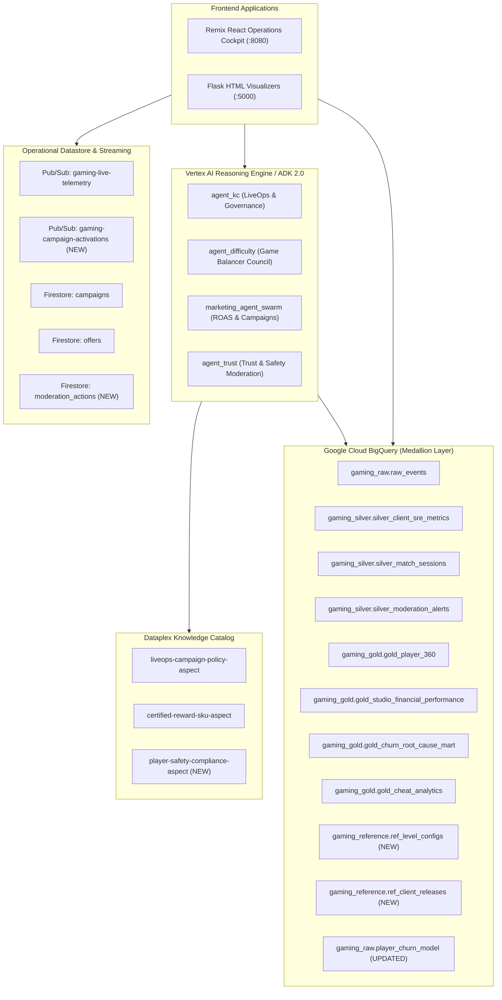

# Operational Dashboard UI: Project-Wide Live Audit, Backend Gap Analysis & Implementation Plan

## Executive Summary

This document presents a comprehensive, project-wide audit of the gaming operational dashboard UI across both frontend presentation tiers:
1. **Remix React Application** (`src/remix-gaming-app`): The primary operational cockpit featuring Executive Overview, Operations, Diurnal CCU Curve, LiveOps Churn Guardrails, Mock Game Client, Agentic Workflows, PineCore AI Assistant, Campaign Engine, Knowledge Catalog Governance, IT Observatory, and System Diagnostics.
2. **Flask Microservice & Visualizers** (`src/gamingdatademo/website-live`): Glassmorphic analytical consoles embedded via iframes (`executive.html`, `difficulty.html`, `toxicity.html`, `marketing_workflow_mockup.html`, `marketing_swarm_visualizer.html`, `graph_visualization.html`).

### Architectural Core Principles
* **Dual-Mode Operational Resilience**: Every UI feature and API endpoint must seamlessly support **LIVE GCP mode** (querying BigQuery Gold marts, Vertex AI Reasoning Engines, Dataplex REST APIs, Cloud Pub/Sub, and Cloud Firestore) and degrade gracefully into **MOCK / PRE-BAKED mode** when credentials, internet connectivity, or specific GCP services are offline.
* **Zero Hardcoded Fakes in Live Mode**: In LIVE mode, simulations, council workflows, and analytical queries must execute against real GCP services rather than returning static JSON strings or simulating progression with Javascript `setTimeout` timers.
* **Strict Ground-Truth Air-Gap**: Application code, UI components, serving gateways, and AI agents must **NEVER** read from or reference `gaming_player_data.simulation_parameters` (or `v_latest_simulation_parameters`). Ground-truth registries are reserved exclusively for headless CI/CD test oracles.
* **Configurable Drift Immunity**: All dataset and table references must resolve dynamically through `dataSourceConfig.ts` and `data_source_config.py`.

---

## 🔍 Section 1: Detailed Project-Wide UI Audit

Below is the exhaustive audit of every UI screen, section component, and embedded visualizer, detailing the exact data sources used, mocked calls, hardcoded strings, and pre-baked fallbacks.

### Summary Matrix

| UI Component / View | Current State | Mock / Pre-Baked Elements | Required Backend System | Priority |
|---|---|---|---|---|
| **1. Executive Overview** (`Overview.tsx`) | Partially Live | Metric cards use `/api/analytics/financial` and `/api/analytics/regional`. Fallbacks contain hardcoded studio figures. | BigQuery Gold (`gold_studio_financial_performance`, `gold_regional_kpis`). | Low (Refine Fallbacks) |
| **2. Executive Council (EPIC)** (`executive.html`) | 100% Mocked | `/api/executive/simulate-diagnostics` returns hardcoded text; `executeRemediation()` is a JS `alert()`. | Vertex AI Reasoning Engine / Multi-Agent Sequential Council (`agent_council_sequential`), Cloud Tasks remediation dispatch. | **HIGH** |
| **3. Game Operations** (`Operations.tsx`) | Mostly Live | KPI scorecards and Churn vs SRE mart are live. Level 2 bottleneck links to `difficulty.html`. | BigQuery Gold (`gold_churn_root_cause_mart`). | Low (Maintain) |
| **4. Difficulty Balancer** (`difficulty.html`) | 90% Mocked | Loads initial stats from `/api/difficulty-stats`, but `/api/simulate/difficulty-spike` returns hardcoded text. JS literally fakes level update (`fills[1].style.width = '78.2%'`). | Vertex AI Agent (`agent_difficulty`), BigQuery Reference Table (`ref_level_configs`), Game Solver Heuristic service. | **HIGH** |
| **5. Agentic Workflows** (`AgenticWorkflows.tsx`) | 33% Live / 67% Mocked | "Player Retention Promo" calls live `/api/guardrail/agent-trace`. "Fraud & Cheat" and "Matchmaking Balance" use hardcoded strings citing "AlloyDB", "Snowflake", "AWS S3". Next steps (`handleFollowUp`) set static text. | ADK / Reasoning Engines for Cheat (`gold_cheat_analytics`) and Matchmaking (`silver_match_sessions`); Pub/Sub event dispatcher. | **HIGH** |
| **6. PineCore AI Assistant** (`GamingAssistant.tsx`) | 80% Mocked | Suggestions ("Dataplex", "Revenue", "Lobby") intercept user input with fake `setTimeout` steppers and render hardcoded `MOCK_REVENUE_DATA` and `MOCK_LOBBY_CONCURRENCY`. Only fallback prompts call `/api/chat`. | Wire all prompt intents to `/api/chat` backed by `agent_kc` (with dynamic function calling into conformed Gold marts). | **HIGH** |
| **7. IT Data Observatory** (`ITObservatory.tsx`) | 100% Mocked | `MOCK_QUERY_LOGS`, `MOCK_TRAFFIC_DATA`, query cost `$0.00042`, 12 API nodes, and engine mix (AlloyDB 82%, Snowflake 12%, S3 6%) are completely static constants. Zero API calls. | `/api/observatory/metrics` endpoint querying BigQuery `INFORMATION_SCHEMA.JOBS_BY_PROJECT` and Dataplex asset telemetry. | **HIGH** |
| **8. LiveOps Guardrail & Ingestion** (`LiveOpsGuardrail.tsx`) | Hybrid (Broken Live BQML) | `/api/telemetry/stream` publishes to Pub/Sub, but BQML query fails due to feature schema mismatch and falls back to a JS math formula (`deathWeight + eventWeight`). | Refactor BQML model training procedure to train on conformed `gold_player_360` and align `ML.PREDICT` input features. | **CRITICAL** |
| **9. Mock Game Client** (`MockClientTab.tsx`) | Hybrid (Live Exemplars) | Exemplars load from BigQuery in LIVE mode. Actions publish to Pub/Sub. Offers fall back to hardcoded `frost_giant_shield_pack` when Firestore is empty. | Cloud Firestore `offers` collection auto-seeded with Dataplex Aspect metadata. | Medium |
| **10. Campaign Marketing Engine** (`CampaignEngine.tsx`) | 70% Mocked | Cohorts load from BigQuery, but "Deploy Campaign via Agent" runs fake `setInterval` with logs citing "Snowflake" and "AlloyDB", calculating budget via local math. | Vertex AI Marketing Swarm (`marketing_agent_swarm`), Firestore `campaigns` collection, Pub/Sub ad sync topic. | **HIGH** |
| **11. Marketing Swarm Visualizers** (`marketing_workflow_mockup.html`, `marketing_swarm_visualizer.html`) | 90% Mocked | `/api/simulate/roas-drop` returns hardcoded text; live mode points to unconfigured agent ID or local Python fallback. | Live deployment of Marketing Swarm on Vertex AI Agent Engine with Imagen 3 creative generation. | Medium |
| **12. Knowledge Catalog** (`KnowledgeCatalog.tsx`) | 80% Mocked | Assets point to `dummy.pdf`. Automatic Rule Discovery calls `/api/catalog/rules/discover` which does regex text matching in `server.ts` to return pre-baked SQL. | Dataplex Search REST API (`entryGroups.entries`), Gemini-powered Natural Language to Dataplex Aspect & BQ Policy Compiler. | **HIGH** |
| **13. Trust & Toxicity Console** (`toxicity.html`) | 100% Mocked | `/api/simulate/toxicity-incident` returns hardcoded strings citing nonexistent `gold_retention_adequacy` and static list of 4 banned players. | Trust & Safety Agent querying `gold_cheat_analytics` and `silver_moderation_alerts`, Firestore `moderation_actions`. | **HIGH** |
| **14. Diagnostics & Probes** (`Diagnostics.tsx`, `SimulatorDiagnostics.tsx`, `GCPHealth.tsx`) | Live Probes | Probes real endpoints, but BQML and Dataplex report `FALLBACK/MOCK` due to missing backend resources/permissions. | Fix BQML model and grant Dataplex Viewer / BigQuery Admin IAM bindings. | Medium |

---

## 🔬 Section 2: Deep Component-by-Component Gap Analysis

### 1. PineCore AI Assistant (`GamingAssistant.tsx`)
* **Problem**: When a user selects a preset chip (e.g., "Revenue Variance Analysis" or "Lobby Occupancy"), the frontend executes lines 98–122 with fake `setTimeout` delays (400ms, 800ms, 1200ms) simulating "Dataplex Schema Search", "Aspect Tag Verification", and "BigQuery SQL Execution". It then renders hardcoded constants `MOCK_REVENUE_DATA` and `MOCK_LOBBY_CONCURRENCY`.
* **Gaps**:
  1. The preset suggestions bypass the `/api/chat` gateway entirely.
  2. The LLM agent `agent_kc` is not invoked to perform real reasoning on portfolio revenue or regional concurrency.
* **Required Backend & Connections**:
  - Route all prompt submissions (including chip clicks) to `POST /api/chat`.
  - Equip `agent_kc` with existing tools: `query_regional_kpis()` and `query_financial_settlements()`.
  - Return structured UI widget payloads from `agent_kc` so the React frontend can render dynamic charts from live BigQuery Gold mart results.
  - When backend is offline (`routingMode === "MOCKED"` or API error), retain `MOCK_REVENUE_DATA` and `MOCK_LOBBY_CONCURRENCY` as offline fallbacks.

### 2. Agentic Workflows (`AgenticWorkflows.tsx`)
* **Problem**:
  - Only "Automated Player Retention Promo" calls `/api/guardrail/agent-trace`.
  - "Fraud & Cheat Detection Agent" and "Dynamic Matchmaking Balance" display pre-baked static text from `workflowData` containing obsolete references:
    - `"Scanning AlloyDB transaction logs for rapid currency duplication..."`
    - `"Fetching historical IP range profiles from AWS S3..."`
    - `"Reading SLA thresholds from Snowflake DB..."`
  - Action buttons (`handleFollowUp`: "In-Game Gift", "Auto-Notify Team", "Scale Cloud Run") simply update a local state string without executing any backend action.
* **Gaps**:
  1. Missing backend reasoning agent for Cheat & Exploit detection connected to `gold_cheat_analytics`.
  2. Missing backend reasoning agent for Matchmaking & SRE balance connected to `silver_match_sessions` and `silver_client_sre_metrics`.
  3. Missing action execution gateway (`/api/workflows/action`) to log audit events into BigQuery or dispatch Pub/Sub messages.
* **Required Backend & Connections**:
  - Implement two new tools in `agent_kc` (or dedicated sub-agents):
    - `analyze_cheat_activity(alert_type, min_severity)` querying `gold_cheat_analytics`.
    - `analyze_matchmaking_sla(region, max_queue_seconds)` querying `silver_match_sessions`.
  - Create endpoint `POST /api/workflows/action` that publishes an intervention event to Cloud Pub/Sub (`gaming-live-telemetry`) and writes an audit record to Firestore / BigQuery.
  - Preserve `workflowData` as offline fallback when `routingMode === "MOCKED"`.

### 3. IT & Data Observatory (`ITObservatory.tsx`)
* **Problem**: 100% hardcoded component. Displays:
  - Avg Query Cost: `$0.00042` (hardcoded).
  - Active Gaming API Nodes: `12` (hardcoded).
  - Query Logs: `join(alloydb_sessions, snowflake_ltv)` (hardcoded).
  - Federated Engine Mix: `AlloyDB (82%)`, `Snowflake (12%)`, `AWS S3 (6%)` (obsolete multicloud narrative).
* **Gaps**:
  1. No backend API endpoint exists to provide real query latency, cost, and telemetry load.
  2. The UI cites systems (AlloyDB, Snowflake, AWS S3) that do not reflect Google Cloud Medallion architecture (CloudEvents JSON, Cloud Storage, BigQuery Silver/Gold, Dataplex).
* **Required Backend & Connections**:
  - Create endpoint `GET /api/observatory/metrics` in `server.ts`.
  - In LIVE mode:
    - Query BigQuery `INFORMATION_SCHEMA.JOBS_BY_PROJECT` (for recent query count, average execution duration in ms, and estimated cost based on bytes billed).
    - Report real Medallion storage distribution: `BigQuery Gold Marts`, `BigQuery Silver Conformed Views`, `Bronze Cloud Storage Raw Ingest`.
  - In MOCK mode:
    - Fallback to conformed local metrics reflecting the Google Cloud Lakehouse architecture.

### 4. Game Balancer & Tuning Council (`difficulty.html` & `app.py`)
* **Problem**:
  - `/api/simulate/difficulty-spike` in `app.py` returns hardcoded Python strings (`mock_data_analysis`, `mock_revision_plan`, `mock_simulation`, `mock_deploy_status`).
  - In `difficulty.html` (lines 512–522), after the mock deployment finishes, the JavaScript literally modifies DOM elements:
    `fills[1].style.width = '78.2%'; fills[1].classList.remove('alert-fill'); pcts[1].innerText = '78.2%';`
    It does not re-query BigQuery or commit the configuration to an actual database table.
* **Gaps**:
  1. No BigQuery table exists to hold live level configurations (`ref_level_configs`).
  2. No live agent exists to analyze the failure rate from `gold_churn_root_cause_mart` and compute an updated moves limit.
  3. No playtest solver heuristic service is connected.
* **Required Backend & Connections**:
  - **Terraform / BigQuery**: Provision `gaming_reference.ref_level_configs` (or `gaming_gold.gold_level_difficulty_configs`) with columns: `level_number`, `level_name`, `max_moves_limit`, `board_size`, `color_count`, `target_clear_score`, `updated_at`.
  - **Backend Endpoint**: Update `POST /api/simulate/difficulty-spike` in `app.py` to:
    1. Query `gold_churn_root_cause_mart` for actual Level 2 failure rates and move exhaustion metrics.
    2. Invoke `agent_difficulty` (or `agent_kc.analyze_churn_root_cause`) to generate a data-backed revision plan.
    3. Run a deterministic solver simulation (1,000 games) evaluating win rates with `moves_limit = 35`.
    4. Execute a BigQuery `MERGE` into `gaming_reference.ref_level_configs` updating `max_moves_limit = 35`.
  - **UI Update**: `difficulty.html` re-runs `loadFunnelStats()` querying the live table rather than manually faking DOM style percentages.
  - When `mode === "cached"` or offline, fallback to `mock_data_analysis`.

### 5. Executive Portfolio Insight Council (EPIC) (`executive.html` & `app.py`)
* **Problem**:
  - `/api/executive/simulate-diagnostics` in `app.py` returns 100% hardcoded strings (`mock_data_isolation`, `mock_sentiment_analysis`, `mock_release_correlation`, `mock_brief_slide`).
  - `executeRemediation(type)` is an alert dialog: `alert("Executive directive received...")`.
* **Gaps**:
  1. No live AI agent correlates regional financial drops with client versions or incident categories.
  2. No release registry table exists in BigQuery.
  3. No remediation endpoint exists to execute store rollbacks or publish config flags.
* **Required Backend & Connections**:
  - **BigQuery Table**: Deploy `gaming_reference.ref_client_releases` tracking `release_version`, `platform`, `region`, `status`, `release_timestamp`.
  - **Backend Endpoint**: Refactor `POST /api/executive/simulate-diagnostics` to:
    1. Query `gold_studio_financial_performance` and `gold_regional_kpis` to isolate revenue anomalies by platform and region.
    2. Invoke `agent_council_sequential` (or Vertex AI Gemini) to synthesize an executive resolution brief.
  - **Remediation Endpoint**: Create `POST /api/executive/execute-remediation` that writes an action record to Firestore `executive_actions` and returns a confirmed status badge.

### 6. Campaign Marketing Engine & Visualizers (`CampaignEngine.tsx`, `marketing_workflow_mockup.html`)
* **Problem**:
  - In `CampaignEngine.tsx`, clicking "Deploy Campaign via Agent" executes lines 1305–1354: a fake JavaScript `setInterval` timer emitting hardcoded logs that cite Snowflake and AlloyDB.
  - In `app.py`, `/api/simulate/roas-drop` in cached mode returns static text, and in live mode tries to query a remote hardcoded `COUNCIL_AGENT_ID` ("5296574560148127744") which fails and falls back to a static mock.
* **Gaps**:
  1. The deployed Cloud Run container does not have an active Vertex AI Reasoning Engine ID for the Marketing Swarm.
  2. Creative asset generation (`Imagen 3`) requires API enablement or a cached asset fallback pipeline.
  3. Deployed campaigns are only saved to Firestore (or local state) without publishing an ad network synchronization event.
* **Required Backend & Connections**:
  - Wire `marketing_agent_swarm` or `agent_council_sequential` to consume conformed `gold_marketing_roas_cohorts`.
  - Add Pub/Sub event publishing on topic `gaming-campaign-activations` when campaigns are deployed.
  - Remove all legacy references to Snowflake and AlloyDB from the step logs, replacing them with BigQuery Gold Marketing Cohorts and Dataplex Governance.

### 7. Knowledge Catalog & Automatic Rule Discovery (`KnowledgeCatalog.tsx` & `server.ts`)
* **Problem**:
  - Asset catalog in `KnowledgeCatalog.tsx` (lines 89–98) is a hardcoded array of 8 items pointing to W3C `dummy.pdf`.
  - Rule Discovery sandbox calls `/api/catalog/rules/discover`. In `server.ts` (lines 1305–1330), the server uses simple string checks:
    ```typescript
    player_tier: rule_text.toLowerCase().includes("whale") ? "Whale" : "All",
    max_discount_pct: rule_text.includes("80%") ? 80 : 50,
    ```
    and outputs a hardcoded BigQuery `ROW ACCESS POLICY` string.
* **Gaps**:
  1. Dataplex REST API (`dataplex.googleapis.com/v1/projects/{project}/locations/{location}/entryGroups/{group}/entries`) is not queried to list live lakehouse catalog assets.
  2. No LLM prompt exists to compile freeform natural language governance policies into validated Dataplex Aspect tags and BigQuery Row Access Policies.
* **Required Backend & Connections**:
  - **Live Catalog Asset Discovery**: Implement `GET /api/catalog/assets` in `server.ts` calling the Dataplex Knowledge Catalog REST API with ADC token to list conformed entries (`gold_player_360`, `gold_studio_financial_performance`, etc.).
  - **Natural Language Policy Compiler**: Refactor `POST /api/catalog/rules/discover` to pass `rule_text` to Gemini (`gemini-2.5-flash` via Vertex AI) with system instructions to compile the rule into a strictly validated Dataplex Aspect Schema JSON and BigQuery Row Access Policy SQL.
  - Retain static rules and `defaultCatalogAssets` when offline.

### 8. Trust, Safety & Chat Toxicity Console (`toxicity.html` & `app.py`)
* **Problem**:
  - `/api/simulate/toxicity-incident` in `app.py` returns hardcoded strings (`mock_data_analysis`, `mock_policy_findings`, `mock_remediation_plan`) citing legacy table `gold_retention_adequacy` (which does not exist).
  - Returns a static list of 4 mocked players (`PLAY-00000172`, `PLAY-00000144`, etc.).
* **Gaps**:
  1. `gold_cheat_analytics` and `silver_moderation_alerts` contain real conformed moderation alerts that are not queried.
  2. No live Trust & Safety agent evaluates the incident against Dataplex safety policies.
* **Required Backend & Connections**:
  - Update `/api/simulate/toxicity-incident` to query `gold_cheat_analytics` for actual alert spikes (grouped by alert type: `Toxic Chat`, `Speedhack`, `Aimbot`, `Wallhack`).
  - Query `silver_moderation_alerts` to retrieve the actual top offending players, strike counts, and quarantine flags.
  - Commit moderation actions (e.g. Mute, Temporary Ban) to Firestore `moderation_actions` collection.
  - Fall back to static mock data in cached/offline mode.

### 9. BQML Churn Prediction Model & Telemetry Ingestion (`server.ts` & Terraform)
* **Problem**:
  - `/api/telemetry/stream` in `server.ts` (lines 1057–1074) tries to execute:
    ```sql
    SELECT * FROM ML.PREDICT(
      MODEL `datacloudgamesdemo006.gaming_raw.player_churn_model`,
      (SELECT @player_id AS player_id, @consecutive_deaths AS consecutive_deaths, @session_duration_seconds AS session_duration_seconds, @event_type AS event_type)
    )
    ```
  - However, the Terraform routine `train-churn-model.sql.tftpl` trains on completely different columns:
    ```sql
    SELECT consecutive_deaths, session_duration_seconds, payer_tier, total_iap_spend, days_since_last_login, favorite_category, is_churned
    FROM `${gold_dataset_id}.gold_player_360`
    ```
  - Furthermore, `train_churn_model` and `calculate_churn_risk` stored procedures reference legacy tables (`live_session_events`, `gcp_players`) that are not present in conformed deployments.
  - Because `ML.PREDICT` errors out with column mismatch, every telemetry event in `LiveOpsGuardrail` falls back to the in-memory math formula.
* **Gaps**:
  1. BQML model training procedure must be deployed and trained on conformed `gold_player_360` and `silver_match_sessions`.
  2. The input feature query in `server.ts` must pass the exact feature columns required by the model.
* **Required Backend & Connections**:
  - Refactor Terraform BQML routines:
    - Train `gaming_raw.player_churn_model` (or `gaming_gold.player_churn_model`) using conformed features from `gold_player_360` and `silver_match_sessions`.
  - Refactor `server.ts` `/api/telemetry/stream`:
    - Perform a lightweight join or pass conformed exemplar features (`consecutive_deaths`, `session_duration_seconds`, `payer_tier`, `total_iap_spend`, `days_since_last_login`, `favorite_category`) into `ML.PREDICT`.

---

## 🛠️ Section 3: Missing Backend Systems, Tables & Policies Required

To transition all audited features from mocked/pre-baked states to fully live GCP implementations, the following backend assets must be created or updated:



### 1. New BigQuery Reference Tables
1. **`gaming_reference.ref_level_configs`**:
   - Location: Multi-region `US`
   - Schema:
     - `level_number` (INT64): Level index (1, 2, 3, 4, 5).
     - `level_name` (STRING): Name (e.g. "Tutorial Stage 2: Frost Giant Citadel").
     - `max_moves_limit` (INT64): Active moves limit (initially 30, tuned to 35).
     - `board_size` (STRING): "14x14".
     - `color_count` (INT64): 6.
     - `target_clear_score` (INT64): 10,000.
     - `updated_at` (TIMESTAMP): Last configuration commit timestamp.
     - `updated_by` (STRING): Agent or operator identifier.
2. **`gaming_reference.ref_client_releases`**:
   - Location: Multi-region `US`
   - Schema:
     - `release_version` (STRING): e.g. "v1.4.2".
     - `platform` (STRING): "iOS", "Android", "PC".
     - `region` (STRING): "Europe", "North America", "APAC".
     - `status` (STRING): "ACTIVE", "ROLLED_BACK".
     - `config_endpoint_url` (STRING): Payment / API gateway URL.
     - `release_timestamp` (TIMESTAMP).

### 2. Refactored BQML Stored Procedure
- **Procedure**: `gaming_raw.train_churn_model`
  - Replaces legacy queries against `live_session_events` and `gcp_players`.
  - Extracts training data directly from `gaming_gold.gold_player_360` joined with `gaming_silver.silver_match_sessions`.
  - Uses standard features:
    `consecutive_deaths`, `session_duration_seconds`, `payer_tier`, `total_iap_spend`, `days_since_last_login`, `favorite_category`, `is_churned`.

### 3. Dataplex Aspect Types & Knowledge Catalog Policies
1. **`liveops-campaign-policy-aspect`**:
   - Fields: `player_tier` (STRING), `max_discount_pct` (INT64), `target_sku` (STRING), `guardrail_boundary_status` (STRING).
2. **`certified-reward-sku-aspect`**:
   - Fields: `sku_id` (STRING), `title` (STRING), `base_price_usd` (FLOAT64), `min_price_usd` (FLOAT64), `is_active` (BOOL).
3. **`player-safety-compliance-aspect`** (NEW):
   - Fields: `max_toxicity_exposure_pct` (FLOAT64), `quarantine_threshold_strikes` (INT64), `enforcement_action` (STRING).

### 4. Vertex AI Reasoning Engine / ADK Agent Enhancements
1. **`agent_kc` (Knowledge Catalog & LiveOps Governance)**:
   - Already equipped with `query_financial_settlements` and `analyze_churn_root_cause`.
   - Add `query_catalog_entries(search_term)` to return real Dataplex search hits.
2. **`agent_difficulty` (Game Balancer & Tuning Council)**:
   - Queries `gold_churn_root_cause_mart` and `ref_level_configs`.
   - Runs deterministic playtest heuristics and commits updates to `ref_level_configs`.
3. **`marketing_agent_swarm`**:
   - Queries `gold_marketing_roas_cohorts` for real cohort telemetry.
   - Generates compliant campaign plans and invokes Imagen 3 (with cached fallback).
4. **`agent_trust` (Trust & Safety Moderation Council)**:
   - Queries `gold_cheat_analytics` and `silver_moderation_alerts`.
   - Recommends player mutes/bans and logs audit records.

---

## 📋 Section 4: Phased Engineering Implementation Task List

### Phase 1: Data Lakehouse & Reference Schema Enhancements
- [ ] **Task 1.1: Deploy Reference Configuration Tables in Terraform**:
  - Create `ref_level_configs` and `ref_client_releases` in `infrastructure/terraform/games/games-bigquery.tf`.
  - Seed initial rows (Level 2 moves limit = 30; client v1.4.2 iOS Europe).
- [ ] **Task 1.2: Refactor BQML Training Stored Procedure**:
  - Update `train-churn-model.sql.tftpl` to source features exclusively from conformed `gold_player_360`.
  - Remove all references to legacy `live_session_events` and `gcp_players`.
  - Validate model training in BigQuery.
- [ ] **Task 1.3: Align BigQuery Model Prediction Payload**:
  - Update `calculate-churn-risk.sql.tftpl` and `server.ts` `/api/telemetry/stream` so the `ML.PREDICT` input schema matches the trained features.

### Phase 2: Operational Datastore & Streaming Infrastructure
- [ ] **Task 2.1: Firestore Schema Standardization & Auto-Seeding**:
  - Define collections: `campaigns`, `offers`, `moderation_actions`, `executive_actions`.
  - Add server startup seeding in `server.ts` so `offers` is populated with certified aspect SKUs if empty.
- [ ] **Task 2.2: Pub/Sub Event Topics Provisioning**:
  - Ensure topics `gaming-live-telemetry` and `gaming-campaign-activations` exist with IAM publishing permissions.

### Phase 3: Vertex AI Reasoning Engines & Agent Integration
- [ ] **Task 3.1: Wire Tuning Council Agent (`agent_difficulty`)**:
  - Connect `agent_difficulty` in `src/gamingdatademo/agents/agent_difficulty` to read `gold_churn_root_cause_mart` and update `ref_level_configs`.
- [ ] **Task 3.2: Wire Marketing Agent Swarm**:
  - Connect `marketing_agent_swarm` to query `gold_marketing_roas_cohorts` and generate structured campaign strategies.
- [ ] **Task 3.3: Wire Trust & Safety Agent**:
  - Create governance tool in `agent_kc` (or `agent_trust`) querying `gold_cheat_analytics` and `silver_moderation_alerts`.

### Phase 4: Serving Gateways & Express/Flask Endpoint Live Migration
- [ ] **Task 4.1: Migrate Difficulty Balancer Endpoints (`app.py`)**:
  - Update `GET /api/difficulty-stats` to read active configs from `ref_level_configs`.
  - Refactor `POST /api/simulate/difficulty-spike` to invoke `agent_difficulty` and commit updates to BigQuery.
- [ ] **Task 4.2: Migrate Executive Diagnostics Endpoints (`app.py`)**:
  - Refactor `POST /api/executive/simulate-diagnostics` to query `gold_studio_financial_performance` and generate live executive briefs.
  - Implement `POST /api/executive/execute-remediation` to log remediation directives.
- [ ] **Task 4.3: Migrate Toxicity Incident Endpoint (`app.py`)**:
  - Refactor `POST /api/simulate/toxicity-incident` to query `gold_cheat_analytics` and return real player violations from `silver_moderation_alerts`.
- [ ] **Task 4.4: Implement IT Observatory Metrics Endpoint (`server.ts`)**:
  - Implement `GET /api/observatory/metrics` querying `INFORMATION_SCHEMA.JOBS_BY_PROJECT`.
- [ ] **Task 4.5: Implement Dataplex Natural Language Policy Compiler (`server.ts`)**:
  - Refactor `POST /api/catalog/rules/discover` to use Gemini to compile freeform text into Dataplex Aspect tags and BigQuery Row Access Policies.

### Phase 5: Frontend UI Decoupling & Live Feed Binding
- [ ] **Task 5.1: Refactor PineCore Assistant (`GamingAssistant.tsx`)**:
  - Remove hardcoded `setTimeout` steppers and `MOCK_REVENUE_DATA` / `MOCK_LOBBY_CONCURRENCY` interceptions.
  - Route all prompt submissions to `/api/chat`, dynamically rendering agent responses with offline fallbacks.
- [ ] **Task 5.2: Refactor Agentic Workflows (`AgenticWorkflows.tsx`)**:
  - Replace static `workflowData` for Fraud/Cheat and Matchmaking with live agent queries.
  - Connect next steps (`handleFollowUp`) to `POST /api/workflows/action`.
  - Eliminate all legacy text referencing AlloyDB, Snowflake, and AWS S3.
- [ ] **Task 5.3: Refactor IT Observatory UI (`ITObservatory.tsx`)**:
  - Connect scorecard and query logs to `GET /api/observatory/metrics`.
  - Replace multicloud engine mix with Medallion Lakehouse distribution (Gold Marts, Silver Conformed, Bronze Ingest).
- [ ] **Task 5.4: Refactor Campaign Engine (`CampaignEngine.tsx`)**:
  - Remove fake `setInterval` logs in `runAgentCampaignWorkflow`.
  - Connect campaign deployment to live Pub/Sub topic and Firestore.
- [ ] **Task 5.5: Refactor HTML Visualizers (`difficulty.html`, `executive.html`, `toxicity.html`)**:
  - In `difficulty.html`: Remove manual `fills[1].style.width = '78.2%'` DOM hack and re-query live stats on workflow completion.
  - In `executive.html`: Replace alert dialog with real remediation execution.

### Phase 6: Automated Verification & Dual-Mode Testing Suite
- [ ] **Task 6.1: Dual-Mode Automated Integration Tests**:
  - Verify every endpoint in LIVE mode (returns `mode: "LIVE"` with real latency).
  - Verify every endpoint in MOCK mode (returns `mode: "MOCK"` with synthetic fallbacks when disconnected).
- [ ] **Task 6.2: Pre-Commit & Cloud Run Deployment Verification**:
  - Run `bash -n entrypoint.sh && bash -n deploy-demo.sh`.
  - Deploy to Cloud Run and verify all 14 UI sections load and toggle between Live and Mock seamlessly.

---

## 🛡️ Section 5: Offline / Disconnected Fallback Architecture

To ensure zero regressions when presenting the demo in environments without active GCP credentials or internet access:

1. **Client-Side Fallback Caching**:
   - Each React component stores its default data structure as a typed constant (e.g. `DEFAULT_MOCK_EXEMPLARS`, `DEFAULT_REVENUE_METRICS`).
   - If an API fetch times out (1.5s - 3s) or returns an error, the UI state automatically renders the default data and sets `dataMode="mock"` or `dataMode="fallback"`.
2. **Server-Side Fallback Interceptors**:
   - Every Express route in `server.ts` and Flask route in `app.py` wraps external GCP calls (`BigQuery`, `PubSub`, `Firestore`, `Dataplex`, `Vertex AI`) in `try / catch` blocks with hard timeouts.
   - On error, the server returns status 200 with `{ mode: "MOCK", ...mockData }` rather than failing with HTTP 500.
3. **Interactive UI Badge**:
   - Every scorecard and chart displays a `DataModeBadge` clearly indicating whether the rendered data originated from `LIVE (GCP)` or `MOCK (Offline Fallback)`.
