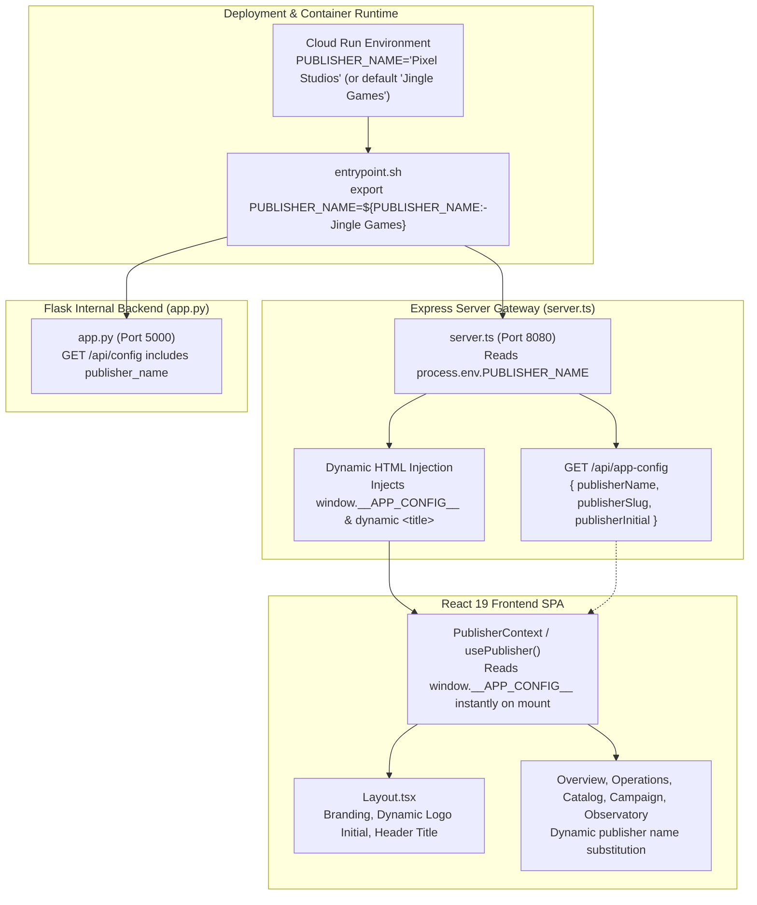

# Implementation Plan: Dynamic Publisher & Studio Configuration

**Target Scope**: Cloud Run Environment Variables, Express Gateway, React 19 Frontend SPA, Flask Backend, and Deployment Pipeline  
**Status**: **PENDING USER REVIEW**  

---

## 1. Goal Description

Currently, the name `"Jingle Games"` is hardcoded across 24 locations in 6 React UI components ([`Layout.tsx`](file:///usr/local/google/home/joeholley/Documents/repos/git/github.com/joeholley/dcgd/src/remix-gaming-app/src/components/Layout.tsx), [`Overview.tsx`](file:///usr/local/google/home/joeholley/Documents/repos/git/github.com/joeholley/dcgd/src/remix-gaming-app/src/components/sections/Overview.tsx), [`Operations.tsx`](file:///usr/local/google/home/joeholley/Documents/repos/git/github.com/joeholley/dcgd/src/remix-gaming-app/src/components/sections/Operations.tsx), [`KnowledgeCatalog.tsx`](file:///usr/local/google/home/joeholley/Documents/repos/git/github.com/joeholley/dcgd/src/remix-gaming-app/src/components/sections/KnowledgeCatalog.tsx), [`CampaignEngine.tsx`](file:///usr/local/google/home/joeholley/Documents/repos/git/github.com/joeholley/dcgd/src/remix-gaming-app/src/components/sections/CampaignEngine.tsx), [`ITObservatory.tsx`](file:///usr/local/google/home/joeholley/Documents/repos/git/github.com/joeholley/dcgd/src/remix-gaming-app/src/components/sections/ITObservatory.tsx)), the HTML page title, and server startup scripts.

This plan reworks the application and deployment process so that:
1. The publisher/studio name can be configured dynamically at runtime via the `PUBLISHER_NAME` (or alias `STUDIO_NAME`) environment variable in the Cloud Run container.
2. It continues to default to `"Jingle Games"` if the variable is not provided, preserving 100% backwards compatibility.
3. Changing the environment variable on the Cloud Run service (`gcloud run services update gaming-demo-app --update-env-vars="PUBLISHER_NAME=..."`) immediately updates the entire user interface, page title, header logo initial, SPIFFE identities, and diagnostic APIs **without requiring a container rebuild or image recompilation**.

---

## 2. Architecture Overview



---

## 3. User Review Required

> [!IMPORTANT]
> **Runtime Flexibility vs. Build-Time Baking**:
> By injecting `window.__APP_CONFIG__` into `index.html` at request time in Express (`server.ts`), changing `PUBLISHER_NAME` in Cloud Run updates the UI immediately on page refresh without needing a 4-minute Cloud Build rebuild!

> [!NOTE]
> **Slug & Initial Derivation**:
> From `PUBLISHER_NAME` (e.g. `"OmniArcade Studios"`):
> - `publisherSlug`: `"omniarcade-studios"` (used for SPIFFE URIs like `spiffe://omniarcade-studios/operations/dev-executor`).
> - `publisherInitial`: `"O"` (rendered in the header logo square).
> - If `PUBLISHER_NAME` is `"Jingle Games"`, initial is `"J"`, slug is `"jingle"`.

---

## 4. Proposed Changes

### Component 1: Deployment Pipeline & Startup

#### [MODIFY] [`deploy-demo.sh`](file:///usr/local/google/home/joeholley/Documents/repos/git/github.com/joeholley/dcgd/deploy-demo.sh)
- Add CLI options `--publisher-name=NAME` / `--publisher-name NAME` and `--studio-name=NAME`.
- Initialize `PUBLISHER_NAME="${PUBLISHER_NAME:-${STUDIO_NAME:-Jingle Games}}"`.
- Print `PUBLISHER_NAME` in Step 0 pre-flight status.
- Add `PUBLISHER_NAME=${PUBLISHER_NAME}` to `--set-env-vars` in Step 8 `gcloud run deploy`.

#### [MODIFY] [`entrypoint.sh`](file:///usr/local/google/home/joeholley/Documents/repos/git/github.com/joeholley/dcgd/entrypoint.sh)
- Export `PUBLISHER_NAME="${PUBLISHER_NAME:-${STUDIO_NAME:-Jingle Games}}"`.
- Compute `PUBLISHER_SLUG` and export it to both Flask and Node.js.

---

### Component 2: Server-Side Runtime & Gateways

#### [MODIFY] [`src/remix-gaming-app/server.ts`](file:///usr/local/google/home/joeholley/Documents/repos/git/github.com/joeholley/dcgd/src/remix-gaming-app/server.ts)
- Read `PUBLISHER_NAME` from `process.env`.
- Expose `GET /api/app-config` returning:
  ```json
  {
    "publisherName": "Jingle Games",
    "publisherSlug": "jingle",
    "publisherInitial": "J",
    "projectId": "datacloudgamesdemo006"
  }
  ```
- In `app.get("*", ...)` (and dev Vite middleware):
  Read `dist/index.html` (cached in memory with file mtime), inject:
  ```html
  <title>${PUBLISHER_NAME} Player 360 | OmniArcade</title>
  <script id="__APP_CONFIG__">window.__APP_CONFIG__ = ${JSON.stringify(config)};</script>
  ```
  This ensures synchronous, zero-latency delivery to the React client with zero layout shifts.

#### [MODIFY] [`src/gamingdatademo/website-live/app.py`](file:///usr/local/google/home/joeholley/Documents/repos/git/github.com/joeholley/dcgd/src/gamingdatademo/website-live/app.py)
- Include `publisher_name` and `publisher_slug` in the response of `GET /api/config`.

---

### Component 3: React 19 Frontend SPA

#### [NEW] [`src/remix-gaming-app/src/context/PublisherContext.tsx`](file:///usr/local/google/home/joeholley/Documents/repos/git/github.com/joeholley/dcgd/src/remix-gaming-app/src/context/PublisherContext.tsx)
- Create `PublisherContext` and `usePublisher()` hook.
- Reads initial state synchronously from `window.__APP_CONFIG__`, with fallback to `"Jingle Games"`.
- Asynchronously reconciles with `GET /api/app-config`.
- Exports:
  - `publisherName`: string
  - `publisherSlug`: string
  - `publisherInitial`: string

#### [MODIFY] [`src/remix-gaming-app/src/App.tsx`](file:///usr/local/google/home/joeholley/Documents/repos/git/github.com/joeholley/dcgd/src/remix-gaming-app/src/App.tsx)
- Wrap application tree in `<PublisherProvider>`.

#### [MODIFY] [`src/remix-gaming-app/src/components/Layout.tsx`](file:///usr/local/google/home/joeholley/Documents/repos/git/github.com/joeholley/dcgd/src/remix-gaming-app/src/components/Layout.tsx)
- Replace static `'J'` logo box with `{publisherInitial}`.
- Replace `Jingle Games` in header title with `{publisherName}`.
- Replace `Jingle Games Admin Console` with `{publisherName} Admin Console`.

#### [MODIFY] [`src/remix-gaming-app/src/components/sections/Overview.tsx`](file:///usr/local/google/home/joeholley/Documents/repos/git/github.com/joeholley/dcgd/src/remix-gaming-app/src/components/sections/Overview.tsx)
- Replace `Jingle Games Customer 360` badge with `{publisherName} Customer 360`.
- Replace hero title `<span className="text-blue-600">{t("Jingle Games.")}</span>` with `<span className="text-blue-600">{publisherName}.</span>`.
- Replace `Managed via Jingle Core DNS` with `Managed via {publisherName} Core DNS`.

#### [MODIFY] [`src/remix-gaming-app/src/components/sections/Operations.tsx`](file:///usr/local/google/home/joeholley/Documents/repos/git/github.com/joeholley/dcgd/src/remix-gaming-app/src/components/sections/Operations.tsx)
- Replace subtitle `Jingle Games Customer 360` with `{publisherName} Customer 360`.
- Replace `...in Jingle titles` with `...in {publisherName} titles`.

#### [MODIFY] [`src/remix-gaming-app/src/components/sections/KnowledgeCatalog.tsx`](file:///usr/local/google/home/joeholley/Documents/repos/git/github.com/joeholley/dcgd/src/remix-gaming-app/src/components/sections/KnowledgeCatalog.tsx)
- Replace hardcoded references in asset source badges, descriptions, modal preview text, and search headers with `{publisherName}`.

#### [MODIFY] [`src/remix-gaming-app/src/components/sections/CampaignEngine.tsx`](file:///usr/local/google/home/joeholley/Documents/repos/git/github.com/joeholley/dcgd/src/remix-gaming-app/src/components/sections/CampaignEngine.tsx)
- Replace hardcoded `Jingle Games` in telemetry sync log step with `{publisherName}`.

#### [MODIFY] [`src/remix-gaming-app/src/components/sections/ITObservatory.tsx`](file:///usr/local/google/home/joeholley/Documents/repos/git/github.com/joeholley/dcgd/src/remix-gaming-app/src/components/sections/ITObservatory.tsx)
- Replace `spiffe://jingle/operations/dev-executor` with `spiffe://${publisherSlug}/operations/dev-executor`.

---

### Component 4: Verification & Automated Testing

#### [MODIFY] [`docs/verify-dual-mode.sh`](file:///usr/local/google/home/joeholley/Documents/repos/git/github.com/joeholley/dcgd/docs/verify-dual-mode.sh)
- Add verification check for `GET /api/app-config` ensuring `publisherName` is returned correctly and reflects configured environment variables.

---

## 5. Verification Plan

### Automated Verification
1. **Shell Script Validation**:
   ```bash
   bash -n deploy-demo.sh && bash -n entrypoint.sh && bash -n docs/verify-dual-mode.sh
   ```
2. **Endpoint Verification**:
   ```bash
   curl -s http://localhost:8080/api/app-config
   ```
   Verify JSON response structure:
   `{"publisherName":"Jingle Games","publisherSlug":"jingle","publisherInitial":"J","projectId":"datacloudgamesdemo006"}`
3. **HTML Dynamic Injection Test**:
   ```bash
   curl -s http://localhost:8080/ | grep -E "window.__APP_CONFIG__|<title>"
   ```

### Manual Verification
1. **Default Test**:
   - Start or browse the app without specifying `PUBLISHER_NAME`.
   - Confirm it renders `"Jingle Games"`, `"J"` logo, and page title `"Jingle Games Player 360 | OmniArcade"`.
2. **Dynamic Substitution Test**:
   - Update Cloud Run environment variable:
     ```bash
     gcloud run services update gaming-demo-app --region=us-central1 --project=datacloudgamesdemo006 --update-env-vars="PUBLISHER_NAME=OmniArcade Studios"
     ```
   - Refresh the page in browser.
   - Confirm UI immediately renders:
     - Header: `OmniArcade Studios Player 360 Platform`
     - Logo square: `O`
     - User badge: `OmniArcade Studios Admin Console`
     - Page title: `OmniArcade Studios Player 360 | OmniArcade`
     - Operations & Overview: `OmniArcade Studios Customer 360`
     - SPIFFE: `spiffe://omniarcade-studios/operations/dev-executor`
   - Revert back or set to desired studio name.
