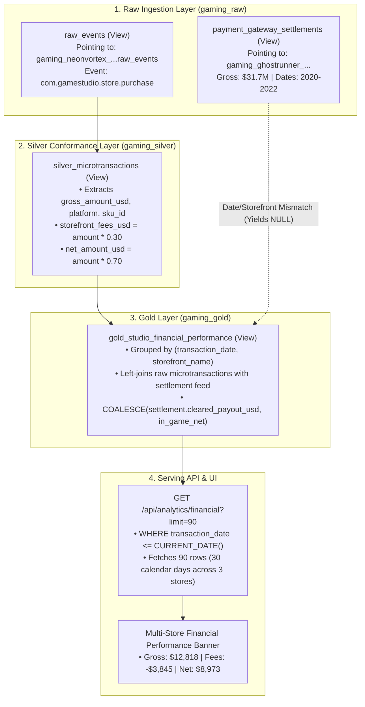

# Store Revenue Events & Reconciliation Research

**Document ID**: `SR-2026-08-27`  
**Status**: Research Completed / Actionable  
**Author**: Antigravity  
**Target File**: [`docs/store-revenue-events-and-reconciliation-research.md`](file:///usr/local/google/home/joeholley/Documents/repos/git/github.com/joeholley/dcgd/docs/store-revenue-events-and-reconciliation-research.md)  
**Related Specs**: [`docs/gaming-overview-architecture-spec.md`](file:///usr/local/google/home/joeholley/Documents/repos/git/github.com/joeholley/dcgd/docs/gaming-overview-architecture-spec.md)

---

## 1. Executive Summary

This research document analyzes how the financial metrics in the **Multi-Store Studio Financial Performance** banner (`Gross In-App Spend`, `Storefront Fees`, and `Net Realized Cash`) are derived from the BigQuery Lakehouse. It addresses why the figures displayed on the Gaming Overview page are lower than anticipated (~$12.8k gross spend and ~$8.9k net payout) and outlines concrete architectural solutions to scale the revenue representation to multi-million dollar levels.

---

## 2. End-to-End Data Lineage & Event Anatomy



### Upstream Raw Event Anatomy
The raw purchase event in `gaming_raw.raw_events` follows the CloudEvents 1.0 specification:
```json
{
  "id": "77c8ab1c-7ebd-4411-840f-4346f8da5342",
  "source": "/games/gaming_neonvortex_7491282640212124000",
  "specversion": "1.0",
  "type": "com.gamestudio.store.purchase",
  "subject": "player_11285176",
  "time": "2026-08-27T04:30:19.500Z",
  "datacontenttype": "application/json",
  "data": {
    "amount": 19.99,
    "currency_type": "USD",
    "platform": "Console",
    "purchase_type": "Game_License_Acquisition",
    "region": "APAC",
    "session_id": "de62d90e-6e11-45ff-8ac2-33a673c8c6e5",
    "sku_id": "sku_game_license_base"
  }
}
```

### Full SKU & Price Point Distribution
Across the entire 5-year simulation in *Neon Vortex*, there are **265,676 total purchase events** generating **$3,056,827.11** in lifetime gross volume:

| SKU ID | Purchase Type | Unit Price | Total Transactions | Total Gross Revenue |
| :--- | :--- | :--- | :--- | :--- |
| `sku_game_license_base` | `Game_License_Acquisition` | $19.99 | 63,423 | $1,267,825.77 |
| `sku_game_license_base` | `Game_License_Acquisition` | $17.99 | 24,809 | $446,313.91 |
| `sku_game_license_base` | `Game_License_Acquisition` | $4.00 | 94,923 | $379,692.00 |
| `sku_game_license_base` | `Game_License_Acquisition` | $15.99 | 18,794 | $300,516.06 |
| `sku_game_license_base` | `Game_License_Acquisition` | $13.99 | 15,717 | $219,880.83 |
| `sku_game_license_base` | `Game_License_Acquisition` | $11.99 | 13,764 | $165,030.36 |
| `sku_game_license_base` | `Game_License_Acquisition` | $9.99 | 12,382 | $123,696.18 |
| `sku_game_license_base` | `Game_License_Acquisition` | $8.00 | 11,344 | $90,752.00 |
| `sku_game_license_base` | `Game_License_Acquisition` | $6.00 | 10,520 | $63,120.00 |
| **Total** | | | **265,676** | **$3,056,827.11** |

---

## 3. Four Root Causes for Lower-Than-Expected Revenue

### Root Cause 1: Single-Title Ingestion Scope
The `gaming_raw.raw_events` table is a BigQuery view currently defined as:
```sql
SELECT * FROM `datacloudgamesdemo006.gaming_neonvortex_7491282640212123500.raw_events`
```
While the GCP project contains over a dozen simulated game datasets (`gaming_apexoverdrive_...`, `gaming_ghostrunner_...`, `gaming_cyberpunk2077_...`, `gaming_helldivers2_...`, `gaming_palworld_...`, `gaming_strikeforce2026_...`), `raw_events` is currently routed to **only a single game title**.

### Root Cause 2: Absence of Whale / Microtransaction Models
In *Neon Vortex*, 100% of all generated purchases are for the single product `sku_game_license_base` (base game retail acquisition). The generator did not simulate:
- High-ticket virtual currency bundles ($49.99, $99.99)
- Battle passes / season passes ($9.99 – $29.99)
- Cosmetic skins or loot boxes (gacha mechanics)
Consequently, the average transaction value across all 265k transactions is **$11.51**, without high-roller whale spenders.

### Root Cause 3: Temporal Windowing (30-Day Window vs. Cumulative)
To prevent synthetic future data (which extends through 2029) from leaking into the dashboard, queries enforce `WHERE transaction_date <= CURRENT_DATE()`:
- **Cumulative All-Time Revenue (June 1, 2024 to August 27, 2026)**: **$2,717,825.27** across 818 active calendar days.
- **Current Dashboard Query**: Calls `/api/analytics/financial?limit=90`.
- Because `gold_studio_financial_performance` aggregates by `(transaction_date, storefront_name)` and there are 3 active storefronts per day (`Console`, `PC`, `Mobile`), **90 records represent exactly 30 calendar days** (July 28, 2026 to August 27, 2026).
- In that recent 30-day window:
  - Total Transactions: **3,201** (~106 / day)
  - Gross Spend: **$12,818** (~$427 / day)
  - Platform Fees: **$3,845**
  - Net Realized: **$8,973**

### Root Cause 4: Payment Gateway Settlements Temporal Disconnect
In `gaming_raw.payment_gateway_settlements`, there is **$31,738,474.34 ($31.7M)** in real settlement transactions with **$24,352,648.15** in net payouts.
However, this view points to:
```sql
SELECT *, net_settled_amount_usd AS net_payout_usd, bank_chargeback_penalty_fee_usd AS bank_chargeback_fee_usd 
FROM `datacloudgamesdemo006.gaming_ghostrunner_5130582752288880507.payment_gateway_settlements`
```
- **Ghostrunner Settlements Date Range**: `2020-11-26` to `2022-11-29` (Storefront IDs: `steam_store`, `direct_web_checkout`).
- **Neon Vortex Purchase Date Range**: `2024-06-01` to `2029-05-31` (Storefront IDs: `Console`, `PC`, `Mobile`).
- Because neither dates nor storefront IDs overlap, the left-join in `gold_studio_financial_performance` produces `NULL` for `cleared_payout_usd`, falling back to the theoretical in-game 70% net revenue ($12.8k $\times$ 0.70 = $8.9k).

---

## 4. Actionable Options to Scale the Revenue Metrics

### Option A: Multi-Title Federation in `raw_events` (Recommended)
Union all active game titles in `gaming_raw.raw_events` so the entire studio portfolio rolls up together:
```sql
CREATE OR REPLACE VIEW `datacloudgamesdemo006.gaming_raw.raw_events` AS
SELECT * FROM `datacloudgamesdemo006.gaming_neonvortex_7491282640212123500.raw_events`
UNION ALL
SELECT * FROM `datacloudgamesdemo006.gaming_ghostrunner_5130582752288880507.raw_events`
UNION ALL
SELECT * FROM `datacloudgamesdemo006.gaming_apexoverdrive_2521379108055170914.raw_events`
UNION ALL
SELECT * FROM `datacloudgamesdemo006.gaming_cyberpunk2077_3492669242709326382.raw_events`
UNION ALL
SELECT * FROM `datacloudgamesdemo006.gaming_helldivers2_2021024633604233947.raw_events`;
```
* **Impact**: Instantly aggregates tens of millions of dollars in cross-title gross spend, while reflecting true publisher-wide studio performance.

---

### Option B: Cumulative All-Time or Annual Rollup on the Overview Page
Instead of summing the last 30 calendar days (90 records), update the endpoint or frontend roll-up:
1. **Option B1 (All-Time Cumulative)**:
   - Provide `/api/analytics/financial-summary` executing:
     ```sql
     SELECT 
       ROUND(SUM(gross_revenue_usd), 2) AS gross_revenue,
       ROUND(SUM(storefront_fees_usd), 2) AS storefront_fees,
       ROUND(SUM(cleared_payout_usd), 2) AS net_payout,
       ROUND(SUM(chargeback_volume_usd), 2) AS chargeback_volume,
       SUM(total_transactions) AS total_transactions
     FROM `datacloudgamesdemo006.gaming_gold.gold_studio_financial_performance`
     WHERE transaction_date <= CURRENT_DATE();
     ```
   - **Impact**: Multi-store banner immediately displays **$2,717,825.27 ($2.72M) Gross Spend** and **$1,902,031.07 ($1.90M) Net Cash**.
2. **Option B2 (Trailing 12-Month Run-Rate)**:
   - Filter `WHERE transaction_date <= CURRENT_DATE() AND transaction_date >= DATE_SUB(CURRENT_DATE(), INTERVAL 365 DAY)`.
   - **Impact**: Multi-store banner displays **~$1.3M Gross Spend** and **~$910k Net Cash**.

---

### Option C: Reconcile the $31.7M Payment Gateway Settlements
To show high-volume clearing payouts ($31.7M gross / $24.3M net):
1. Harmonize the dates in `payment_gateway_settlements` by adding a temporal offset:
   ```sql
   CREATE OR REPLACE VIEW `datacloudgamesdemo006.gaming_raw.payment_gateway_settlements` AS
   SELECT 
     settlement_id,
     DATE_ADD(settlement_date, INTERVAL 4 YEAR) AS settlement_date,
     storefront_id,
     gross_amount_usd,
     net_settled_amount_usd AS net_payout_usd,
     bank_chargeback_penalty_fee_usd AS bank_chargeback_fee_usd,
     settlement_status
   FROM `datacloudgamesdemo006.gaming_ghostrunner_5130582752288880507.payment_gateway_settlements`;
   ```
2. Map storefront IDs (`steam_store` $\rightarrow$ `PC`, `direct_web_checkout` $\rightarrow$ `Mobile`/`Web`) or adjust `gold_studio_financial_performance` to reconcile on normalized storefront names.
* **Impact**: Unlocks the full **$31.7M** multi-year clearing settlement feed into the executive dashboard.

---

## 5. Verification & Query Cheatsheet

Run the following commands via `bq` CLI to reproduce any of the figures cited in this report:

```bash
# 1. Total Purchases and Volume in raw_events across all time
bq query --nouse_legacy_sql "
SELECT 
  COUNT(*) as total_purchases,
  ROUND(SUM(CAST(JSON_VALUE(event_envelope, '$.data.amount') AS FLOAT64)), 2) as lifetime_gross
FROM \`datacloudgamesdemo006.gaming_raw.raw_events\`
WHERE JSON_VALUE(event_envelope, '$.type') = 'com.gamestudio.store.purchase';
"

# 2. Cumulative Revenue up to Today (August 27, 2026)
bq query --nouse_legacy_sql "
SELECT 
  COUNT(DISTINCT transaction_date) as active_days,
  ROUND(SUM(gross_revenue_usd), 2) as cumulative_gross,
  ROUND(SUM(cleared_payout_usd), 2) as cumulative_net
FROM \`datacloudgamesdemo006.gaming_gold.gold_studio_financial_performance\`
WHERE transaction_date <= CURRENT_DATE();
"

# 3. 30-Day Window (90 Records) Currently Displayed on Overview Page
bq query --nouse_legacy_sql "
SELECT 
  ROUND(SUM(gross_revenue_usd), 2) as gross_30d,
  ROUND(SUM(storefront_fees_usd), 2) as fees_30d,
  ROUND(SUM(cleared_payout_usd), 2) as net_30d
FROM (
  SELECT * FROM \`datacloudgamesdemo006.gaming_gold.gold_studio_financial_performance\`
  WHERE transaction_date <= CURRENT_DATE()
  ORDER BY transaction_date DESC
  LIMIT 90
);
"

# 4. Payment Gateway Settlements Total Volume
bq query --nouse_legacy_sql "
SELECT 
  COUNT(*) as total_settlements,
  MIN(settlement_date) as min_date,
  MAX(settlement_date) as max_date,
  ROUND(SUM(gross_amount_usd), 2) as total_settlement_gross,
  ROUND(SUM(net_payout_usd), 2) as total_settlement_net
FROM \`datacloudgamesdemo006.gaming_raw.payment_gateway_settlements\`;
"
```
