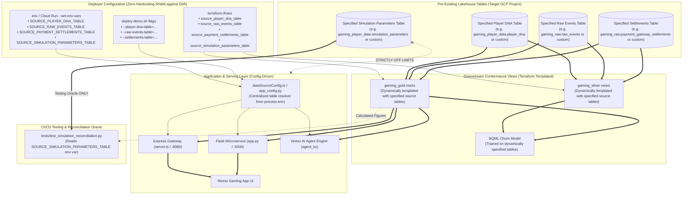

# Upstream Software Integration: Engineering Task List & Execution Plan
## Pure-Consumer Lakehouse Architecture with Configurable Source Table Mapping

---

## 1. Executive Summary & Core Architectural Invariants

This plan defines the concrete, step-by-step engineering tasks to refactor the **Data Cloud Games Demo (DCGD)** repository into a **pure downstream consumer** of upstream player populations and game telemetry events generated by the external tools ([`docs/upstream/generator.md`](file:///usr/local/google/home/joeholley/Documents/repos/git/github.com/joeholley/dcgd/docs/upstream/generator.md) and [`docs/upstream/eventsim.md`](file:///usr/local/google/home/joeholley/Documents/repos/git/github.com/joeholley/dcgd/docs/upstream/eventsim.md)).

### 🏛️ Core Architectural Invariants

> [!IMPORTANT]
> ### 1. Configurable Source Table Mapping (Drift Immunity)
> - **Zero Hardcoding**: Because table names created by upstream generators or legacy setups may drift over time (e.g. `players` vs. `player_dna`, `events` vs. `raw_events`, custom dataset names), **no source table name may be hardcoded** anywhere in Terraform DDL, backend SQL queries, or serving routes.
> - **Deployer Control**: The person deploying must be able to specify the necessary source table names via:
>   - Terraform variables (`terraform.tfvars` or `-var="source_player_dna_table=..."`)
>   - Deployment script flags (`./deploy-demo.sh --player-dna-table=... --raw-events-table=...`)
>   - Runtime environment variables (`SOURCE_PLAYER_DNA_TABLE`, `SOURCE_RAW_EVENTS_TABLE`, `SOURCE_PAYMENT_SETTLEMENTS_TABLE`, `SOURCE_SIMULATION_PARAMETERS_TABLE`)
>
> ### 2. Deprecation & Quarantine of In-Repo Data Generation (`legacy-data-gen`)
> - **Zero In-Repo Generation**: All existing BigQuery data generation routines in `src/retail-data-and-ai-demo` ([`generate-players.sql.tftpl`](file:///usr/local/google/home/joeholley/Documents/repos/git/github.com/joeholley/dcgd/src/retail-data-and-ai-demo/infrastructure/terraform/games/games-bigquery-routines/generate-players.sql.tftpl), [`populate-player-tables.sql.tftpl`](file:///usr/local/google/home/joeholley/Documents/repos/git/github.com/joeholley/dcgd/src/retail-data-and-ai-demo/infrastructure/terraform/games/games-bigquery-routines/populate-player-tables.sql.tftpl), [`generate-iap.sql.tftpl`](file:///usr/local/google/home/joeholley/Documents/repos/git/github.com/joeholley/dcgd/src/retail-data-and-ai-demo/infrastructure/terraform/games/games-bigquery-routines/generate-iap.sql.tftpl)) are **deprecated**.
> - **Quarantine**: These routines are sequestered under `src/retail-data-and-ai-demo/infrastructure/terraform/games/legacy-data-gen/` and gated behind Terraform variable `enable_legacy_data_gen = false`.
> - **Nothing Takes Their Place**: This repository will **NOT** run `eventsim` or the population generator as build or deployment steps.
>
> ### 3. Pure Downstream Consumption Architecture
> - The primary function of this repository is consuming pre-existing tables in the target GCP project:
>   - Pre-existing specified player DNA table (default: `gaming_player_data.player_dna`)
>   - Pre-existing specified raw telemetry table (default: `gaming_raw.raw_events`)
>   - Pre-existing specified payment clearing table (default: `gaming_raw.payment_gateway_settlements`)
> - This repository creates and owns the conformed Medallion layers: `gaming_silver.*` (deduplication, SRE metrics, schema evolution handling) and `gaming_gold.*` (Player 360, studio financial performance, churn root cause, level difficulty funnels).
>
> ### 4. Demo Presenter Prerequisite Runbook
> - The root [`README.md`](file:///usr/local/google/home/joeholley/Documents/repos/git/github.com/joeholley/dcgd/README.md) and [`deploy-demo.sh`](file:///usr/local/google/home/joeholley/Documents/repos/git/github.com/joeholley/dcgd/deploy-demo.sh) must prominently document:
>   > *"**Prerequisite**: The preferred and supported path is for the demo presenter to generate the required synthetic player population (`player_dna`) and telemetry streams (`raw_events`) using the upstream tools ([`generator`](file:///usr/local/google/home/joeholley/Documents/repos/git/github.com/joeholley/dcgd/docs/upstream/generator.md) and [`eventsim`](file:///usr/local/google/home/joeholley/Documents/repos/git/github.com/joeholley/dcgd/docs/upstream/eventsim.md)) **BEFORE** deploying this repository's software stack. If table names differ from defaults, provide them via `--player-dna-table` and `--raw-events-table`."*
>
> ### 5. Strict Ground-Truth Air-Gap
> - The **Simulation Parameters Registry** (`gaming_player_data.simulation_parameters` and its helper views: [`v_latest_simulation_parameters`](file:///usr/local/google/home/joeholley/Documents/repos/git/github.com/joeholley/dcgd/docs/upstream/generator.md#L37-L41), `v_simulation_metrics_flattened`, `v_simulation_run_history`, `v_player_dna_parameter_history`) are **STRICTLY OFF-LIMITS** for all runtime applications ([`server.ts`](file:///usr/local/google/home/joeholley/Documents/repos/git/github.com/joeholley/dcgd/src/remix-gaming-app/server.ts), [`app.py`](file:///usr/local/google/home/joeholley/Documents/repos/git/github.com/joeholley/dcgd/src/gamingdatademo/website-live/app.py)), UI views, and AI agents ([`governance.py`](file:///usr/local/google/home/joeholley/Documents/repos/git/github.com/joeholley/dcgd/src/agents/kc/agent_kc/governance.py)).
> - All dashboard KPIs and agent insights are computed purely **bottom-up** from conformed lakehouse tables.
> - The registry is used exclusively by `tests/test_simulation_reconciliation.py` to audit accuracy headlessly.

---

## 2. End-to-End System Topology



---

## 3. Detailed Engineering Task List

### Phase 1: Terraform Deprecation (`legacy-data-gen`) & Parameterized DDL Provisioning
- [x] **Task 1.1: Add Configurable Source Table Variables in Terraform**
  - Path: [`src/retail-data-and-ai-demo/infrastructure/terraform/games/variables.tf`](file:///usr/local/google/home/joeholley/Documents/repos/git/github.com/joeholley/dcgd/src/retail-data-and-ai-demo/infrastructure/terraform/games/variables.tf)
  - Define variables:
    ```hcl
    variable "source_player_dna_table" {
      description = "Source BigQuery table for player demographic DNA (e.g. gaming_player_data.player_dna)"
      type        = string
      default     = "gaming_player_data.player_dna"
    }

    variable "source_raw_events_table" {
      description = "Source BigQuery table for raw telemetry CloudEvents (e.g. gaming_raw.raw_events)"
      type        = string
      default     = "gaming_raw.raw_events"
    }

    variable "source_payment_settlements_table" {
      description = "Source BigQuery table for payment gateway settlements clearing feed"
      type        = string
      default     = "gaming_raw.payment_gateway_settlements"
    }

    variable "source_simulation_parameters_table" {
      description = "Source BigQuery table for simulation parameters registry (used ONLY by test/validation suites)"
      type        = string
      default     = "gaming_player_data.simulation_parameters"
    }

    variable "enable_legacy_data_gen" {
      description = "Deprecated: Toggles legacy in-repo synthetic data generation routines. Default false."
      type        = bool
      default     = false
    }
    ```
- [x] **Task 1.2: Sequester Legacy Generation under `legacy-data-gen`**
  - Path: [`src/retail-data-and-ai-demo/infrastructure/terraform/games/`](file:///usr/local/google/home/joeholley/Documents/repos/git/github.com/joeholley/dcgd/src/retail-data-and-ai-demo/infrastructure/terraform/games/)
  - Move legacy generation routines into `infrastructure/terraform/games/legacy-data-gen/`:
    - `generate-players.sql.tftpl`
    - `populate-player-tables.sql.tftpl`
    - `generate-iap.sql.tftpl`
  - Wrap module/routine provisioning in `count = var.enable_legacy_data_gen ? 1 : 0`.
  - **Do NOT add replacement data generation in this repository**.
- [x] **Task 1.3: Parameterize Silver Conformance Views (`gaming_silver`)**
  - Path: `src/retail-data-and-ai-demo/infrastructure/terraform/games/games-bigquery-routines/silver-views.sql.tftpl`
  - Inject `${source_raw_events_table}` dynamically into `silver_microtransactions`, `silver_match_sessions`, `silver_client_sre_metrics`, `silver_marketing_attribution`, and `silver_moderation_alerts`.
  - Inject `${source_player_dna_table}` dynamically into `silver_player_history`.
- [x] **Task 1.4: Parameterize Gold Analytical Marts (`gaming_gold`)**
  - Path: `src/retail-data-and-ai-demo/infrastructure/terraform/games/games-bigquery-routines/gold-marts.sql.tftpl`
  - Inject `${source_payment_settlements_table}` dynamically into `gold_studio_financial_performance`.
  - Inject `${source_player_dna_table}` dynamically into `gold_player_360`.
  - Deploy `gold_churn_root_cause_mart`, `gold_marketing_roas_cohorts`, `gold_level_difficulty_funnel`, and `gold_cheat_analytics`.
- [x] **Task 1.5: Retrain BQML Churn Prediction Model**
  - Path: [`src/retail-data-and-ai-demo/infrastructure/terraform/games/games-bigquery-routines/train-churn-model.sql.tftpl`](file:///usr/local/google/home/joeholley/Documents/repos/git/github.com/joeholley/dcgd/src/retail-data-and-ai-demo/infrastructure/terraform/games/games-bigquery-routines/train-churn-model.sql.tftpl)
  - Train `gaming_raw.gaming_player_churn_model` against `gold_churn_root_cause_mart`.
- [x] **Task 1.6: Configure Dataplex Governance & Scans**
  - Path: [`src/retail-data-and-ai-demo/infrastructure/terraform/games/games-dataplex.tf`](file:///usr/local/google/home/joeholley/Documents/repos/git/github.com/joeholley/dcgd/src/retail-data-and-ai-demo/infrastructure/terraform/games/games-dataplex.tf)
  - Parameterize Dataplex DQ scans and dynamic column masking targeting `${source_raw_events_table}` and `${source_player_dna_table}`.

---

### Phase 2: Backend Config-Driven Resolution (Express & Flask)
- [x] **Task 2.1: Create Centralized Table Resolver in Remix Gaming App**
  - Path: `src/remix-gaming-app/src/services/dataSourceConfig.ts`
  - Expose dynamic table resolver and `getTableMapping()` reading from `process.env` with sensible fallbacks:
  - Strictly enforce air-gap (exclude `simulation_parameters`).
- [x] **Task 2.2: Refactor `bigquery.ts` to Use Dynamic Table Configuration**
  - Path: [`src/remix-gaming-app/src/services/bigquery.ts`](file:///usr/local/google/home/joeholley/Documents/repos/git/github.com/joeholley/dcgd/src/remix-gaming-app/src/services/bigquery.ts)
  - Replace all hardcoded table names with `tables.*` from `dataSourceConfig.ts`.
  - Implement query methods reading from `goldPlayer360`, `goldRegionalKpis`, `goldMarketingRoas`, `goldStudioFinancial`, `goldChurnRootCause`, and `goldCheatAnalytics`.
  - **Air-Gap Check**: Verify zero imports or queries targeting `simulation_parameters`.
- [x] **Task 2.3: Update Express Server Gateway Endpoints**
  - Path: [`src/remix-gaming-app/server.ts`](file:///usr/local/google/home/joeholley/Documents/repos/git/github.com/joeholley/dcgd/src/remix-gaming-app/server.ts)
  - Refactor `/api/analytics/regional`, `/api/analytics/player360`, `/api/analytics/exemplars`, `/api/analytics/financial`, `/api/analytics/churn-root-cause`, and `/api/analytics/cheat-analytics` to use dynamic table mapping.
  - **Air-Gap Check**: Verify zero endpoints expose or query `simulation_parameters`.
- [x] **Task 2.4: Create Centralized Table Resolver in Flask Microservice**
  - Path: `src/gamingdatademo/website-live/data_source_config.py`
  - Expose Python dictionary and resolver methods reading from `os.getenv()` with matching defaults.
  - Refactor [`app.py`](file:///usr/local/google/home/joeholley/Documents/repos/git/github.com/joeholley/dcgd/src/gamingdatademo/website-live/app.py) (`/api/difficulty-stats`, `/api/simulate/*`, `/api/marketing/*`, `/api/executive/*`, `/api/financial-summary`, `/api/churn-root-cause-stats`, `/api/cheat-analytics-stats`) to format SQL queries with `get_table_mapping()`.
  - **Air-Gap Check**: Verify zero endpoints query `simulation_parameters`.
  - **Deployment Guardrail**: Run multi-threaded with `gunicorn --threads 8 --bind 127.0.0.1:5000` and `debug=False`.

---

### Phase 3: Frontend UI Alignment (Remix Gaming App)
- [x] **Task 3.1: Executive Overview & Multi-Store Financials**
  - Path: [`src/remix-gaming-app/src/components/sections/Overview.tsx`](file:///usr/local/google/home/joeholley/Documents/repos/git/github.com/joeholley/dcgd/src/remix-gaming-app/src/components/sections/Overview.tsx)
  - Connect cards to live BigQuery feeds showing Gross Revenue vs. Net Settlement Revenue, storefront fee deductions, and multi-device platform shares.
- [x] **Task 3.2: Game Operations & Client SRE Telemetry**
  - Path: [`src/remix-gaming-app/src/components/sections/Operations.tsx`](file:///usr/local/google/home/joeholley/Documents/repos/git/github.com/joeholley/dcgd/src/remix-gaming-app/src/components/sections/Operations.tsx)
  - Replace static `GAME_METRICS`, `WEEKLY_ENGAGEMENT_TREND`, and `STORE_CONVERSION_FUNNEL` constants with live Recharts time-series feeds from `silver_client_sre_metrics`.
- [x] **Task 3.3: Diurnal Sine Wave CCU Distribution**
  - Path: [`src/remix-gaming-app/src/components/sections/DiurnalSineWaveGraph.tsx`](file:///usr/local/google/home/joeholley/Documents/repos/git/github.com/joeholley/dcgd/src/remix-gaming-app/src/components/sections/DiurnalSineWaveGraph.tsx)
  - Plot the 24-hour match concurrency curve against real hourly match queue timestamps from `silver_match_sessions`.
- [x] **Task 3.4: LiveOps Churn Guardrail & Exemplar Profiles**
  - Path: [`src/remix-gaming-app/src/components/sections/LiveOpsGuardrail.tsx`](file:///usr/local/google/home/joeholley/Documents/repos/git/github.com/joeholley/dcgd/src/remix-gaming-app/src/components/sections/LiveOpsGuardrail.tsx), [`MockClientTab.tsx`](file:///usr/local/google/home/joeholley/Documents/repos/git/github.com/joeholley/dcgd/src/remix-gaming-app/src/components/sections/MockClientTab.tsx)
  - Update `MockClientTab.tsx` to dynamically query top exemplar players per tier (`Whale`, `Dolphin`, `Minnow`, `F2P`) from `gold_player_360`.
- [x] **Task 3.5: Operator Simulator Controls & Anomaly Modes**
  - Path: [`src/remix-gaming-app/src/components/sections/OperatorSimulatorTab.tsx`](file:///usr/local/google/home/joeholley/Documents/repos/git/github.com/joeholley/dcgd/src/remix-gaming-app/src/components/sections/OperatorSimulatorTab.tsx)
  - Enable Level 2 bottleneck and toxic chat outbreak anomaly modes.
- [x] **Task 3.6: Campaign Marketing Engine & Swarm**
  - Path: [`src/remix-gaming-app/src/components/sections/CampaignEngine.tsx`](file:///usr/local/google/home/joeholley/Documents/repos/git/github.com/joeholley/dcgd/src/remix-gaming-app/src/components/sections/CampaignEngine.tsx)
  - Replace static `PRESET_COHORTS` with queries to `gold_marketing_roas_cohorts`.
- [x] **Task 3.7: Dataplex Governance & GDPR Erasure Demonstration**
  - Path: [`src/remix-gaming-app/src/components/sections/KnowledgeCatalog.tsx`](file:///usr/local/google/home/joeholley/Documents/repos/git/github.com/joeholley/dcgd/src/remix-gaming-app/src/components/sections/KnowledgeCatalog.tsx)
  - Expose Dataplex DQ scan findings on dirty data sentinels ($P_{\text{dirty}} = 0.005$) and demonstrate GDPR erasure masking.
- [x] **Task 3.8: UI Data Mode Badge Verification**
  - Path: [`src/remix-gaming-app/src/components/sections/Diagnostics.tsx`](file:///usr/local/google/home/joeholley/Documents/repos/git/github.com/joeholley/dcgd/src/remix-gaming-app/src/components/sections/Diagnostics.tsx)
  - Verify all `DataModeBadge` indicators show `LIVE` mode with real BigQuery query latencies.

---

### Phase 4: Vertex AI Reasoning Engine / ADK Agent Enhancement
- [x] **Task 4.1: Expand Governance & Financial Reasoning Tools**
  - Path: [`src/agents/kc/agent_kc/governance.py`](file:///usr/local/google/home/joeholley/Documents/repos/git/github.com/joeholley/dcgd/src/agents/kc/agent_kc/governance.py)
  - Add `query_financial_settlements()` tool querying `gold_studio_financial_performance`.
  - Add `analyze_churn_root_cause()` tool querying `gold_churn_root_cause_mart`.
  - **Air-Gap Check**: Ensure zero agent tools or prompt templates reference `simulation_parameters`.

---

### Phase 5: Automated Testing & Ground-Truth Reconciliation Suite (Testing Oracle ONLY)
- [ ] **Task 5.1: Implement Reconciliation Test Suite**
  - Path: `tests/test_simulation_reconciliation.py`
  - Parameterize test suite with `SOURCE_SIMULATION_PARAMETERS_TABLE` and `GOLD_FINANCIAL_PERFORMANCE_TABLE` environment variables.
- [ ] **Task 5.2: Test 1: Lakehouse Data-Layer Reconciliation**
  - Query `gold_studio_financial_performance` bottom-up.
  - Fetch target revenue from specified simulation parameters table (`budget * hit_ratio`).
  - Assert $|\text{Calculated} - \text{Target}| / \text{Target} \le 0.05$ (within 5% tolerance).
- [ ] **Task 5.3: Test 2: Headless REST API Contract Reconciliation**
  - Send headless HTTP `GET` to `/api/analytics/regional` and `/api/difficulty-stats`.
  - Assert response matches conformed BigQuery Gold mart values with zero browser interaction.
- [ ] **Task 5.4: Test 3: Autonomous Agent Diagnosis Reconciliation**
  - Send headless HTTP `POST` to `/api/marketing/simulate-cluster` and `/api/simulate/difficulty-spike`.
  - Assert that the agent's diagnosis correctly isolates the injected problem network or level bottleneck from underlying data alone.
- [ ] **Task 5.5: Test 4: Air-Gap Verification Static Scan**
  - Execute automated static grep scan ensuring zero occurrences of `simulation_parameters` exist inside `src/remix-gaming-app`, `src/gamingdatademo`, or `src/agents`.
- [ ] **Task 5.6: Pre-Commit & Cloud Build Quality Gate**
  - Run `bash -n entrypoint.sh && bash -n deploy-demo.sh`.
  - Verify container builds pass in Cloud Build.

---

### Phase 6: Documentation & Demo Runbook Parameterization
- [ ] **Task 6.1: Update Root `README.md`**
  - Document that in-repo data generation routines are deprecated under `legacy-data-gen` and disabled by default.
  - Document the upstream prerequisite: presenter generates `player_dna` and `raw_events` beforehand using [`generator`](file:///usr/local/google/home/joeholley/Documents/repos/git/github.com/joeholley/dcgd/docs/upstream/generator.md) and [`eventsim`](file:///usr/local/google/home/joeholley/Documents/repos/git/github.com/joeholley/dcgd/docs/upstream/eventsim.md).
  - Document how to specify custom table names via `terraform.tfvars`, `deploy-demo.sh` CLI flags, or environment variables.
- [ ] **Task 6.2: Parameterize `deploy-demo.sh`**
  - Add CLI arguments for custom source tables:
    ```bash
    --player-dna-table=<TABLE>
    --raw-events-table=<TABLE>
    --settlements-table=<TABLE>
    --sim-parameters-table=<TABLE>
    ```
  - Pass arguments into Terraform (`-var="source_player_dna_table=..."`) and Cloud Run (`--set-env-vars`).
