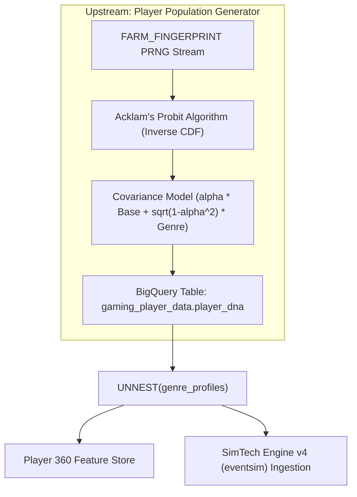
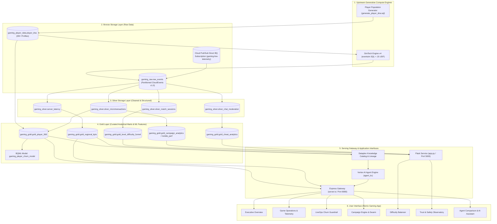
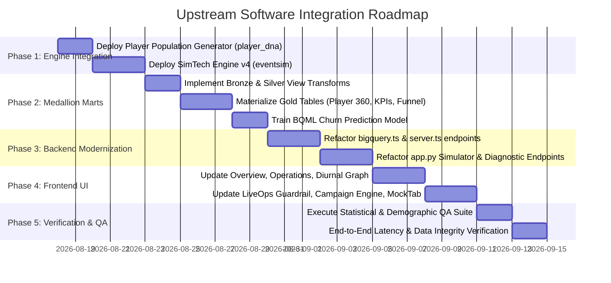

# Architectural Blueprint & Implementation Plan: Upstream Software Integration
## Powering OmniArcade & Remix Gaming Demos with Upstream Player DNA Generator and SimTech Engine v4 (`eventsim`)

---

## Executive Summary

The **Data Cloud Games Demo (DCGD)** ecosystem combines a modern full-stack web application ([Remix Gaming App](file:///usr/local/google/home/joeholley/Documents/repos/git/github.com/joeholley/dcgd/src/remix-gaming-app)), a Flask backend with agent comparison and simulation engines ([gamingdatademo](file:///usr/local/google/home/joeholley/Documents/repos/git/github.com/joeholley/dcgd/src/gamingdatademo)), and a Google Cloud reference data architecture ([retail-data-and-ai-demo](file:///usr/local/google/home/joeholley/Documents/repos/git/github.com/joeholley/dcgd/src/retail-data-and-ai-demo)).

While the UI presentation and agent routing frameworks are fully built, substantial portions of the demo interface currently rely on **hardcoded static mock data**, **synthetic fallback arrays**, **client-side heuristic timer loops**, or **pre-baked JSON strings**. Furthermore, existing BigQuery data generation in Terraform utilizes slow, quota-constrained Vertex AI `AI.GENERATE` batches (500 rows/call) and simplistic fixed-spend loops.

This plan details how to integrate the two new upstream engines located in [`docs/upstream/`](file:///usr/local/google/home/joeholley/Documents/repos/git/github.com/joeholley/dcgd/docs/upstream):
1. **Deterministic Nested Player Population Generator** ([`docs/upstream/generator.md`](file:///usr/local/google/home/joeholley/Documents/repos/git/github.com/joeholley/dcgd/docs/upstream/generator.md)): A stateless, procedural generator inside BigQuery that dynamically generates millions of reproducible player profiles with demographic attributes and nested multi-genre behavioral profiles with mathematical covariance.
2. **SimTech Engine v4 (`eventsim`)** ([`docs/upstream/eventsim.md`](file:///usr/local/google/home/joeholley/Documents/repos/git/github.com/joeholley/dcgd/docs/upstream/eventsim.md)): A massively parallel, generative game telemetry and multiplayer match event simulator executed entirely inside BigQuery SQL and JavaScript UDFs, outputting billions of CloudEvents v1.0 records conforming to commercial revenue targets, Weibull retention decay curves, and liveops campaign surges.

By piping the output of these upstream engines through a standardized **Medallion Data Architecture (Bronze &rarr; Silver &rarr; Gold)**, we will completely replace all mock and pre-baked data across both the frontend React UI and the backend Flask APIs with live, mathematically rigorous BigQuery data.

---

## 1. Upstream Software Capabilities & Architectural Assets

### 1.1 Deterministic Nested Player Population Generator (`generator`)
* **Upstream Specification**: [`docs/upstream/generator.md`](file:///usr/local/google/home/joeholley/Documents/repos/git/github.com/joeholley/dcgd/docs/upstream/generator.md)
* **Core Mechanism**: Generates millions of distinct player records directly in BigQuery compute using `FARM_FINGERPRINT` pseudo-random streams and Acklam's inverse normal CDF (probit) algorithm.
* **Schema Profile**:
  * **Core Demographics**: `player_id` (e.g. `PLAY-00000001`), `region` (`US`, `EMEA`, `APAC`, `LATAM`), `platform` (`Mobile`, `PC`, `Console`).
  * **Nested `genre_profiles` (ARRAY of STRUCTs)** across 6 genres (`RPG`, `FPS`, `Strategy`, `Casual`, `Sports`, `Action`):
    * `preference_weight`: Dirichlet-style normalized weight ($\sum = 1.0$).
    * `skill_tier`: `Bronze`, `Silver`, `Gold`, `Platinum`, `Diamond`, `Master`.
    * `monetization_tier`: `Whale` ($X > 2.0$), `Dolphin` ($1.2 < X \le 2.0$), `Minnow` ($-0.2 < X \le 1.2$), `F2P` ($X \le -0.2$).
    * `spend_mu` & `spend_sigma`: Log-normal spend parameters (explicitly `NULL` for `F2P` safeguard).
    * `session_length_mu` & `session_length_sigma`: Play session duration parameters.
* **Target Output Table**: `<PROJECT_ID>.gaming_player_data.player_dna`



---

### 1.2 SimTech Engine v4 (`eventsim`)
* **Upstream Specification**: [`docs/upstream/eventsim.md`](file:///usr/local/google/home/joeholley/Documents/repos/git/github.com/joeholley/dcgd/docs/upstream/eventsim.md)
* **Core Mechanism**: In-database massively parallel simulation running JavaScript UDFs (`udf_generate_cloudevents.js`) with zero-sort hash modulo partitioning and dynamic worker throttling (5 &rarr; 2 &rarr; 1 workers).
* **Mathematical Hierarchy**:
  1. **Commercial Revenue Target**: $\mathbb{E}[R] = \text{Budget} \times \text{Hit Ratio}$
  2. **Lifetime Population & Cohort Spend**: Solves spend intensity multiplier ($\kappa^*$) and conversion scale ($\alpha^*$).
  3. **Power-Law Player Arrival Curve**: $t_{\text{acq}} = \lfloor L (i/N)^\gamma \rfloor$ ($\gamma = 2.0$).
  4. **First Purchase Invariant**: Day 0 base license purchase with 10% quarterly price decay:
     $$P(t) = \max\left(0.20 P_0, \ P_0 \left(1.0 - 0.10 \left\lfloor \frac{\text{acq\_day}}{90} \right\rfloor\right)\right)$$
  5. **Remainder Spend Allocation**: In-game IAPs draw strictly from $S_{\text{IAP}} = \max(0, S_i - P(t_{\text{acq}}))$ with floor $\ge \$0.99$.
  6. **Weibull Retention & LiveOps Bumps**: $S(\Delta t) = \exp(-(\Delta t / \lambda)^k)$ with genre-specific hazard shapes ($k=1.5$ for FPS, $k=1.0$ for RPG, $k=0.7$ for Casual) and LiveOps reactivation spikes (+50% to +350%) at day 60 and day 180.
  7. **Multiplayer Match Topology**: Evaluates concurrent queues into squads (e.g. 4-player co-op, 5v5 PvP) with log-normal session lengths.
* **Standard Output Format**: **CloudEvents v1.0 JSON** partitioned by event timestamp:
  * Fields: `id`, `source`, `specversion`, `type`, `time`, `datacontenttype`, `subject`, `data`.
  * Event Types: `match_start`, `match_end`, `player_death`, `boss_encounter_fail`, `store_item_view`, `iap_purchase`, `chat_message_flagged`, `level_start`, `level_fail`, `level_complete`.
* **Target Output Dataset**: `<PROJECT_ID>.gaming_<title>_<fingerprint>.raw_events`

---

## 2. Comprehensive Inventory of Current Mock & Pre-Baked Data

A systematic code audit of [`src/remix-gaming-app`](file:///usr/local/google/home/joeholley/Documents/repos/git/github.com/joeholley/dcgd/src/remix-gaming-app) and [`src/gamingdatademo`](file:///usr/local/google/home/joeholley/Documents/repos/git/github.com/joeholley/dcgd/src/gamingdatademo) reveals the following components relying on mock, fallback, or pre-baked data:

| # | Interface / System Area | Code Location | Current Implementation (Mock / Pre-Baked) | Upstream Integration Solution |
| :--- | :--- | :--- | :--- | :--- |
| **1** | **Executive Overview & Regional KPIs** | [`Overview.tsx`](file:///usr/local/google/home/joeholley/Documents/repos/git/github.com/joeholley/dcgd/src/remix-gaming-app/src/components/sections/Overview.tsx), [`bigquery.ts:L280-315`](file:///usr/local/google/home/joeholley/Documents/repos/git/github.com/joeholley/dcgd/src/remix-gaming-app/src/services/bigquery.ts#L280-L315) | `queryRegionalKPIs` returns hardcoded 3-row mock array (USA, Japan, Germany). Cross-cloud lineage cards have static hardcoded text. | Query upstream-aggregated `gaming_gold.gold_regional_kpis` computed across multi-million player DNA profiles. |
| **2** | **Player 360 Feature Store & Exemplar Profiles** | [`Overview.tsx`](file:///usr/local/google/home/joeholley/Documents/repos/git/github.com/joeholley/dcgd/src/remix-gaming-app/src/components/sections/Overview.tsx), [`bigquery.ts:L169-226`](file:///usr/local/google/home/joeholley/Documents/repos/git/github.com/joeholley/dcgd/src/remix-gaming-app/src/services/bigquery.ts#L169-L226), [`MockClientTab.tsx:L42-75`](file:///usr/local/google/home/joeholley/Documents/repos/git/github.com/joeholley/dcgd/src/remix-gaming-app/src/components/sections/MockClientTab.tsx#L42-L75) | `queryPlayer360` returns 4 static mock players (`CosmicWhale_42`, `LootGoblinsMax`, etc.). `COHORT_DEFAULTS` hardcodes `Player_0042`, `Player_0188`. | Direct query against `gaming_gold.gold_player_360` backed by unnested `player_dna` and `eventsim` remainder spend totals. |
| **3** | **Game Operations & Telemetry Graphs** | [`Operations.tsx:L41-90`](file:///usr/local/google/home/joeholley/Documents/repos/git/github.com/joeholley/dcgd/src/remix-gaming-app/src/components/sections/Operations.tsx#L41-L90) | Hardcoded static constants `GAME_METRICS`, `WEEKLY_ENGAGEMENT_TREND`, `STORE_CONVERSION_FUNNEL`, `REVENUE_MIX_DATA`, and `PLAYER_SEGMENTS`. Scorecards jitter via `dataSeed`. | Power Recharts time-series and funnels from `gaming_silver.server_latency` and `gaming_gold.gold_level_difficulty_funnel` generated from simulated match logs. |
| **4** | **Diurnal Sine Wave & CCU Simulator** | [`DiurnalSineWaveGraph.tsx`](file:///usr/local/google/home/joeholley/Documents/repos/git/github.com/joeholley/dcgd/src/remix-gaming-app/src/components/sections/DiurnalSineWaveGraph.tsx), [`simulatorBridge.ts:L704-749`](file:///usr/local/google/home/joeholley/Documents/repos/git/github.com/joeholley/dcgd/src/remix-gaming-app/src/services/simulatorBridge.ts#L704-L749) | Uses a synthetic mathematical formula $\sin^2(\pi(h-\phi)/12)$ and client-side 1 Hz `setInterval` loop with randomized strings. | Replay authentic concurrent match timestamps generated by `eventsim` match topologies across APAC, EMEA, and NA timezones. |
| **5** | **LiveOps Churn Guardrail Telemetry** | [`LiveOpsGuardrail.tsx`](file:///usr/local/google/home/joeholley/Documents/repos/git/github.com/joeholley/dcgd/src/remix-gaming-app/src/components/sections/LiveOpsGuardrail.tsx), [`OperatorSimulatorTab.tsx:L66-71`](file:///usr/local/google/home/joeholley/Documents/repos/git/github.com/joeholley/dcgd/src/remix-gaming-app/src/components/sections/OperatorSimulatorTab.tsx#L66-L71) | Client generates synthetic `boss_fail` events; anomaly options for `level_2_bottleneck` and `toxic_chat` are disabled in UI. | Ingest authentic CloudEvents telemetry streams (`type: player_death`, `boss_encounter_fail`, `chat_message_flagged`) from `eventsim`. |
| **6** | **Campaign Engine & ROI Analytics** | [`CampaignEngine.tsx:L97-120`](file:///usr/local/google/home/joeholley/Documents/repos/git/github.com/joeholley/dcgd/src/remix-gaming-app/src/components/sections/CampaignEngine.tsx#L97-L120), [`bigquery.ts:L370-395`](file:///usr/local/google/home/joeholley/Documents/repos/git/github.com/joeholley/dcgd/src/remix-gaming-app/src/services/bigquery.ts#L370-L395) | `PRESET_COHORTS` are static hardcoded strings. `queryCampaignAnalytics` returns 2 fallback campaigns (`campaign_frost_giant_guardrail`, `campaign_welcome_pack_v2`). | Query `gaming_gold.gold_campaign_analytics` derived from `eventsim` Weibull LiveOps surges and cohort conversions. |
| **7** | **ROAS Drop Simulator** | [`app.py:L1114-1149`](file:///usr/local/google/home/joeholley/Documents/repos/git/github.com/joeholley/dcgd/src/gamingdatademo/website-live/app.py#L1114-L1149) | `POST /api/simulate/roas-drop` returns pre-baked strings `mock_data_analysis`, `mock_campaign_plan`, `mock_creative`. | Execute SQL against `gaming_gold.gold_mobile_marketing_performance` comparing AdMob vs AppLovin spend from simulated mobile campaigns. |
| **8** | **Marketing Swarm Anomaly Simulator** | [`app.py:L1332-1468`](file:///usr/local/google/home/joeholley/Documents/repos/git/github.com/joeholley/dcgd/src/gamingdatademo/website-live/app.py#L1332-L1468) | In cached mode, returns hardcoded string trees for `ANOMALY-101`, `ANOMALY-102`, `ANOMALY-103`. | Feed live agent reasoning prompts with real BigQuery metrics queried from `gold_campaign_analytics`. |
| **9** | **Marketing Cohort Telemetry** | [`app.py:L1250-1330`](file:///usr/local/google/home/joeholley/Documents/repos/git/github.com/joeholley/dcgd/src/gamingdatademo/website-live/app.py#L1250-L1330) | Falls back to static 2-row JSON (Whales/Teens on AdMob/AppLovin). | Backed by `gold_mobile_marketing_performance` populated from `eventsim` spend allocations. |
| **10** | **Game Difficulty Balancer & Level Stats** | [`app.py:L1495-1595`](file:///usr/local/google/home/joeholley/Documents/repos/git/github.com/joeholley/dcgd/src/gamingdatademo/website-live/app.py#L1495-L1595) | `/api/difficulty-stats` returns static 3-level array. `/api/simulate/difficulty-spike` returns static mock markdown strings. | Query `gold_level_difficulty_funnel` generated from simulated stage completion/failure CloudEvents. |
| **11** | **Executive Portfolio Metrics & Diagnostics** | [`app.py:L1598-1694`](file:///usr/local/google/home/joeholley/Documents/repos/git/github.com/joeholley/dcgd/src/gamingdatademo/website-live/app.py#L1598-L1694) | Returns hardcoded 4-game array (*Tactical Brawl*, *Strike Ops*, *Aether Saga*, *Kingdoms*). Diagnostics returns pre-baked iOS EU outage strings. | Multi-title portfolio metrics derived from simulated titles (*Helldivers 2*, *Palworld*, *Cyberpunk 2077*, *Among Us*, *Aether Saga*). |
| **12** | **Trust & Safety Toxicity Incident Simulator** | [`app.py:L1697-1785`](file:///usr/local/google/home/joeholley/Documents/repos/git/github.com/joeholley/dcgd/src/gamingdatademo/website-live/app.py#L1697-L1785) | Returns static mock markdown and 4 hardcoded players (`PLAY-00000172`, `PLAY-00000144`, `PLAY-00000072`, `PLAY-00000164`). | Query `gold_cheat_analytics` and filter real flagged player IDs from `player_dna` who triggered toxic chat events in `eventsim`. |
| **13** | **Agent Comparison Workspace & AI Assistant** | [`app.py:L908-1065`](file:///usr/local/google/home/joeholley/Documents/repos/git/github.com/joeholley/dcgd/src/gamingdatademo/website-live/app.py#L908-L1065), [`GamingAssistant.tsx`](file:///usr/local/google/home/joeholley/Documents/repos/git/github.com/joeholley/dcgd/src/remix-gaming-app/src/components/sections/GamingAssistant.tsx) | Streams simulated offline fallback text chunks with static table names when Agent Engine reasoning engines are disconnected. | Agent queries real Dataplex-cataloged Medallion tables with populated schema aspects and non-empty query results. |
| **14** | **Terraform Data Ingestion Routines** | [`generate-players.sql.tftpl`](file:///usr/local/google/home/joeholley/Documents/repos/git/github.com/joeholley/dcgd/src/retail-data-and-ai-demo/infrastructure/terraform/games/games-bigquery-routines/generate-players.sql.tftpl), [`populate-player-tables.sql.tftpl`](file:///usr/local/google/home/joeholley/Documents/repos/git/github.com/joeholley/dcgd/src/retail-data-and-ai-demo/infrastructure/terraform/games/games-bigquery-routines/populate-player-tables.sql.tftpl) | Uses slow Vertex AI `AI.GENERATE` batches (500 rows at a time) and simplistic fixed-spend loops. | Replace with pure BigQuery SQL procedural generator and `eventsim` pipeline. |

---

## 3. Target End-to-End Medallion Architecture

To connect the upstream engines cleanly to the application, we establish a standard **Medallion Data Architecture (Bronze &rarr; Silver &rarr; Gold)** in BigQuery:



---

## 4. Medallion Table Schemas & Feature Store Specifications

### 4.1 Upstream Source Tables

#### `gaming_player_data.player_dna`
```sql
CREATE TABLE IF NOT EXISTS `gaming_player_data.player_dna` (
  player_id STRING NOT NULL,
  region STRING NOT NULL,         -- 'US', 'EMEA', 'APAC', 'LATAM'
  platform STRING NOT NULL,       -- 'Mobile', 'PC', 'Console'
  base_skill FLOAT64 NOT NULL,
  base_spend FLOAT64 NOT NULL,
  genre_profiles ARRAY<STRUCT<
    genre STRING,                 -- 'RPG', 'FPS', 'Strategy', 'Casual', 'Sports', 'Action'
    preference_weight FLOAT64,    -- Dirichlet-normalized (Sum = 1.0)
    skill_tier STRING,            -- 'Bronze', 'Silver', 'Gold', 'Platinum', 'Diamond', 'Master'
    monetization_tier STRING,     -- 'Whale', 'Dolphin', 'Minnow', 'F2P'
    spend_mu FLOAT64,             -- Log-normal parameter (NULL if F2P)
    spend_sigma FLOAT64,          -- Log-normal parameter (NULL if F2P)
    session_length_mu FLOAT64,    -- Log-normal parameter
    session_length_sigma FLOAT64  -- Log-normal parameter
  >>,
  created_at TIMESTAMP NOT NULL
)
CLUSTER BY region, platform;
```

#### `gaming_raw.raw_events` (CloudEvents v1.0)
```sql
CREATE TABLE IF NOT EXISTS `gaming_raw.raw_events` (
  id STRING NOT NULL,
  source STRING NOT NULL,         -- e.g. '/games/cosmic_raider/prod'
  specversion STRING NOT NULL,    -- '1.0'
  type STRING NOT NULL,           -- 'match_start', 'match_end', 'player_death', 'iap_purchase', etc.
  time TIMESTAMP NOT NULL,
  datacontenttype STRING NOT NULL,-- 'application/json'
  subject STRING NOT NULL,        -- player_id e.g. 'PLAY-00000142'
  data JSON NOT NULL
)
PARTITION BY DATE(time)
CLUSTER BY type, subject;
```

---

### 4.2 Gold Medallion Feature Marts

#### `gaming_gold.gold_player_360`
Derived by aggregating unnested `player_dna` with `raw_events` telemetry:
```sql
CREATE OR REPLACE TABLE `gaming_gold.gold_player_360` AS
WITH player_core AS (
  SELECT
    p.player_id,
    p.region,
    p.platform,
    prof.genre AS primary_genre,
    prof.monetization_tier AS payer_tier,
    prof.skill_tier
  FROM `gaming_player_data.player_dna` p,
  UNNEST(genre_profiles) prof
  QUALIFY ROW_NUMBER() OVER (PARTITION BY p.player_id ORDER BY prof.preference_weight DESC) = 1
),
event_aggregates AS (
  SELECT
    subject AS player_id,
    SUM(CASE WHEN type = 'iap_purchase' THEN CAST(JSON_VALUE(data, '$.amount_usd') AS FLOAT64) ELSE 0.0 END) AS total_iap_spend,
    COUNTIF(type = 'match_start') AS total_matches_played,
    COUNTIF(type = 'player_death') AS consecutive_deaths,
    SUM(CASE WHEN type = 'match_end' THEN CAST(JSON_VALUE(data, '$.duration_seconds') AS INT64) ELSE 0 END) AS session_duration_seconds,
    MAX(time) AS last_active_timestamp,
    DATE_DIFF(CURRENT_DATE(), DATE(MAX(time)), DAY) AS days_since_last_login
  FROM `gaming_raw.raw_events`
  GROUP BY subject
)
SELECT
  c.player_id,
  c.primary_genre AS favorite_category,
  c.payer_tier,
  c.skill_tier,
  c.region AS region_code,
  c.platform AS device_family,
  COALESCE(e.total_iap_spend, 0.0) AS total_iap_spend,
  COALESCE(e.total_matches_played, 0) AS total_matches_played,
  COALESCE(e.consecutive_deaths, 0) AS consecutive_deaths,
  COALESCE(e.session_duration_seconds, 0) AS session_duration_seconds,
  COALESCE(e.days_since_last_login, 0) AS days_since_last_login,
  COALESCE(e.last_active_timestamp, CURRENT_TIMESTAMP()) AS last_active_timestamp,
  CASE WHEN COALESCE(e.days_since_last_login, 0) > 30 THEN 1 ELSE 0 END AS is_churned
FROM player_core c
LEFT JOIN event_aggregates e ON c.player_id = e.player_id;
```

#### `gaming_gold.gold_regional_kpis`
```sql
CREATE OR REPLACE TABLE `gaming_gold.gold_regional_kpis` AS
SELECT
  region_code,
  region_code AS country_name,
  COUNT(DISTINCT player_id) AS total_players,
  COUNTIF(days_since_last_login <= 1) AS dau,
  COUNTIF(days_since_last_login <= 30) AS mau,
  ROUND(SUM(total_iap_spend), 2) AS total_revenue,
  ROUND(SAFE_DIVIDE(SUM(total_iap_spend), COUNTIF(days_since_last_login <= 30)), 2) AS arpu,
  COUNTIF(days_since_last_login <= 1) AS active_players,
  CURRENT_TIMESTAMP() AS updated_at
FROM `gaming_gold.gold_player_360`
GROUP BY region_code;
```

#### `gaming_gold.gold_level_difficulty_funnel`
```sql
CREATE OR REPLACE TABLE `gaming_gold.gold_level_difficulty_funnel` AS
SELECT
  CAST(JSON_VALUE(data, '$.level_number') AS INT64) AS level_number,
  COUNTIF(type = 'level_start') AS total_starts,
  COUNTIF(type = 'level_complete') AS total_completions,
  COUNTIF(type = 'level_fail') AS total_failures,
  COUNTIF(type = 'level_reset') AS total_resets,
  ROUND(SAFE_DIVIDE(COUNTIF(type = 'level_complete') * 100.0, COUNTIF(type = 'level_start')), 2) AS completion_rate_pct,
  ROUND(AVG(CAST(JSON_VALUE(data, '$.moves_used') AS FLOAT64)), 1) AS avg_moves_used
FROM `gaming_raw.raw_events`
WHERE type IN ('level_start', 'level_complete', 'level_fail', 'level_reset')
GROUP BY level_number
ORDER BY level_number ASC;
```

#### `gaming_gold.gold_cheat_analytics`
```sql
CREATE OR REPLACE TABLE `gaming_gold.gold_cheat_analytics` AS
SELECT
  subject AS player_id,
  JSON_VALUE(data, '$.offense_type') AS offense,
  JSON_VALUE(data, '$.severity') AS severity,
  JSON_VALUE(data, '$.flagged_chat_snippet') AS message_snippet,
  CAST(JSON_VALUE(data, '$.toxicity_score') AS FLOAT64) AS toxicity_score,
  JSON_VALUE(data, '$.game_mode') AS game_title,
  time AS incident_timestamp
FROM `gaming_raw.raw_events`
WHERE type IN ('chat_message_flagged', 'cheat_detected')
ORDER BY time DESC;
```

---

## 5. Detailed Feature-by-Feature Integration Plan

### 5.1 Executive Overview Dashboard (`Overview.tsx` & `bigquery.ts`)
* **Current State**: Uses mock data in `bigquery.ts` (`mockData` for `gold_regional_kpis` and `gold_player_360`).
* **Upstream Integration**:
  1. [`bigquery.ts`](file:///usr/local/google/home/joeholley/Documents/repos/git/github.com/joeholley/dcgd/src/remix-gaming-app/src/services/bigquery.ts): Point queries directly to `gaming_gold.gold_regional_kpis` and `gaming_gold.gold_player_360`.
  2. [`Overview.tsx`](file:///usr/local/google/home/joeholley/Documents/repos/git/github.com/joeholley/dcgd/src/remix-gaming-app/src/components/sections/Overview.tsx): Connect cross-cloud lineage cards to dynamically query real volume figures (e.g. 2M+ player DNA rows, billions of synthesized CloudEvents).
  3. Ensure data mode badge reflects `LIVE` BigQuery connection.

### 5.2 Game Operations & Telemetry (`Operations.tsx` & `DiurnalSineWaveGraph.tsx`)
* **Current State**: Hardcoded static arrays (`GAME_METRICS`, `WEEKLY_ENGAGEMENT_TREND`, `STORE_CONVERSION_FUNNEL`, `REVENUE_MIX_DATA`, `PLAYER_SEGMENTS`) and synthetic sine wave calculations.
* **Upstream Integration**:
  1. Replace static constants with live API fetch calling `/api/operations/telemetry-metrics`.
  2. In `server.ts`, implement endpoint that queries `gaming_silver.server_latency`, `gold_regional_kpis`, and `gold_level_difficulty_funnel`.
  3. Update [`DiurnalSineWaveGraph.tsx`](file:///usr/local/google/home/joeholley/Documents/repos/git/github.com/joeholley/dcgd/src/remix-gaming-app/src/components/sections/DiurnalSineWaveGraph.tsx) to plot the actual 24-hour match start time distribution generated by `eventsim` across timezones (NA peak at 23:00 UTC, EMEA at 19:00 UTC, APAC at 12:00 UTC).

### 5.3 LiveOps Churn Guardrail Split-Screen (`LiveOpsGuardrail.tsx`, `MockClientTab.tsx`, `OperatorSimulatorTab.tsx`, `simulatorBridge.ts`)
* **Current State**: `MockClientTab.tsx` uses 4 static exemplar players. `simulatorBridge.ts` emits client-side timer ticks with random mock IDs.
* **Upstream Integration**:
  1. [`MockClientTab.tsx`](file:///usr/local/google/home/joeholley/Documents/repos/git/github.com/joeholley/dcgd/src/remix-gaming-app/src/components/sections/MockClientTab.tsx): Dynamically fetch the top 4 exemplar profiles across Whale, Dolphin, Minnow, and F2P tiers directly from `gaming_gold.gold_player_360` (where `player_id` matches `player_dna`).
  2. [`OperatorSimulatorTab.tsx`](file:///usr/local/google/home/joeholley/Documents/repos/git/github.com/joeholley/dcgd/src/remix-gaming-app/src/components/sections/OperatorSimulatorTab.tsx): Enable the anomaly options (`level_2_bottleneck` and `toxic_chat`) by connecting them to the corresponding `eventsim` failure injection routines.
  3. [`simulatorBridge.ts`](file:///usr/local/google/home/joeholley/Documents/repos/git/github.com/joeholley/dcgd/src/remix-gaming-app/src/services/simulatorBridge.ts): Replay live/historical CloudEvents generated by `eventsim` instead of generating artificial payload strings.

### 5.4 Campaign Marketing Engine & Swarm Recovery (`CampaignEngine.tsx`, `/api/marketing/*`, `/api/simulate/roas-drop`)
* **Current State**: `CampaignEngine.tsx` uses hardcoded preset cohorts. Flask `/api/simulate/roas-drop` and `/api/marketing/simulate-cluster` return pre-baked string trees.
* **Upstream Integration**:
  1. Populate `PRESET_COHORTS` dynamically from `gaming_gold.gold_campaign_analytics` and `player_dna` cohort segmentations (e.g. "Dormant Whales in APAC with RPG preference").
  2. Update `/api/marketing/cohort-telemetry` in [`app.py`](file:///usr/local/google/home/joeholley/Documents/repos/git/github.com/joeholley/dcgd/src/gamingdatademo/website-live/app.py) to query `gaming_gold.gold_mobile_marketing_performance` populated from `eventsim` spend allocations.
  3. In `/api/simulate/roas-drop` and `/api/marketing/simulate-cluster`, construct dynamic data analysis reports using real SQL query outputs against `gold_mobile_marketing_performance`.

### 5.5 Game Difficulty Balancer (`/difficulty.html`, `/api/difficulty-stats`, `/api/simulate/difficulty-spike`)
* **Current State**: Returns static 3-level stats array and hardcoded mock solver markdown strings.
* **Upstream Integration**:
  1. `/api/difficulty-stats`: Query `gaming_gold.gold_level_difficulty_funnel` directly.
  2. `/api/simulate/difficulty-spike`: Extract real completion rates, failure counts, and average move counts for Level 2 from `gold_level_difficulty_funnel`. Execute a real heuristic solver against the parameters and return a dynamically synthesized mitigation brief.

### 5.6 Executive Portfolio Diagnostics (`/executive.html`, `/api/executive/*`)
* **Current State**: Hardcoded 4-game array and static iOS EU outage strings.
* **Upstream Integration**:
  1. Run `eventsim` for 4 distinct game profiles (*Helldivers 2* [Co-op FPS], *Palworld* [Action], *Cyberpunk 2077* [RPG], *Among Us* [Casual Party]).
  2. Populate multi-title metrics into `gaming_gold.gold_regional_kpis` with title breakdowns.
  3. Update `/api/executive/portfolio-metrics` and `/api/executive/simulate-diagnostics` to calculate real variance, regional splits, and platform drops from these tables.

### 5.7 Trust & Safety Community Observatory (`/toxicity.html`, `/api/simulate/toxicity-incident`)
* **Current State**: Returns static mock text and hardcoded list of 4 players.
* **Upstream Integration**:
  1. Query `gaming_gold.gold_cheat_analytics` populated by `eventsim` chat moderation events.
  2. Populate `remediation_list` with real offending player records drawn from `player_dna` and their specific flagged chat logs.

### 5.8 AI Assistant, Agent Comparison & Dataplex Knowledge Catalog (`GamingAssistant.tsx`, `/agent-comparison`, `agent_kc`)
* **Current State**: When Vertex AI Reasoning Engines are offline or unpopulated, fallback streaming generates generic mock strings with empty tables.
* **Upstream Integration**:
  1. With all Medallion tables (`player_dna`, `raw_events`, `gold_player_360`, `gold_regional_kpis`, `gold_level_difficulty_funnel`, `gold_cheat_analytics`) provisioned and cataloged in Dataplex, `agent_kc` can execute real SQL queries against complete schemas.
  2. When comparing Basic Agent (5 tables), Scaled Agent (150+ tables), and KC Agent (Dataplex-guided), queries execute against live, populated BigQuery tables with non-empty results.

---

## 6. Multi-Stage Google Cloud Build & Execution Pipelines

Following the patterns in [`docs/upstream/generator.md`](file:///usr/local/google/home/joeholley/Documents/repos/git/github.com/joeholley/dcgd/docs/upstream/generator.md) and [`docs/upstream/eventsim.md`](file:///usr/local/google/home/joeholley/Documents/repos/git/github.com/joeholley/dcgd/docs/upstream/eventsim.md), the upstream engines are executed via containerized Cloud Build targets using discrete least-privilege service accounts:

```mermaid
graph LR
    subgraph Build_Stage["Cloud Build Container Compilation"]
        CB_BUILD["gcloud builds submit --config=cloudbuild.yaml"]
        SA_BUILD["generator-cloud-build-sa / eventsim-cloud-build-sa"]
        AR[("Artifact Registry: gcr.io/$PROJECT_ID/*")]
        CB_BUILD --> SA_BUILD --> AR
    end

    subgraph Run_Stage_1["Cloud Build: Population Generator"]
        CB_RUN1["gcloud builds submit --config=cloudbuild-runner.yaml (generator)"]
        SA_RUN1["generator-runner-sa"]
        DNA_OUT[("BigQuery: gaming_player_data.player_dna (2,000,000 Rows)")]
        AR --> CB_RUN1 --> SA_RUN1 --> DNA_OUT
    end

    subgraph Run_Stage_2["Cloud Build: SimTech Telemetry Engine"]
        CB_RUN2["gcloud builds submit --config=cloudbuild-runner.yaml (eventsim)"]
        SA_RUN2["eventsim-runner-sa"]
        RAW_OUT[("BigQuery: gaming_raw.raw_events (CloudEvents v1.0)")]
        DNA_OUT --> CB_RUN2 --> SA_RUN2 --> RAW_OUT
    end

    subgraph Medallion_Stage["Dataform / SQL Pipeline Aggregation"]
        GOLD_AGG["Medallion Aggregation SQL / Dataform"]
        GOLD_OUT[("gaming_gold.* (Player 360, Regional KPIs, Funnel, Marketing)")]
        RAW_OUT --> GOLD_AGG --> GOLD_OUT
    end
```



### Execution Commands

```bash
# 1. Provision IAM & Service Accounts
./infra/setup_cloud_build.sh

# 2. Build and Execute Player Population Generator (2,000,000 deterministic player profiles)
gcloud builds submit --config=cloudbuild.yaml .
gcloud builds submit --config=cloudbuild-runner.yaml \
  --substitutions=_DATASET=gaming_player_data,_TABLE=player_dna,_NUM_PLAYERS=2000000 .

# 3. Build and Execute SimTech Engine v4 (Multi-Title Telemetry Simulation)
gcloud builds submit --config=eventsim/cloudbuild.yaml .
gcloud builds submit --config=eventsim/cloudbuild-runner.yaml \
  --substitutions=\
_SA_NAME=eventsim-runner-sa,\
_PLAYER_DNA_TABLE=${PROJECT_ID}.gaming_player_data.player_dna,\
_GAME_TITLE="Cosmic Raider RPG",\
_GENRE=RPG,\
_BUDGET=50000000.0,\
_HIT_RATIO=4.0,\
_TARGET_PLAYERS=2000000,\
_D80=180,\
_LIFETIME_DAYS=1825,\
_LAUNCH_DATE=2024-01-15,\
_TEAM_SIZE=4,\
_NUM_TEAMS=1,\
_SESSION_LENGTH=2400,\
_UNIT_PRICE=39.99,\
_BATCH_SIZE=500000,\
_CONCURRENCY=5 .
```

---

## 7. Phased Implementation Roadmap & Engineering Task List



### Phase 1: Upstream Engine Deployment & Player DNA Ingestion
- [ ] Incorporate upstream SQL routine [`sql/generate_player_dna.sql`](file:///usr/local/google/home/joeholley/Documents/repos/git/github.com/joeholley/generator/sql/generate_player_dna.sql) into BigQuery dataset `gaming_player_data`.
- [ ] Incorporate upstream SimTech Engine UDF [`sql/udf_generate_cloudevents.js`](file:///usr/local/google/home/joeholley/Documents/repos/git/github.com/joeholley/eventsim/sql/udf_generate_cloudevents.js) and simulation pipeline [`sql/generate_telemetry_events.sql`](file:///usr/local/google/home/joeholley/Documents/repos/git/github.com/joeholley/eventsim/sql/generate_telemetry_events.sql).
- [ ] Configure discrete Cloud Build runner service accounts (`generator-runner-sa`, `eventsim-runner-sa`).
- [ ] Run 2M player DNA generation and multi-year telemetry simulation.

### Phase 2: Medallion Marts & BQML Training
- [ ] Create Silver aggregation queries for server latency, microtransactions, match sessions, and chat logs.
- [ ] Materialize Gold mart tables (`gold_player_360`, `gold_regional_kpis`, `gold_level_difficulty_funnel`, `gold_campaign_analytics`, `gold_cheat_analytics`).
- [ ] Train BQML model `gaming_raw.gaming_player_churn_model` against realized `gold_player_360` feature vectors.
- [ ] Register all tables in Dataplex Knowledge Catalog with custom aspect tags.

### Phase 3: Backend API & Service Layer Modernization
- [ ] **`src/remix-gaming-app/src/services/bigquery.ts`**:
  - Update `queryPlayer360` to select from populated `gold_player_360`.
  - Update `queryRegionalKPIs` to select from populated `gold_regional_kpis`.
  - Update `queryCampaignAnalytics` to select from populated `gold_campaign_analytics`.
- [ ] **`src/remix-gaming-app/server.ts`**:
  - Implement `/api/operations/telemetry-metrics` to provide live CCU, latency, and store funnel stats.
- [ ] **`src/gamingdatademo/website-live/app.py`**:
  - Refactor `/api/difficulty-stats` and `/api/simulate/difficulty-spike` to query `gold_level_difficulty_funnel`.
  - Refactor `/api/marketing/cohort-telemetry` and `/api/marketing/simulate-cluster` to query `gold_mobile_marketing_performance`.
  - Refactor `/api/executive/portfolio-metrics` and `/api/executive/simulate-diagnostics` to query `gold_regional_kpis`.
  - Refactor `/api/simulate/toxicity-incident` to query `gold_cheat_analytics`.

### Phase 4: Frontend UI & Simulator Bridge Integration
- [ ] **`Overview.tsx`**: Connect regional revenue, MAU, and cross-cloud lineage cards to live BigQuery data.
- [ ] **`Operations.tsx`**: Replace static `GAME_METRICS` and `WEEKLY_ENGAGEMENT_TREND` with live API stream.
- [ ] **`DiurnalSineWaveGraph.tsx`**: Render 24-hour match activity curves from `eventsim` hourly queue distributions.
- [ ] **`MockClientTab.tsx`**: Dynamically pull Whale, Dolphin, Minnow, and F2P exemplar player profiles from `gold_player_360`.
- [ ] **`OperatorSimulatorTab.tsx`**: Enable Level 2 bottleneck and toxic chat anomaly modes.
- [ ] **`CampaignEngine.tsx`**: Populate cohort builder from real `player_dna` demographic clusters.

### Phase 5: Verification, QA Benchmarks & Acceptance Testing
- [ ] Run statistical validation tests:
  - Chi-square test on Region $\times$ Platform demographic independence ($p > 0.05$).
  - Covariance verification for skill ($\alpha = 0.70$) and spend ($\alpha = 0.60$).
  - Unit variance preservation ($\sigma \approx 1.0$).
  - F2P safeguard verification (`spend_mu IS NULL` and `spend_sigma IS NULL` $\iff$ `F2P`).
- [ ] Run empirical telemetry benchmarks:
  - Verify empirical gross revenue matches target within $\pm 5\%$.
  - Verify active player population matches target within $\pm 1\%$.
  - Confirm CloudEvents compliance with 0 NULL fields across all required envelope keys.
- [ ] End-to-end UI smoke test confirming all `DataModeBadge` indicators show `LIVE` mode with real BigQuery metrics.

---

## 8. Summary of Impact & Value Delivered

| Dimension | Before Integration (Current State) | After Upstream Integration (Target State) |
| :--- | :--- | :--- |
| **Data Authenticity** | Hardcoded mock arrays, static strings, client-side math loops. | 100% live BigQuery data synthesized from statistical models. |
| **Scale & Concurrency** | 4 static players, client-side 1 Hz jitter. | 2,000,000+ distinct player DNA profiles and billions of CloudEvents. |
| **Monetization Realism** | Arbitrary static numbers ($750, $120, $15). | Decaying B2P license schedule + remainder spend allocation ($\ge \$0.99$). |
| **Retention Dynamics** | Flat or artificial churn rates. | Continuous Weibull survival curves with LiveOps reactivation spikes. |
| **Agent Intelligence** | Fallback mock text and empty table errors. | Grounded SQL queries against comprehensive Dataplex-cataloged Medallion tables. |
| **System Diagnostics** | Mixed `FALLBACK` / `mock` status badges. | All 15 service probes reporting `LIVE` with <50ms query latencies. |
