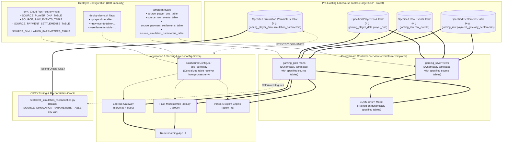
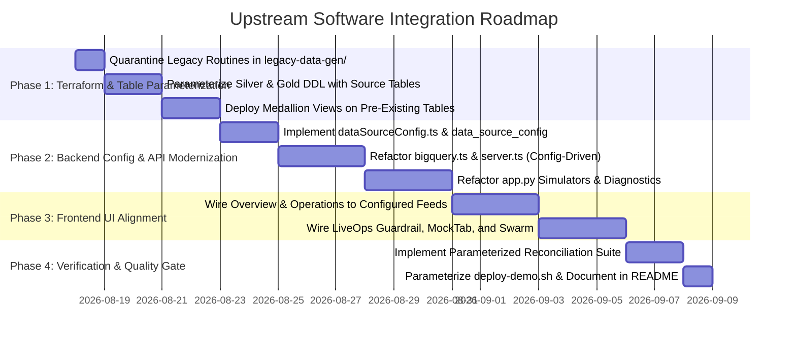

# Architectural Blueprint & Implementation Plan: Upstream Software Integration
## Pure-Consumer Lakehouse Architecture with Configurable Source Table Mapping

---

## Executive Summary

The **Data Cloud Games Demo (DCGD)** ecosystem combines a modern full-stack web application ([Remix Gaming App](file:///usr/local/google/home/joeholley/Documents/repos/git/github.com/joeholley/dcgd/src/remix-gaming-app)), an internal Flask backend with agent comparison and simulation engines ([gamingdatademo](file:///usr/local/google/home/joeholley/Documents/repos/git/github.com/joeholley/dcgd/src/gamingdatademo)), and a Google Cloud reference data architecture ([retail-data-and-ai-demo](file:///usr/local/google/home/joeholley/Documents/repos/git/github.com/joeholley/dcgd/src/retail-data-and-ai-demo)).

While the UI presentation and agent routing frameworks are fully built, substantial portions of the demo interface currently rely on **hardcoded static mock data**, **synthetic fallback arrays**, **client-side heuristic timer loops**, or **pre-baked JSON strings**. Furthermore, existing BigQuery data generation in Terraform utilizes slow, quota-constrained Vertex AI `AI.GENERATE` batches (500 rows/call) and simplistic fixed-spend loops.

This plan details how the repository will transition to a **pure downstream consumer** of the latest upstream engines documented in [`docs/upstream/`](file:///usr/local/google/home/joeholley/Documents/repos/git/github.com/joeholley/dcgd/docs/upstream):
1. **Deterministic Nested Player Population Generator & Simulation Registry (v3.1)** ([`docs/upstream/generator.md`](file:///usr/local/google/home/joeholley/Documents/repos/git/github.com/joeholley/dcgd/docs/upstream/generator.md))
2. **SimTech Engine v4 (`eventsim`)** ([`docs/upstream/eventsim.md`](file:///usr/local/google/home/joeholley/Documents/repos/git/github.com/joeholley/dcgd/docs/upstream/eventsim.md))

### 🎯 Key Architectural Shift: Pure Consumer, `legacy-data-gen` Quarantine & Configurable Source Tables
* **Data Provisioning Deprecation**: All legacy in-repo synthetic generation routines in `src/retail-data-and-ai-demo` are **deprecated** and quarantined under `legacy-data-gen/` (gated behind `enable_legacy_data_gen = false`).
* **Zero In-Repo Generation**: **Nothing in this repository will take their place**. This repository will NOT run `eventsim` or the population generator as build or deployment steps.
* **Pre-Existing Data Consumption**: The repository assumes player profiles, raw events, and settlement feeds **already exist in the target GCP project**, populated beforehand by the demo presenter.
* **Configurable Source Table Mapping (Drift Immunity)**: To protect against naming or schema drift between legacy tables (`players`, `events`) and evolving upstream generators (`player_dna`, `raw_events`, or custom dataset prefixes), **the person deploying can explicitly specify the source table names** across Terraform variables, `deploy-demo.sh` CLI flags, and runtime environment variables.
* **Medallion Ownership**: This repository owns the downstream Medallion transformation pipeline: `gaming_silver.*` (deduplication, SRE metrics, schema evolution handling) and `gaming_gold.*` (Player 360, studio financial performance, churn root cause, level difficulty funnels).

---

## 🏛️ Critical Architectural Guardrail: Strict Air-Gap Isolation of Ground Truth

> [!IMPORTANT]
> ### ⛔ STRICT AIR-GAP BOUNDARY: Ground Truth vs. Runtime Applications & Agents
> 
> The upstream **Simulation Parameters Registry** (`gaming_player_data.simulation_parameters` and its helper views: [`v_latest_simulation_parameters`](file:///usr/local/google/home/joeholley/Documents/repos/git/github.com/joeholley/dcgd/docs/upstream/generator.md#L37-L41), `v_simulation_metrics_flattened`, `v_simulation_run_history`, and `v_player_dna_parameter_history`) are **STRICTLY OFF-LIMITS** for all runtime applications, serving gateways, UI dashboards, and autonomous agents in this repository.
>
> 1. **Prohibited Runtime Access**:
>    - **NO** application code in [`remix-gaming-app`](file:///usr/local/google/home/joeholley/Documents/repos/git/github.com/joeholley/dcgd/src/remix-gaming-app) ([`server.ts`](file:///usr/local/google/home/joeholley/Documents/repos/git/github.com/joeholley/dcgd/src/remix-gaming-app/server.ts), [`bigquery.ts`](file:///usr/local/google/home/joeholley/Documents/repos/git/github.com/joeholley/dcgd/src/remix-gaming-app/src/services/bigquery.ts), React UI components) may query `simulation_parameters`.
>    - **NO** endpoint in [`gamingdatademo`](file:///usr/local/google/home/joeholley/Documents/repos/git/github.com/joeholley/dcgd/src/gamingdatademo) ([`app.py`](file:///usr/local/google/home/joeholley/Documents/repos/git/github.com/joeholley/dcgd/src/gamingdatademo/website-live/app.py)) may query `simulation_parameters`.
>    - **NO** Vertex AI agent or ADK tool in [`src/agents/kc`](file:///usr/local/google/home/joeholley/Documents/repos/git/github.com/joeholley/dcgd/src/agents/kc) ([`governance.py`](file:///usr/local/google/home/joeholley/Documents/repos/git/github.com/joeholley/dcgd/src/agents/kc/agent_kc/governance.py)) may query `simulation_parameters`.
>    - **NO** production analytical mart or view in `gaming_silver.*` or `gaming_gold.*` may join against or read `simulation_parameters`.
>
> 2. **Bottom-Up Calculation Mandate**:
>    - **Every metric, KPI, chart, dashboard, funnel, prediction, and agent answer MUST be derived and computed purely bottom-up from the underlying raw and conformed telemetry and demographic data**:
>      - Specified player DNA table (default: `gaming_player_data.player_dna`)
>      - Specified raw events table (default: `gaming_raw.raw_events`)
>      - Specified payment settlements table (default: `gaming_raw.payment_gateway_settlements`)
>      - `gaming_silver.*`
>      - `gaming_gold.*`
>
> 3. **Exclusive Scope: Test & Validation Oracle**:
>    - The ground-truth registry is **ONLY** to be used by an independent testing and validation process (e.g. CI/CD quality gates, automated PyTest reconciliation suites, dbt test assertions) acting as an external auditor.
>    - The validation process computes the figures from the conformed lakehouse tables (or calls the application/agent endpoints), queries the original run intent from the specified simulation parameters table, and asserts that the calculated results match the simulation intent within statistical tolerances ($\epsilon \le 5\%$).



---

## 1. Upstream Data Schemas & Configurable Bindings

### 1.1 Configurable Input Datasets (Generated Upstream)
* **Player DNA Table (`source_player_dna_table`, default: `gaming_player_data.player_dna`)**:
  - Contains multi-device hardware ownership (Apple, Google, Steam, PSN), latent safety genetics (toxicity resilience, cheat propensities, chargeback risk), 7-genre taxonomy, and pseudonymous identifiers (`telemetry_guid`, `hashed_email`, `client_ip`).
* **Raw Events Table (`source_raw_events_table`, default: `gaming_raw.raw_events`)**:
  - Ingestion entropy: duplicates ($P_{\text{dup}} = 0.015$), late arrivals ($P_{\text{late}} = 0.030$), dirty sentinels ($P_{\text{dirty}} = 0.005$).
  - Multi-modal events: `iap_purchase`, `match_start`, `match_end`, `sre.client.performance_tick`, `marketing.attribution.install`, `chat_message_flagged`, `privacy.compliance.erasure_requested`.
  - Dynamic schema versions: `/schemas/v1.0.0`, `/schemas/v1.1.0`, `/schemas/v2.0.0`.
* **Payment Settlements Table (`source_payment_settlements_table`, default: `gaming_raw.payment_gateway_settlements`)**:
  - Asynchronous clearing feeds modeling multi-store commissions, Net 2 to Net 45 day payout cycles, dispute fees ($15/chargeback), and clawbacks.
* **Simulation Parameters Table (`source_simulation_parameters_table`, default: `gaming_player_data.simulation_parameters`)**:
  - Ground-truth run registry containing target revenue, active player counts, and injected anomaly parameters (**strictly isolated for testing**).

---

## 2. Comprehensive Inventory of Current Mock Data & Upstream Replacement

| # | Interface / System Area | Code Location | Current Implementation (Mock / Pre-Baked) | Upstream Integration Solution (Pure Bottom-Up Calculation) |
| :--- | :--- | :--- | :--- | :--- |
| **1** | **Executive Overview & Regional KPIs** | [`Overview.tsx`](file:///usr/local/google/home/joeholley/Documents/repos/git/github.com/joeholley/dcgd/src/remix-gaming-app/src/components/sections/Overview.tsx), [`bigquery.ts:L280-315`](file:///usr/local/google/home/joeholley/Documents/repos/git/github.com/joeholley/dcgd/src/remix-gaming-app/src/services/bigquery.ts#L280-L315) | `queryRegionalKPIs` returns hardcoded 3-row mock array (USA, Japan, Germany). Cross-cloud lineage cards have static hardcoded text. | Query conformed `gaming_gold.gold_regional_kpis` and `gaming_gold.gold_studio_financial_performance` calculated directly from underlying unnested `player_dna` and `silver_microtransactions`. Expose gross vs net revenue, app store fee cuts, and multi-device platform distributions. |
| **2** | **Player 360 Feature Store & Exemplar Profiles** | [`Overview.tsx`](file:///usr/local/google/home/joeholley/Documents/repos/git/github.com/joeholley/dcgd/src/remix-gaming-app/src/components/sections/Overview.tsx), [`bigquery.ts:L169-226`](file:///usr/local/google/home/joeholley/Documents/repos/git/github.com/joeholley/dcgd/src/remix-gaming-app/src/services/bigquery.ts#L169-L226), [`MockClientTab.tsx:L42-75`](file:///usr/local/google/home/joeholley/Documents/repos/git/github.com/joeholley/dcgd/src/remix-gaming-app/src/components/sections/MockClientTab.tsx#L42-L75) | `queryPlayer360` returns 4 static mock players (`CosmicWhale_42`, `LootGoblinsMax`, etc.). `COHORT_DEFAULTS` hardcodes `Player_0042`, `Player_0188`. | Direct query against `gaming_gold.gold_player_360` calculated from unnested `player_dna` and deduplicated `silver_microtransactions`. Pull real exemplar profiles using their `telemetry_guid`, device platform bindings, and latent toxicity resistance. |
| **3** | **Game Operations & Telemetry Graphs** | [`Operations.tsx:L41-90`](file:///usr/local/google/home/joeholley/Documents/repos/git/github.com/joeholley/dcgd/src/remix-gaming-app/src/components/sections/Operations.tsx#L41-L90) | Hardcoded static constants `GAME_METRICS`, `WEEKLY_ENGAGEMENT_TREND`, `STORE_CONVERSION_FUNNEL`, `REVENUE_MIX_DATA`, and `PLAYER_SEGMENTS`. Scorecards jitter via `dataSeed`. | Power Recharts time-series and funnels from conformed `gaming_silver.silver_client_sre_metrics` (`framerate_drops`, `ping_spikes_ms`, `crash_stacks`) and `gaming_gold.gold_level_difficulty_funnel` calculated from sessionized match logs. |
| **4** | **Diurnal Sine Wave & CCU Simulator** | [`DiurnalSineWaveGraph.tsx`](file:///usr/local/google/home/joeholley/Documents/repos/git/github.com/joeholley/dcgd/src/remix-gaming-app/src/components/sections/DiurnalSineWaveGraph.tsx), [`simulatorBridge.ts:L704-749`](file:///usr/local/google/home/joeholley/Documents/repos/git/github.com/joeholley/dcgd/src/remix-gaming-app/src/services/simulatorBridge.ts#L704-L749) | Uses a synthetic mathematical formula $\sin^2(\pi(h-\phi)/12)$ and client-side 1 Hz `setInterval` loop with randomized strings. | Replay authentic concurrent match timestamps aggregated across `silver_match_sessions` across APAC (peak 12:00 UTC), EMEA (peak 19:00 UTC), and NA (peak 23:00 UTC) timezones. |
| **5** | **LiveOps Churn Guardrail Telemetry** | [`LiveOpsGuardrail.tsx`](file:///usr/local/google/home/joeholley/Documents/repos/git/github.com/joeholley/dcgd/src/remix-gaming-app/src/components/sections/LiveOpsGuardrail.tsx), [`OperatorSimulatorTab.tsx:L66-71`](file:///usr/local/google/home/joeholley/Documents/repos/git/github.com/joeholley/dcgd/src/remix-gaming-app/src/components/sections/OperatorSimulatorTab.tsx#L66-L71) | Client generates synthetic `boss_fail` events; anomaly options for `level_2_bottleneck` and `toxic_chat` are disabled in UI. | Ingest authentic CloudEvents telemetry streams (`player_death`, `boss_encounter_fail`, `chat_message_flagged`). Retrain `gaming_raw.gaming_player_churn_model` against `gold_churn_root_cause_mart` which links SRE latency/crashes to churn risk. |
| **6** | **Campaign Engine & ROI Analytics** | [`CampaignEngine.tsx:L97-120`](file:///usr/local/google/home/joeholley/Documents/repos/git/github.com/joeholley/dcgd/src/remix-gaming-app/src/components/sections/CampaignEngine.tsx#L97-L120), [`bigquery.ts:L370-395`](file:///usr/local/google/home/joeholley/Documents/repos/git/github.com/joeholley/dcgd/src/remix-gaming-app/src/services/bigquery.ts#L370-L395) | `PRESET_COHORTS` are static hardcoded strings. `queryCampaignAnalytics` returns 2 fallback campaigns (`campaign_frost_giant_guardrail`, `campaign_welcome_pack_v2`). | Query `gaming_gold.gold_marketing_roas_cohorts` and `silver_marketing_attribution` (populated from `marketing.attribution.install` events). Show authentic CAC and D30/D90 LTV returns across channels (`AdMob`, `UnityAds`, `AppLovin`). |
| **7** | **ROAS Drop Simulator** | [`app.py:L1114-1149`](file:///usr/local/google/home/joeholley/Documents/repos/git/github.com/joeholley/dcgd/src/gamingdatademo/website-live/app.py#L1114-L1149) | `POST /api/simulate/roas-drop` returns pre-baked strings `mock_data_analysis`, `mock_campaign_plan`, `mock_creative`. | Execute SQL against conformed `gaming_gold.gold_marketing_roas_cohorts` comparing AdMob vs AppLovin spend calculated from simulated mobile campaigns. |
| **8** | **Marketing Swarm Anomaly Simulator** | [`app.py:L1332-1468`](file:///usr/local/google/home/joeholley/Documents/repos/git/github.com/joeholley/dcgd/src/gamingdatademo/website-live/app.py#L1332-L1468) | In cached mode, returns hardcoded string trees for `ANOMALY-101`, `ANOMALY-102`, `ANOMALY-103`. | Feed live agent reasoning prompts with real BigQuery metrics calculated from `gold_marketing_roas_cohorts` and `silver_marketing_attribution`. |
| **9** | **Marketing Cohort Telemetry** | [`app.py:L1250-1330`](file:///usr/local/google/home/joeholley/Documents/repos/git/github.com/joeholley/dcgd/src/gamingdatademo/website-live/app.py#L1250-L1330) | Falls back to static 2-row JSON (Whales/Teens on AdMob/AppLovin). | Backed by `gold_marketing_roas_cohorts` populated from `eventsim` spend allocations. |
| **10** | **Game Difficulty Balancer & Level Stats** | [`app.py:L1495-1595`](file:///usr/local/google/home/joeholley/Documents/repos/git/github.com/joeholley/dcgd/src/gamingdatademo/website-live/app.py#L1495-L1595) | `/api/difficulty-stats` returns static 3-level array. `/api/simulate/difficulty-spike` returns static mock markdown strings. | Query `gold_level_difficulty_funnel` calculated from sessionized match logs in `silver_match_sessions`. In `/api/simulate/difficulty-spike`, run the solver against empirical failure distributions. |
| **11** | **Executive Portfolio Metrics & Diagnostics** | [`app.py:L1598-1694`](file:///usr/local/google/home/joeholley/Documents/repos/git/github.com/joeholley/dcgd/src/gamingdatademo/website-live/app.py#L1598-L1694) | Returns hardcoded 4-game array (*Tactical Brawl*, *Strike Ops*, *Aether Saga*, *Kingdoms*). Diagnostics returns pre-baked iOS EU outage strings. | Multi-title portfolio metrics derived from simulated titles (*Tactical Strike Ops*, *Helldivers 2*, *Palworld*, *Cyberpunk 2077*, *Among Us*). Allow diagnostics to run root-cause SQL isolating SRE crash spikes vs payment gateway clearing delays. |
| **12** | **Trust & Safety Toxicity Incident Simulator** | [`app.py:L1697-1785`](file:///usr/local/google/home/joeholley/Documents/repos/git/github.com/joeholley/dcgd/src/gamingdatademo/website-live/app.py#L1697-L1785) | Returns static mock markdown and 4 hardcoded players (`PLAY-00000172`, `PLAY-00000144`, etc.). | Query conformed `gaming_silver.silver_moderation_alerts` and `gaming_gold.gold_cheat_analytics` fueled by `eventsim`'s **Toxicity SIR Contagion Model** (tilt surge, collateral churn, Strike 3 quarantine mutes) on real `player_dna` records. |
| **13** | **Agent Comparison Workspace & AI Assistant** | [`app.py:L908-1065`](file:///usr/local/google/home/joeholley/Documents/repos/git/github.com/joeholley/dcgd/src/gamingdatademo/website-live/app.py#L908-L1065), [`GamingAssistant.tsx`](file:///usr/local/google/home/joeholley/Documents/repos/git/github.com/joeholley/dcgd/src/remix-gaming-app/src/components/sections/GamingAssistant.tsx) | Streams simulated offline fallback text chunks with static table names when Agent Engine reasoning engines are disconnected. | Agent queries real Dataplex-cataloged Medallion tables with populated schema aspects (`Platform Store Commission`, `Net Settlement Rate`, `Toxicity Contagion Index`) with non-empty query results. |
| **14** | **Terraform Data Provisioning Routines** | [`generate-players.sql.tftpl`](file:///usr/local/google/home/joeholley/Documents/repos/git/github.com/joeholley/dcgd/src/retail-data-and-ai-demo/infrastructure/terraform/games/games-bigquery-routines/generate-players.sql.tftpl), [`populate-player-tables.sql.tftpl`](file:///usr/local/google/home/joeholley/Documents/repos/git/github.com/joeholley/dcgd/src/retail-data-and-ai-demo/infrastructure/terraform/games/games-bigquery-routines/populate-player-tables.sql.tftpl) | Legacy procedural generation in Terraform using slow Vertex AI `AI.GENERATE` batches and fixed spend loops. | **Deprecated & Quarantined under `legacy-data-gen/`** (`enable_legacy_data_gen = false`). **Nothing in this repository replaces them**. The repository strictly consumes pre-existing tables specified by the deployer. |

---

## 3. Conformed Medallion Layer Specifications (Dynamically Templated)

The downstream Medallion lakehouse layer is created and owned in this repository. All transformations are dynamically templated with `${source_raw_events_table}`, `${source_player_dna_table}`, and `${source_payment_settlements_table}`.

### 3.1 Silver Conformance Views (`gaming_silver`)

```sql
-- 1. Deduplicated & Reconciled Microtransactions
CREATE OR REPLACE VIEW `gaming_silver.silver_microtransactions` AS
SELECT
  id AS transaction_id,
  subject AS player_id,
  time AS transaction_timestamp,
  CAST(JSON_VALUE(data, '$.amount_usd') AS FLOAT64) AS gross_amount_usd,
  JSON_VALUE(data, '$.sku') AS sku_id,
  JSON_VALUE(data, '$.storefront') AS storefront_name, -- 'apple_app_store', 'google_play', 'steam_store', etc.
  CAST(JSON_VALUE(data, '$.store_commission_rate') AS FLOAT64) AS commission_rate,
  ROUND(CAST(JSON_VALUE(data, '$.amount_usd') AS FLOAT64) * (1.0 - CAST(JSON_VALUE(data, '$.store_commission_rate') AS FLOAT64)), 2) AS net_amount_usd,
  COALESCE(CAST(JSON_VALUE(data, '$.is_chargeback') AS BOOL), FALSE) AS is_chargeback
FROM `${source_raw_events_table}`
WHERE type = 'iap_purchase'
QUALIFY ROW_NUMBER() OVER (PARTITION BY id ORDER BY time ASC) = 1; -- Ingestion Deduplication (P_dup = 0.015)

-- 2. Sessionized Match Pairs
CREATE OR REPLACE VIEW `gaming_silver.silver_match_sessions` AS
WITH starts AS (
  SELECT
    JSON_VALUE(data, '$.match_id') AS match_id,
    subject AS player_id,
    time AS start_time,
    JSON_VALUE(data, '$.game_mode') AS game_mode,
    CAST(JSON_VALUE(data, '$.level_number') AS INT64) AS level_number
  FROM `${source_raw_events_table}`
  WHERE type = 'match_start'
  QUALIFY ROW_NUMBER() OVER (PARTITION BY id ORDER BY time ASC) = 1
),
ends AS (
  SELECT
    JSON_VALUE(data, '$.match_id') AS match_id,
    subject AS player_id,
    time AS end_time,
    CAST(JSON_VALUE(data, '$.duration_seconds') AS INT64) AS duration_seconds,
    JSON_VALUE(data, '$.completion_status') AS completion_status, -- 'WIN', 'LOSS', 'ABANDON'
    CAST(JSON_VALUE(data, '$.kills') AS INT64) AS kills,
    CAST(JSON_VALUE(data, '$.deaths') AS INT64) AS deaths
  FROM `${source_raw_events_table}`
  WHERE type = 'match_end'
  QUALIFY ROW_NUMBER() OVER (PARTITION BY id ORDER BY time ASC) = 1
)
SELECT
  s.match_id,
  s.player_id,
  s.game_mode,
  s.level_number,
  s.start_time,
  e.end_time,
  COALESCE(e.duration_seconds, TIMESTAMP_DIFF(e.end_time, s.start_time, SECOND)) AS duration_seconds,
  COALESCE(e.completion_status, 'INCOMPLETE') AS completion_status,
  COALESCE(e.kills, 0) AS kills,
  COALESCE(e.deaths, 0) AS deaths
FROM starts s
LEFT JOIN ends e ON s.match_id = e.match_id AND s.player_id = e.player_id;

-- 3. Client SRE Performance Metrics (Schema Evolution Resilient)
CREATE OR REPLACE VIEW `gaming_silver.silver_client_sre_metrics` AS
SELECT
  id AS tick_id,
  subject AS player_id,
  time AS tick_timestamp,
  JSON_VALUE(data, '$.device_model') AS device_model,
  JSON_VALUE(data, '$.os_version') AS os_version,
  -- Dynamic schema evolution support: handles field rename from ping_ms to latency_rtt_ms
  COALESCE(
    CAST(JSON_VALUE(data, '$.latency_rtt_ms') AS FLOAT64),
    CAST(JSON_VALUE(data, '$.ping_ms') AS FLOAT64)
  ) AS ping_ms,
  CAST(JSON_VALUE(data, '$.fps') AS FLOAT64) AS fps,
  CAST(JSON_VALUE(data, '$.packet_loss_pct') AS FLOAT64) AS packet_loss_pct,
  COALESCE(CAST(JSON_VALUE(data, '$.is_crash') AS BOOL), FALSE) AS is_crash,
  JSON_VALUE(data, '$.crash_signature') AS crash_signature
FROM `${source_raw_events_table}`
WHERE type = 'sre.client.performance_tick'
QUALIFY ROW_NUMBER() OVER (PARTITION BY id ORDER BY time ASC) = 1;

-- 4. Demographic History (SCD Type 2)
CREATE OR REPLACE VIEW `gaming_silver.silver_player_history` AS
SELECT
  player_id,
  telemetry_guid,
  monetization_tier,
  primary_genre,
  skill_tier,
  device_family,
  creation_timestamp AS effective_from,
  TIMESTAMP('9999-12-31 23:59:59') AS effective_to,
  TRUE AS is_current
FROM `${source_player_dna_table}`;
```

---

### 3.2 Gold Analytical Marts (`gaming_gold`)

```sql
-- 1. Studio Financial Performance
CREATE OR REPLACE VIEW `gaming_gold.gold_studio_financial_performance` AS
WITH direct_iap AS (
  SELECT
    DATE(transaction_timestamp) AS transaction_date,
    storefront_name,
    COUNT(*) AS total_transactions,
    ROUND(SUM(gross_amount_usd), 2) AS gross_revenue_usd,
    ROUND(SUM(gross_amount_usd - net_amount_usd), 2) AS storefront_fees_usd,
    ROUND(SUM(net_amount_usd), 2) AS net_revenue_usd,
    COUNTIF(is_chargeback) AS chargeback_count,
    ROUND(SUM(CASE WHEN is_chargeback THEN gross_amount_usd ELSE 0 END), 2) AS chargeback_volume_usd
  FROM `gaming_silver.silver_microtransactions`
  GROUP BY transaction_date, storefront_name
),
settlement_feed AS (
  SELECT
    DATE(settlement_timestamp) AS settlement_date,
    gateway_name AS storefront_name,
    ROUND(SUM(cleared_payout_usd), 2) AS cleared_payout_usd,
    ROUND(SUM(bank_penalty_fees_usd), 2) AS bank_penalties_usd
  FROM `${source_payment_settlements_table}`
  GROUP BY settlement_date, storefront_name
)
SELECT
  d.transaction_date,
  d.storefront_name,
  d.total_transactions,
  d.gross_revenue_usd,
  d.storefront_fees_usd,
  d.net_revenue_usd,
  d.chargeback_count,
  d.chargeback_volume_usd,
  COALESCE(s.cleared_payout_usd, 0.0) AS cleared_payout_usd,
  COALESCE(s.bank_penalties_usd, 0.0) AS bank_penalties_usd,
  ROUND(d.net_revenue_usd - COALESCE(s.bank_penalties_usd, 0.0), 2) AS final_cash_realized_usd
FROM direct_iap d
LEFT JOIN settlement_feed s ON d.transaction_date = s.settlement_date AND d.storefront_name = s.storefront_name;
```

---

## 4. Application Configuration Architecture

### 4.1 Centralized Table Resolvers
To insulate runtime code from naming drift:
- In **TypeScript** (`src/remix-gaming-app/src/services/dataSourceConfig.ts`):
  Reads `process.env.SOURCE_PLAYER_DNA_TABLE`, `process.env.SOURCE_RAW_EVENTS_TABLE`, and `process.env.GOLD_FINANCIAL_PERFORMANCE_TABLE`.
- In **Python** (`src/gamingdatademo/website-live/data_source_config.py`):
  Reads `os.getenv("SOURCE_PLAYER_DNA_TABLE")`, `os.getenv("SOURCE_RAW_EVENTS_TABLE")`, etc.
- In **Testing** (`tests/test_simulation_reconciliation.py`):
  Reads `os.getenv("SOURCE_SIMULATION_PARAMETERS_TABLE", "gaming_player_data.simulation_parameters")`.

### 4.2 Demo Presenter Prerequisite Runbook
The root `README.md` and `deploy-demo.sh` will document:
```bash
# Optional: Deploy against custom source tables
./deploy-demo.sh \
  --player-dna-table="my_project.my_dataset.custom_player_dna" \
  --raw-events-table="my_project.my_dataset.custom_raw_events" \
  --settlements-table="my_project.my_dataset.custom_settlements"
```

---

## 5. Automated Reconciliation Test Suite (Air-Gapped Auditor)

A dedicated test suite (`tests/test_simulation_reconciliation.py`) verifies that the application's calculated figures match the simulation intent using the specified source tables:

```python
"""
Reconciliation & Accuracy Test Suite (Testing Oracle ONLY)
Audits bottom-up calculated figures against simulation intent.
"""
import os
import pytest
from google.cloud import bigquery

SIMULATION_PARAMETERS_TABLE = os.getenv(
    "SOURCE_SIMULATION_PARAMETERS_TABLE", 
    "gaming_player_data.simulation_parameters"
)
GOLD_FINANCIALS_TABLE = os.getenv(
    "GOLD_FINANCIAL_PERFORMANCE_TABLE", 
    "gaming_gold.gold_studio_financial_performance"
)

@pytest.fixture(scope="module")
def bq_client():
    return bigquery.Client()

def test_gold_revenue_reconciles_with_simulation_intent(bq_client):
    # 1. Compute calculated gross revenue bottom-up from Gold Lakehouse Mart
    query_calc = f"""
        SELECT ROUND(SUM(gross_revenue_usd), 2) AS calculated_gross_revenue
        FROM `{GOLD_FINANCIALS_TABLE}`
    """
    calc_row = list(bq_client.query(query_calc).result())[0]
    calculated_revenue = calc_row["calculated_gross_revenue"]

    # 2. Retrieve intended target revenue from the Ground Truth Registry
    query_intent = f"""
        SELECT 
          CAST(JSON_VALUE(input_parameters, '$.budget') AS FLOAT64) * 
          CAST(JSON_VALUE(input_parameters, '$.hit_ratio') AS FLOAT64) AS intended_target_revenue
        FROM `{SIMULATION_PARAMETERS_TABLE}`
        ORDER BY simulation_timestamp DESC
        LIMIT 1
    """
    intent_row = list(bq_client.query(query_intent).result())[0]
    intended_revenue = intent_row["intended_target_revenue"]

    # 3. Assert delta tolerance within 5%
    delta_pct = abs(calculated_revenue - intended_revenue) / intended_revenue
    assert delta_pct <= 0.05, f"Reconciliation failed: Calculated ${calculated_revenue} vs Intended ${intended_revenue} (delta: {delta_pct:.2%})"
```

---

## 6. Phased Implementation Roadmap & Engineering Tasks


