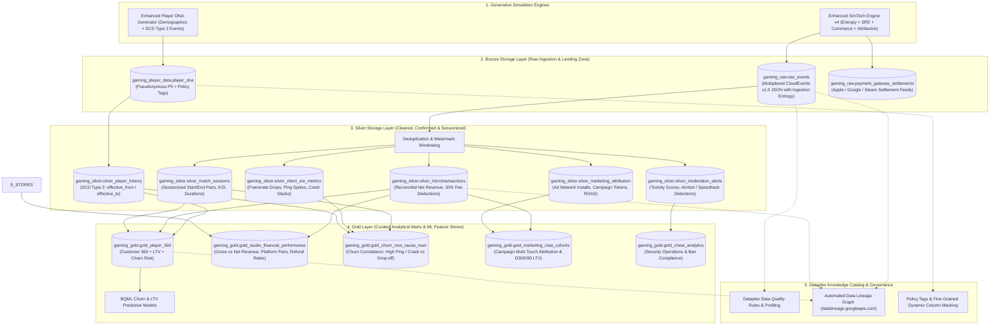
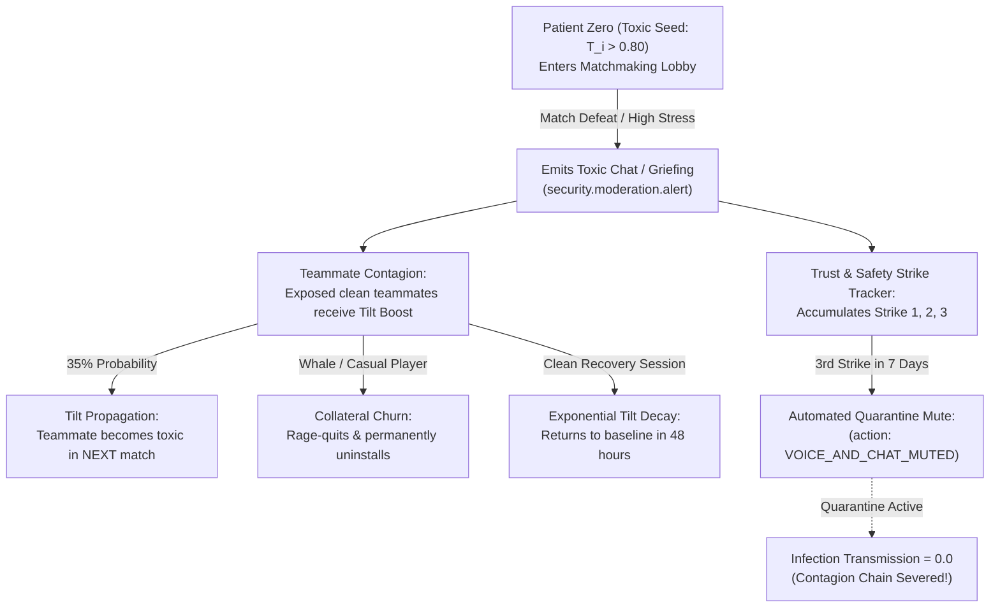
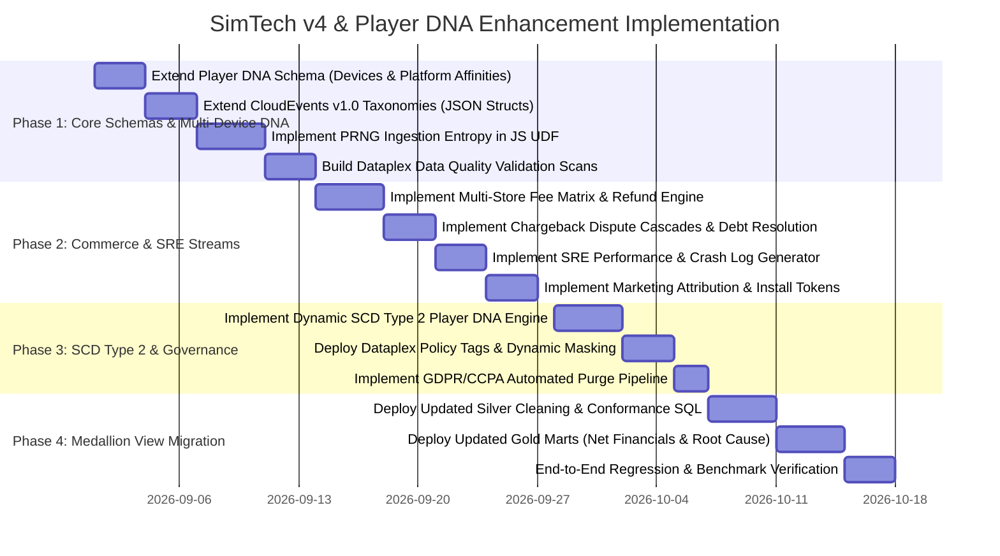

# 📐 Technical Specification: SimTech Engine v4 & Player DNA Generator Enhancements
### Advanced Medallion Lakehouse Architecture, Ingestion Entropy, Financial Reconciliation & Multi-Modal Observability

[](https://cloud.google.com/bigquery)
[](https://cloudevents.io/)
[](https://cloud.google.com/dataplex)
[]()

---

## 1. Executive Summary & Problem Statement

The **SimTech Engine v4 (`eventsim`)** and **Deterministic Player DNA Generator** currently produce mathematically rigorous, reproducible game telemetry aligned with commercial targets (revenue, retention decay, session duration, and multiplayer match topology). 

However, because existing generated events are **100% syntactically uniform, static, and defect-free**, they bypass the real-world data engineering challenges that the **Bronze $\to$ Silver $\to$ Gold Medallion Architecture** is designed to solve in enterprise production environments.

### Core Objectives of this Specification
This enhancement specification defines the mathematical models, schema extensions, event taxonomies, and architectural upgrades required to:
1. **Introduce Controlled Ingestion Entropy**: Simulate real-world network phenomena (out-of-order delivery, duplicate retries, clock drift, legacy sentinel values) to exercise **Bronze deduplication, Silver cleansing, and Dataplex Data Quality scans**.
2. **Support Multi-Channel Financial Reconciliation**: Model multi-store platform fees (Apple, Google, Steam, Sony, Direct Web), tax deductions, currency normalizations, chargebacks, and refund lifecycles for **Gold financial accounting marts**.
3. **Unify Multi-Modal Operational Streams**: Synthesize interconnected **Client SRE/Crash logs**, **Marketing User Acquisition (UA) attribution tokens**, and **Trust & Safety moderation alerts** for **Customer 360 and Root-Cause Churn models**.
4. **Implement Slowly Changing Dimensions (SCD Type 2)**: Transition static player demographics into time-valid historical states (tier promotions, guild migrations, sanctions) for **time-accurate historical spend analysis**.
5. **Demonstrate Enterprise Governance & Privacy Compliance**: Embed pseudonymous identifiers, Dataplex Policy Tags (PII masking), and **GDPR/CCPA "Right to be Forgotten" tombstone purges**.

---

## 2. End-to-End Medallion Telemetry Flow



---

## 3. Pillar 1: High-Performance Anomaly Injection, State Mutation & Ingestion Entropy

Simulating realistic game anomalies (SRE outages, economic exploits, difficulty walls) across **billions of generated CloudEvents** creates a severe performance challenge: evaluating complex conditional checks inside the inner event loop destroys V8 CPU cache lines and wastes massive compute.

To achieve **100% generative behavioral fidelity** with **near-zero compute overhead on baseline events**, `eventsim` implements a **5-Layer High-Performance Optimization Stack**.

---

### 3.1 The 5-Layer Performance Optimization Stack

```
┌────────────────────────────────────────────────────────────┐
│ 1. BigQuery SQL: Columnar Cluster Pruning (Region/Platform)│  ──► Bypasses 80% of unneeded scan IO
├────────────────────────────────────────────────────────────┤
│ 2. UDF Entry: Spatial Blast Radius Check (1 per Player)    │  ──► 95% of players take pure Fast Path
├────────────────────────────────────────────────────────────┤
│ 3. Sparse Day Jumping: Skip inactive days via Weibull jump │  ──► Reduces 1,825 daily loops to ~60 sessions
├────────────────────────────────────────────────────────────┤
│ 4. Timeline Chunking: 3-Interval Execution (Pre/During/Post)│  ──► Zero branches on Days 0-89 & 91-1825
├────────────────────────────────────────────────────────────┤
│ 5. Latent State Mutation: Mutate parameters, not events    │  ──► True downstream fidelity with no bloat
└────────────────────────────────────────────────────────────┘
```

#### Layer 1: BigQuery Columnar Clustering Pushdown (SQL Layer)
* Target tables are clustered: `CLUSTER BY region, platform`.
* When BigQuery feeds candidate slices into worker threads, unaffected regions (e.g. US players when an outage targets EU) are skipped at the storage block layer.

#### Layer 2: Player-Level Spatial Blast Radius Early Exit
* Evaluated **once per player at worker initialization**, rather than thousands of times per event:
  ```javascript
  const inBlastRadius = (player.region === 'europe-west3' && player.platform === 'iOS');
  if (!inBlastRadius) {
    return runStandardTimeline(player, 0, LIFETIME_DAYS); // 100% branchless fast path!
  }
  ```

#### Layer 3: Sparse Session Day Jumping (Weibull Inter-Arrivals)
* Instead of stepping through `day = 0; day < 1825; day++`, the simulator samples the geometric inter-arrival jump to the next active session:
  $$\Delta t_{\text{next}} \sim \text{Geometric}(P_{\text{active}}(t)), \quad t_{\text{current}} \leftarrow t_{\text{current}} + \Delta t_{\text{next}}$$
* If $t_{\text{current}} + \Delta t_{\text{next}}$ skips over the anomaly window entirely, the player was offline during the incident and zero anomaly logic executes ($\mathcal{O}(1)$ skip).

#### Layer 4: Generalized Timeline Interval / Phase Chunking
For affected players, the lifetime horizon is partitioned into sequential, non-overlapping intervals:

```
[0 ───────► t_start)              [t_start ────────► t_end)               [t_end ────────► T_lifetime)
┌─────────────────────────────┐   ┌───────────────────────────────────┐   ┌─────────────────────────────┐
│    Phase 1: Pre-Anomaly     │──►│     Phase 2: Active Anomaly       │──►│    Phase 3: Post-Anomaly    │
│  (Days 0 -> 89: Baseline)   │   │  (Days 90 -> 93: 72-Hour Outage)  │   │  (Days 94 -> 1825: Legacy)  │
└─────────────────────────────┘   └───────────────────────────────────┘   └─────────────────────────────┘
```

* **Phase 1 ($[0, t_{\text{start}})$)**: Runs at maximum JIT compiler throughput with zero anomaly branching.
* **Phase 2 ($[t_{\text{start}}, t_{\text{end}})$)**: Applies perturbations (e.g., ping surges to 450ms, packet loss $20\%$, failure rate $+70\%$).
* **Phase 3 ($[t_{\text{end}}, T_{\text{lifetime}})$)**: Resumes standard generation, carrying forward the mutated state.

#### Layer 5: Catastrophic Anomaly Churn & Early Exit
If the anomaly is severe enough to cause a player to rage-quit or uninstall during Phase 2, **Phase 3 is immediately aborted**:
```javascript
// Inside Phase 2 execution:
if (state.isChurned) {
  state.emittedEvents.push(createCloudEvent({
    type: "player_lifecycle.churned",
    subject: player.telemetryGuid,
    time: state.churnTimestamp,
    data: { reason: "RAGE_QUIT_ANOMALY_SRE", final_stage: state.currentStage }
  }));
  return state.emittedEvents; // Phase 3 is completely bypassed, saving compute!
}
```

---

### 3.2 State-Space Mutation & Persistent Recovery Curves

State mutations are **permanent alterations to the player's internal state vector**:

1. **Permanent Cumulative Invariants**:
   * **Spend & Virtual Currency**: Purchases during an exploit or sale window permanently deduct from the player's remainder spend budget ($S_i - P_{\text{acq}}$), lowering future baseline spend.
   * **Account Sanctions**: Safety infractions and strikes remain on the account profile permanently.
2. **Decaying Dynamic Traits (Exponential Recovery Half-Life)**:
   * When an outage ends at $t_{\text{end}}$, the player's elevated tilt and dissatisfaction decay back toward baseline with an exponential half-life:
     $$\text{Tilt}(t) = \text{Tilt}(t_{\text{end}}) \times \exp\left(-\frac{t - t_{\text{end}}}{\tau_{\text{recovery}}}\right), \quad \tau_{\text{recovery}} \approx 5\text{ days}$$

---

### 3.3 Declarative Anomaly Scenario Model (JSON DSL)

Engineers can declare anomaly scenarios via JSON configuration:

```json
[
  {
    "scenario_id": "ANOMALY-SRE-2026-01",
    "category": "INFRASTRUCTURE_OUTAGE",
    "title_filter": ["Tactical Strike Ops", "Helldivers 2"],
    "start_day": 90,
    "duration_hours": 72,
    "blast_radius": {
      "regions": ["europe-west3", "europe-west1"],
      "platforms": ["iOS"],
      "affected_cohort_pct": 0.85
    },
    "perturbations": {
      "ping_mean_ms": 420.0,
      "ping_sigma": 85.0,
      "packet_loss_rate": 0.22,
      "disconnect_rate": 0.35,
      "disconnect_reason": "SOCKET_TIMEOUT_GATEWAY_DEGRADED"
    }
  },
  {
    "scenario_id": "ANOMALY-ECON-2026-04",
    "category": "VIRTUAL_ECONOMY_EXPLOIT",
    "title_filter": ["Aether Saga", "Cyberpunk 2077"],
    "start_day": 180,
    "duration_hours": 336,
    "blast_radius": {
      "regions": ["APAC", "US"],
      "platforms": ["PC"],
      "affected_cohort_pct": 0.12
    },
    "perturbations": {
      "faucet_multiplier": 75.0,
      "item_drop_rate_multiplier": 20.0,
      "exploit_signature": "STAGE_12_BOSS_REWARD_OVERFLOW"
    }
  }
]
```

---

### 3.4 Ingestion Entropy & Edge Case Quality Rules

1. **At-Least-Once Delivery & Duplicates**: $P_{\text{dup}} \approx 1.5\%$ of events re-emitted with $\Delta t \sim \text{Exp}(15\text{s})$ to exercise Silver deduplication (`QUALIFY ROW_NUMBER() OVER (...) = 1`).
2. **Late-Arriving Telemetry**: $P_{\text{late}} \approx 3.0\%$ mobile events delayed by $6\text{h}\text{–}72\text{h}$ to evaluate watermark partition merges.
3. **Dirty Data Sentinels**: $P_{\text{dirty}} \approx 0.5\%$ legacy sentinels (`mmr = 0/999`, negative durations) to trigger Dataplex Data Quality validation rules.

---

## 4. Pillar 2: Multi-Channel Commerce, Dispute Cascades & Chargebacks

Modern game economies operate across multiple digital storefronts with differing fee structures, settlement latency, currency conversions, and refund/chargeback disputes. Because a player's active platform and payment processor are now resolved **per game session** from their `platform_affinities`, `eventsim` models storefront-specific financial rules with high precision.

### 4.1 Digital Storefront Matrix & Processing Liabilities

| Storefront ID | Platform | Gross Cut / Commission | Settlement Cycle | Refund Dispute Window | Bank Chargeback Fee |
| :--- | :--- | :--- | :--- | :--- | :--- |
| `apple_app_store` | iOS Mobile | 30% (15% for Small Business Tier) | Net 45 days | 14 days | $0.00 (Apple absorbs) |
| `google_play` | Android Mobile | 15% (first $1M), 30% thereafter | Net 30 days | 48 hours | $0.00 (Google absorbs) |
| `steam_store` | PC Windows / Linux | 30% (steps to 25% > $10M, 20% > $50M) | Net 30 days | 14 days / < 2 hrs played | $0.00 (Steam absorbs) |
| `playstation_network`| PS5 Console | 30% | Net 30 days | Strict (Un-downloaded only) | $0.00 (Sony absorbs) |
| `direct_web_checkout`| Web Storefront | 2.9% + $0.30 USD (Stripe/Payment Gateway) | Net 2 days | 30 days | **$15.00 USD (Bank Penalty)** |

* **Platform Fee Shielding**: On platform stores (Apple, Google, Steam, PlayStation), the platform absorbs third-party dispute fees. On `direct_web_checkout` (Stripe), the studio bears direct liability for the mandatory **$\$15.00$ bank penalty fee**.

---

### 4.2 High-Performance 2-Level Chargeback Evaluation Stack

In a multi-million player simulation generating 50M+ transactions, evaluating risk equations on every single IAP would waste massive compute. `eventsim` implements a **2-Level Hierarchical Pruning Pipeline**:

```
Level 1 (Player Initialization):
[ Player Spawns ] ──► Roll 1-in-200 Lifetime Dispute Propensity:
                      hasChargebackRisk = (PRNG(player_id, "cb_risk") < 0.006)
                                │
          ┌─────────────────────┴─────────────────────┐
          ▼                                           ▼
[ FALSE: 99.4% of Players ]                 [ TRUE: 0.6% of Players ]
(Normal players who never dispute)          (Candidate transactors)
          │                                           │
          ▼                                           ▼
Level 2 (In-Game Purchase Loop):            Level 2 (In-Game Purchase Loop):
FAST PATH:                                  Check Dollar Threshold & Storefront:
• if (!player.hasChargebackRisk) return;    • if (amount < $10.00) return;
• 0 checks, 0 PRNG rolls, 0 latency!        • Only then evaluate risk score!
```

#### The Evaluation Code in `eventsim` (JavaScript UDF):
```javascript
function evaluateChargebackOnPurchase(player, transactionId, amount, storefront, deviceId, purchaseTimestamp) {
  // Level 1 Fast-Path Guard: 99.4% of players exit immediately in 1 clock cycle
  if (!player.hasChargebackRisk) return null;

  // Level 2 Dollar Threshold: Micro-purchases under $10 are never disputed
  if (amount < 10.00) return null;

  // Single Active Dispute Guard: Account cannot double-dispute
  if (player.hasActiveDispute || player.accountStatus === "PAYMENT_SUSPENDED") return null;

  // Step 1: Identify Trigger Situation based on Account Profile & Game Context
  const situation = determineChargebackTrigger(player, player.tenureDays, player.cumulativeSpend, player.isBanned);

  // Step 2: Look up Exact Conditional Probability
  const pChargeback = CHARGEBACK_PROBABILITIES[situation];

  // Step 3: Roll Deterministic Die from Transaction ID
  const roll = (cyrb53(transactionId + "_cb_die", 101) % 10000) / 10000.0;

  if (roll < pChargeback) {
    player.hasActiveDispute = true;
    const disputeDelayDays = 14 + (cyrb53(transactionId + "_delay", 42) % 32); // 14 to 45 days
    const disputeTimestamp = purchaseTimestamp + (disputeDelayDays * 86400);

    return {
      scheduledDisputeTimestamp: disputeTimestamp,
      situation: situation,
      deviceId: deviceId,
      merchantFee: (storefront === "direct_web_checkout") ? 15.00 : 0.00,
      resolution: resolveSuspendedPlayer(situation, transactionId)
    };
  }

  return null;
}
```

---

### 4.3 Causal Triad & Resolution Transition Matrix

To prevent absurdities (such as a 3-year veteran Whale vanishing like a throwaway bot, or a stolen card ring calling customer support to repay debt), resolution paths are **strictly conditioned on the trigger cause and account profile**:

```
                       ┌─────────────────────────────────────────────────────────────┐
                       │           CONDITIONAL RESOLUTION TRANSITION MATRIX          │
┌──────────────────────┴──────────────────┬──────────────┬──────────────┬────────────┤
│ Chargeback Trigger Situation            │ Path A: Ghost│ Path B: Churn│ Path C: Pay│
├─────────────────────────────────────────┼──────────────┼──────────────┼────────────┤
│ 1. TRIGGER_CARD_TESTING_STOLEN_CARD     │   98.0%      │    2.0%      │    0.0%    │  <-- Bots NEVER repay
│ 2. TRIGGER_RETALIATORY_BAN              │    0.0%      │  100.0%      │    0.0%    │  <-- Cheaters NEVER unban
│ 3. TRIGGER_FRIENDLY_FRAUD_ACCIDENTAL    │    0.0%      │   15.0%      │   85.0%    │  <-- Whales repay to save account
│ 4. TRIGGER_BUYERS_REMORSE               │    0.0%      │   80.0%      │   20.0%    │  <-- Casuals mostly walk away
└─────────────────────────────────────────┴──────────────┴──────────────┴────────────┘
```

* **Path A (Fraudster Ghost - $35\%$ of disputes)**: Stolen card testing. Account is abandoned immediately upon lockout; simulation loop terminates with zero future events.
* **Path B (Angry Churner - $50\%$ of disputes)**: Buyer's remorse or banned player. Rejects negative wallet, logs an angry support ticket, emits `player_lifecycle.churned`, and permanently uninstalls.
* **Path C (Debt Repayment & Restoration - $15\%$ of disputes)**: High-LTV Whale with hundreds of hours invested. Repays the negative balance via customer support (`commerce.debt_repayment.settled`), unlocks matchmaking, and resumes play under 90-day 3D-Secure probation.

---

### 4.4 Extended Commerce CloudEvents Taxonomies

#### 1. Purchase Event (`type: "commerce.purchase.completed"`)
```json
{
  "specversion": "1.0",
  "id": "evt-tx-9948214-a",
  "source": "/stores/steam/us",
  "type": "commerce.purchase.completed",
  "subject": "d1f8a84b-6e21-4f12-9842-1e9a7e089201",
  "time": "2026-04-12T14:23:10.450Z",
  "datacontenttype": "application/json",
  "data": {
    "transaction_id": "TX-STEAM-881920",
    "device_id": "dev_pc_a9f81204-7718-4e12",
    "storefront_id": "steam_store",
    "item_sku": "SKU-BATTLEPASS-S4",
    "currency_code": "USD",
    "gross_amount_usd": 9.99,
    "platform_fee_usd": 3.00,
    "net_revenue_usd": 6.99,
    "player_payer_tier": "Dolphin"
  }
}
```

#### 2. Fraudulent Credit Card Chargeback Event (`type: "commerce.chargeback.received"`)
```json
{
  "specversion": "1.0",
  "id": "evt-cb-44182-f",
  "source": "/payment_gateways/disputes",
  "type": "commerce.chargeback.received",
  "subject": "d1f8a84b-6e21-4f12-9842-1e9a7e089201",
  "time": "2026-05-15T16:30:00.000Z",
  "datacontenttype": "application/json",
  "data": {
    "dispute_id": "DISP-VISA-77182",
    "original_transaction_id": "TX-DIRECT-992184",
    "device_id": "dev_pc_a9f81204-7718-4e12",
    "storefront_id": "direct_web_checkout",
    "dispute_reason": "FRAUDULENT_UNRECOGNIZED_TRANSACTION",
    "gross_clawback_usd": 99.99,
    "merchant_penalty_fee_usd": 15.00,
    "net_studio_loss_usd": 114.99,
    "issuing_bank": "Chase / Visa",
    "sanction_triggered": "PAYMENT_SUSPENDED"
  }
}
```

#### 3. Debt Repayment & Account Restoration Event (`type: "commerce.debt_repayment.settled"`)
```json
{
  "specversion": "1.0",
  "id": "evt-repay-88102-a",
  "source": "/payment_gateways/settlements",
  "type": "commerce.debt_repayment.settled",
  "subject": "d1f8a84b-6e21-4f12-9842-1e9a7e089201",
  "time": "2026-05-23T11:15:00.000Z",
  "datacontenttype": "application/json",
  "data": {
    "repayment_id": "REPAY-991204",
    "original_dispute_id": "DISP-VISA-77182",
    "amount_paid_usd": 99.99,
    "debt_cleared": true,
    "payment_method": "VERIFIED_3DS_CARD",
    "account_status_restored": "ACTIVE"
  }
}
```

### 4.5 Financial Accounting Mart in Gold (`gaming_gold.gold_studio_financial_performance`)
Silver processes these streams to calculate net realized margins, platform commissions, and chargeback dispute rates:
```sql
CREATE OR REPLACE TABLE `gaming_gold.gold_studio_financial_performance` AS
SELECT
  DATE_TRUNC(DATE(t.transaction_timestamp), MONTH) AS fiscal_month,
  t.storefront_id,
  COUNT(DISTINCT t.transaction_id) AS gross_transactions,
  SUM(t.gross_amount_usd) AS gross_revenue_usd,
  SUM(t.platform_fee_usd) AS total_platform_fees_usd,
  COUNT(DISTINCT r.refund_id) AS total_refunds_count,
  COALESCE(SUM(r.refund_amount_usd), 0.0) AS total_refunded_amount_usd,
  COUNT(DISTINCT cb.dispute_id) AS total_chargebacks_count,
  COALESCE(SUM(cb.gross_clawback_usd + cb.merchant_penalty_fee_usd), 0.0) AS total_chargeback_losses_usd,
  SUM(t.gross_amount_usd) 
    - SUM(t.platform_fee_usd) 
    - COALESCE(SUM(r.net_revenue_clawback_usd), 0.0)
    - COALESCE(SUM(cb.gross_clawback_usd + cb.merchant_penalty_fee_usd), 0.0) AS net_realized_revenue_usd,
  SAFE_DIVIDE(COUNT(DISTINCT cb.dispute_id), COUNT(DISTINCT t.transaction_id)) AS chargeback_rate
FROM `gaming_silver.silver_microtransactions` t
LEFT JOIN `gaming_silver.silver_refund_settlements` r
  ON t.transaction_id = r.original_transaction_id
LEFT JOIN `gaming_silver.silver_chargeback_disputes` cb
  ON t.transaction_id = cb.original_transaction_id
GROUP BY 1, 2;
```

---

## 5. Pillar 3: Multi-Modal Operational Telemetry & Toxicity Contagion

To enable cross-domain analytics in Gold marts and provide realistic data for AI Agents, `eventsim` generates correlated multi-modal operational streams.

### 5.1 Client & Infrastructure SRE Logs (`type: "sre.client.performance_tick"`)
Simulates frame-rate drops, network latency, and memory crashes across device specifications:
```json
{
  "specversion": "1.0",
  "id": "evt-sre-771829",
  "source": "/client/telemetry/android",
  "type": "sre.client.performance_tick",
  "subject": "d1f8a84b-6e21-4f12-9842-1e9a7e089201",
  "time": "2026-04-12T18:44:00Z",
  "datacontenttype": "application/json",
  "data": {
    "match_id": "MATCH-EU-99214",
    "server_region": "europe-west1",
    "device_model": "Samsung Galaxy S22",
    "average_fps": 24.2,
    "target_fps": 60.0,
    "jank_frames_count": 312,
    "ping_ms": 194.5,
    "packet_loss_pct": 4.8,
    "battery_temp_celsius": 42.1,
    "crash_signal": null
  }
}
```

* **Root-Cause Churn Analysis in Gold**: Correlates players who experienced `average_fps < 30` or `ping_ms > 150` in their last 3 sessions with subsequent churn events (`D7_active = FALSE`).

### 5.2 Marketing User Acquisition Attribution (`type: "marketing.attribution.install"`)
Tracks acquisition channels, creative IDs, and attribution tokens:
```json
{
  "specversion": "1.0",
  "id": "evt-mkt-00129",
  "source": "/attribution/adjust",
  "type": "marketing.attribution.install",
  "subject": "d1f8a84b-6e21-4f12-9842-1e9a7e089201",
  "time": "2026-01-15T10:00:00Z",
  "datacontenttype": "application/json",
  "data": {
    "ad_network": "AppLovin",
    "campaign_id": "CAMP-2026-SPRING-PROMO",
    "creative_id": "CR-VIDEO-BOSS-FIGHT-30S",
    "channel_type": "Paid_UA",
    "cost_per_install_usd": 3.85,
    "country_code": "US",
    "attribution_window_days": 7
  }
}
```

* **ROAS Mart in Gold**: Calculates Cohort Return on Ad Spend:
  $$\text{ROAS}_{D30} = \frac{\sum \text{IAP Spend}_{D30} + \sum \text{Ad Revenue}_{D30}}{\text{Cost Per Install (CPI)}}$$

### 5.3 Toxicity Contagion, Tilt Dynamics & Churn Amplification (The SIR Model)

Toxicity in multiplayer gaming spreads like an epidemic. When toxic players abuse teammates, clean players become tilted, pass toxicity into subsequent matches, or quit entirely.



#### A. Toxicity Generation in `player_dna` (Latent Traits)
1. **`baseline_toxicity` ($T_i \in [0.0, 1.0]$)**:
   * **$98\%$ Peaceful / Normal Players**: $T_i \sim \text{Beta}(\alpha=1.0, \beta=9.0)$ with mean $\mu \approx 0.10$.
   * **$2\%$ Chronic Toxic Seeds**: $T_i \sim \text{Beta}(\alpha=8.0, \beta=2.0)$ with mean $\mu \approx 0.80$.
2. **`toxicity_resilience` ($R_i \in [0.0, 1.0]$)**:
   * Casuals and Whales spawn with lower resilience ($R_i \approx 0.30$), making them sensitive to toxic dropouts.
   * Hardcore/Master-tier players spawn with higher resilience ($R_i \approx 0.85$).
3. **`cheat_propensity` ($C_i \in [0.0, 1.0]$)**:
   * Latent probit correlated with high toxicity ($r = 0.65$).

#### B. The 5-Stage Toxicity Lifecycle in `eventsim`

1. **In-Match Trigger & Event Emission**:
   When a player with dynamic $\text{Tilt}_i(t) > 0.70$ or `baseline_toxicity > 0.75` experiences match stress (defeat or $>3$ consecutive deaths), `eventsim` emits `security.moderation.alert`:
   ```json
   {
     "specversion": "1.0",
     "id": "evt-sec-881920",
     "type": "security.moderation.alert",
     "subject": "d1f8a84b-6e21-4f12-9842-1e9a7e089201",
     "time": "2026-04-14T20:15:30Z",
     "data": {
       "match_id": "MATCH-US-44012",
       "device_id": "dev_ps5_a9f81204-7718-4e12",
       "category": "VERBAL_ABUSE_HARASSMENT",
       "toxicity_score": 0.942,
       "trigger_context": "CONSECUTIVE_DEATHS_ROUND_3",
       "flagged_teammates_exposed": ["usr_beta_44", "usr_gamma_12"]
     }
   }
   ```

2. **Teammate Contagion (The Tilt Boost)**:
   Clean teammates present in that match suffer a tilt surge inversely proportional to their resilience:
   $$\text{Tilt}_j(t+1) = \text{Tilt}_j(t) + 0.40 \times (1 - R_j) \times \mathbb{I}(\text{Match Defeat})$$
   Tilted teammates have a $35\%$ probability of propagating toxicity in their next $1\text{–}3$ matches.

3. **Collateral Churn Amplification (The "Toxic Dropout")**:
   When low-toxicity players ($T_j < 0.20$, especially Whales/Casuals) suffer $\ge 3$ toxic lobbies in a 48-hour window, their Weibull churn hazard accelerates:
   $$\lambda_{\text{churn}} \leftarrow \lambda_{\text{churn}} \times 3.5$$
   If churn occurs, `eventsim` emits `player_lifecycle.churned` (`reason: "COLLATERAL_TOXICITY_CHURN"`) and terminates future simulation for that player.

4. **Exponential Tilt Decay (Natural Recovery)**:
   When placed in clean matches, elevated tilt decays naturally with an exponential half-life:
   $$\text{Tilt}(t) = T_{\text{baseline}} + (\text{Tilt}_{\text{peak}} - T_{\text{baseline}}) \times \exp\left(-\frac{t - t_{\text{incident}}}{\tau_{\text{recovery}}}\right), \quad \tau \approx 2.5\text{ days}$$

5. **Trust & Safety Strike Ladder & Quarantine**:
   * **Strike 1**: Automated chat warning (`security.moderation.warning`).
   * **Strike 2**: 24-hour competitive matchmaking timeout.
   * **Strike 3**: **7-Day Voice & Chat Mute** (`action: "VOICE_AND_CHAT_MUTED"`). Infection transmission drops to **$0.0$**, cutting off the contagion chain.
   * **Strike 4**: Permanent ban (`account_status: "PERMANENTLY_BANNED"`).

#### C. High-Performance Lobby-Level Fast-Path Optimization
To prevent running toxicity contagion calculations across billions of un-affected matches:
```javascript
// Evaluated once per match lobby (4-10 players):
const maxLobbyTilt = Math.max(...lobbyPlayers.map(p => p.dynamicTilt));
if (maxLobbyTilt < 0.65) {
  // FAST PATH: 95% of matches skip all toxicity, NLP, and contagion math in 1 check!
  return runStandardMatchSession(lobbyPlayers);
}
```

#### D. Gold Mart Attribution (`gaming_gold.gold_toxicity_churn_impact_mart`)
```sql
CREATE OR REPLACE TABLE `gaming_gold.gold_toxicity_churn_impact_mart` AS
SELECT
  server_region,
  COUNT(DISTINCT incident_id) AS total_toxic_incidents,
  COUNT(DISTINCT victim_player_id) AS players_exposed,
  COUNT(DISTINCT CASE WHEN churned_within_7d THEN victim_player_id END) AS collateral_churns,
  SUM(projected_lost_ltv_usd) AS lost_ltv_usd
FROM `gaming_silver.silver_moderation_incidents`
GROUP BY 1;
```

---

## 6. Pillar 4: Slowly Changing Dimensions (SCD Type 2) for Player State

Rather than treating player attributes as static, the **Player DNA Generator** will emit demographic state transitions over the simulation lifetime horizon.

### 6.1 State Transitions
1. **Monetization Tier Promotion**: Free-to-Play $\to$ Minnow on first purchase; Minnow $\to$ Dolphin/Whale as cumulative spend breaches thresholds ($\$50.00$, $\$500.00$).
2. **Competitive Skill Promotion**: MMR rating fluctuations promoting players across tiers (`Bronze` $\to$ `Silver` $\to$ `Gold` $\to$ `Master`).
3. **Account Sanctions**: Safety infractions triggering temporary mutes or competitive matchmaking bans (`ACTIVE` $\to$ `MUTED` $\to$ `SUSPENDED`).

### 6.2 Silver Dimension Table (`gaming_silver.silver_player_history`)

```sql
CREATE TABLE IF NOT EXISTS `gaming_silver.silver_player_history` (
  player_id STRING NOT NULL,
  monetization_tier STRING NOT NULL, -- 'F2P', 'Minnow', 'Dolphin', 'Whale'
  skill_tier STRING NOT NULL,        -- 'Bronze', 'Silver', 'Gold', 'Platinum', 'Diamond', 'Master'
  account_status STRING NOT NULL,    -- 'Active', 'Muted', 'Suspended', 'Deleted'
  preferred_region STRING NOT NULL,
  valid_from TIMESTAMP NOT NULL,
  valid_to TIMESTAMP,                -- NULL if current state
  is_current BOOLEAN NOT NULL
)
PARTITION BY DATE(valid_from)
CLUSTER BY player_id, is_current;
```

* **Point-in-Time Join in Gold Marts**:
  ```sql
  -- Join transactions with player tier AT THE TIME the purchase occurred
  SELECT
    t.transaction_id,
    t.amount_usd,
    h.monetization_tier AS tier_at_purchase_time
  FROM `gaming_silver.silver_microtransactions` t
  JOIN `gaming_silver.silver_player_history` h
    ON t.player_id = h.player_id
   AND t.transaction_timestamp >= h.valid_from
   AND (h.valid_to IS NULL OR t.transaction_timestamp < h.valid_to);
  ```

---

## 7. Pillar 5: Ingestion-Time Pseudonymization, Policy Tags & Privacy Compliance

To balance **GDPR Article 17 / CCPA "Right to be Forgotten"** requirements with the mathematical need for **event-to-event longitudinal continuity** (e.g. repeat purchase tracking, survival curves, and match topology):

### 7.1 Ingestion-Time Pseudonymization & Telemetry GUID Generation

Rather than emitting plain human-readable IDs (`PLAY-00000142`) or personal emails into raw event logs, the architecture enforces **Privacy-by-Design at the ingestion boundary**:

```
[ User Account Registration ] ──► Identity Vault (Secure Auth DB):
                                  {
                                    "player_index": 142,
                                    "email": "usr_142@gamer-vault.internal",
                                    "client_ip": "198.51.100.24",
                                    "telemetry_guid": "d1f8a84b-6e21-4f12-9842-1e9a7e089201"
                                  }
                                            │
                                            ▼ (Client JWT Handshake)
[ Telemetry Event Emission ]  ──► CloudEvents v1.0 `subject: "d1f8a84b-6e21-4f12-9842-1e9a7e089201"`
                                  (Bronze logs ONLY ever receive the opaque telemetry_guid)
```

#### A. Deterministic UUID Generation in BigQuery (`generate_player_dna.sql`)
The generator derives RFC-4122 compliant UUIDv4 strings deterministically from the player index and seed:
```sql
WITH player_seeds AS (
  SELECT
    i AS player_index,
    TO_HEX(SHA256(CONCAT('telemetry_seed_v1_', CAST(i AS STRING)))) AS hex_hash
  FROM UNNEST(GENERATE_ARRAY(1, 2000000)) AS i
)
SELECT
  player_index,
  -- Formats standard 8-4-4-4-12 UUIDv4 structure
  CONCAT(
    SUBSTR(hex_hash, 1, 8), '-',
    SUBSTR(hex_hash, 9, 4), '-4',      -- '4' specifies UUID version 4
    SUBSTR(hex_hash, 14, 3), '-a',     -- 'a' specifies RFC 4122 variant
    SUBSTR(hex_hash, 18, 3), '-',
    SUBSTR(hex_hash, 21, 12)
  ) AS telemetry_guid,
  region,
  platform
FROM player_seeds;
```

#### B. Deterministic GUID Generation in JS UDF (`udf_generate_cloudevents.js`)
```javascript
function generateTelemetryGuid(playerIndex, salt) {
  const h1 = cyrb53(playerIndex + "_guid_part1", salt);
  const h2 = cyrb53(playerIndex + "_guid_part2", salt);
  const hex = h1.toString(16).padStart(16, '0') + h2.toString(16).padStart(16, '0');
  return `${hex.slice(0,8)}-${hex.slice(8,12)}-4${hex.slice(13,16)}-a${hex.slice(17,20)}-${hex.slice(20,32)}`;
}
```

---

### 7.2 Preserving Event Linkability Across Purges (The "Bridge-Burning" Pattern)

When a player invokes a deletion request, the system **severs the identity bridge rather than eradicating the historical fact rows**:

1. **Longitudinal Integrity**: All historical events in Bronze (Day 0 purchase, Day 30 match, Day 90 expansion login) continue to share `subject: "d1f8a84b-6e21-4f12-9842-1e9a7e089201"`. Event 1 and Event 2 remain linked to each other, allowing repeat-purchase and cohort LTV metrics to stay 100% mathematically valid.
2. **Irreversible De-identification**: Deleting the user row from `player_dna` / Identity Vault destroys the lookup bridge between `d1f8a84b...` and the real person.
3. **Ghost Node Topology**: Historic 4-player co-op matches retain all 4 participant slots; social graph degree centrality remains stable; monetary ledgers match banking settlement totals to the penny.

---

### 7.3 Dataplex Policy Tags (Column-Level Access Control)
* **Tag Taxonomy**: `Customer_PII_Confidential` $\to$ `Email_Address`, `IP_Address`.
* **Dynamic Masking Policy**: Users without the `Masked Reader` IAM role see `SHA256(email)` or `NULL` on PII columns in BigQuery.

---

### 7.4 End-of-Lifecycle Post-Churn Privacy Erasure Workflow
To simulate privacy lifecycles without disrupting parallel PRNG simulation workers:
* For $0.1\%$ of naturally churned players, `eventsim` emits a single post-churn event: `type: "privacy.compliance.erasure_requested"` at $T = T_{\text{churn}} + 30\text{ days}$.
* **Silver View-Level Logical Filtering**:
  ```sql
  -- gaming_silver.active_player_360 (Excludes erased players from active CRM/marketing)
  SELECT p.*
  FROM `gaming_silver.silver_players` p
  LEFT JOIN `gaming_raw.raw_events` e
    ON p.telemetry_guid = e.subject AND e.type = 'privacy.compliance.erasure_requested'
  WHERE e.id IS NULL;
  ```

---

## 8. Pillar 6: Multi-Device `player_dna` Schema & Industry Calibration Model

Rather than locking a player into a single static platform, modern players operate across a multi-device ecosystem (e.g. playing competitive shooters on Console, casual puzzles on Mobile, and MMOs on PC). 

To reflect real-world market distributions, `player_dna` captures **1–3 owned devices** (each with a pre-populated deterministic `device_id`) and maps **conditional platform preference weights** inside each genre profile.

```
[ player_dna ]
├── region: 'US'
├── network_stability: 'Stable_Broadband'
├── devices: [
│     { device_id: 'dev_ps5_a9f81204-7718-4e12', platform: 'PlayStation', tier: 'Flagship', payment: 'playstation_network', usage_share: 0.70 },
│     { device_id: 'dev_ios_33b81920-1124-4a88', platform: 'iOS',         tier: 'Flagship', payment: 'apple_app_store',     usage_share: 0.30 }
│   ]
└── genre_profiles: [
      ├── genre: 'FPS'     ──► platform_affinities: [ { PlayStation: 0.85 }, { iOS: 0.15 } ]  (Plays FPS on Console!)
      ├── genre: 'Casual'  ──► platform_affinities: [ { PlayStation: 0.06 }, { iOS: 0.94 } ]  (Plays Casual on Mobile!)
      └── genre: 'RPG'     ──► platform_affinities: [ { PlayStation: 0.75 }, { iOS: 0.25 } ]  (Plays RPG mostly on Console)
```

### 8.1 Empirical Market Calibration (Newzoo, ESA & Circana)

The PRNG generation model is calibrated against published industry benchmarks:

#### A. Multi-Platform Ownership Rates
* **Single-Device Players ($55\%$)**: $P(K=1) = 0.55$ (Mobile-only, PC-only, Console-only).
* **Dual-Device Players ($35\%$)**: $P(K=2) = 0.35$ (Console + Mobile, PC + Mobile).
* **Tri-Device Power Users ($10\%$)**: $P(K=3) = 0.10$ (PC + Console + Mobile).

#### B. Regional Hardware Distribution

| Region | Mobile Share | Console Share (PlayStation / Xbox / Switch) | PC Share |
| :--- | :--- | :--- | :--- |
| **US** | $35\%$ | **$45\%$** (PS $50\%$, Xbox $35\%$, Switch $15\%$) | $20\%$ |
| **EMEA** | $40\%$ | **$35\%$** (PS $70\%$, Xbox $15\%$, Switch $15\%$) | $25\%$ |
| **APAC** | **$55\%$** | $10\%$ (PS $50\%$, Switch $45\%$, Xbox $5\%$) | **$35\%$** |
| **LATAM** | **$60\%$** | $25\%$ (PS $55\%$, Xbox $40\%$, Switch $5\%$) | $15\%$ |

#### C. Global Baseline Genre-Platform Affinity Matrix $\mathbf{A}_{\text{genre}, \text{platform}}$

| Genre | PlayStation / Xbox | PC | Mobile (iOS / Android) | Nintendo Switch |
| :--- | :--- | :--- | :--- | :--- |
| **FPS / Shooter** | **$0.45$** | **$0.45$** | $0.08$ | $0.02$ |
| **Casual / Puzzle** | $0.05$ | $0.10$ | **$0.80$** | $0.05$ |
| **Strategy / MOBA** | $0.05$ | **$0.65$** | $0.25$ | $0.05$ |
| **Sports / Racing** | **$0.65$** | $0.15$ | $0.15$ | $0.05$ |
| **RPG (Action / JRPG)**| **$0.45$** | **$0.35$** | $0.15$ | $0.05$ |
| **Action / Adventure**| **$0.50$** | $0.35$ | $0.10$ | $0.05$ |

---

### 8.2 Deterministic Die-Roll Mathematical Model

During player population generation:

1. **Roll Device Count ($K \in \{1, 2, 3\}$)**:
   $$\text{roll}_1 = (\text{FARM\_FINGERPRINT}(i, \text{"device\_count"}) \pmod{100}) / 100.0$$
2. **Sample Owned Platforms, Pre-Populate `device_id` & Bind Payment Gateways**:
   * Pre-populates a deterministic UUIDv4 `device_id` derived from `FARM_FINGERPRINT(player_index, device_index)`.
   * $\text{iOS} \implies \text{apple\_app\_store}$
   * $\text{Android} \implies \text{google\_play}$
   * $\text{PlayStation} \implies \text{playstation\_network}$
   * $\text{Xbox} \implies \text{xbox\_live}$
   * $\text{Switch} \implies \text{nintendo\_eshop}$
   * $\text{PC} \implies 70\% \text{ steam\_store}, \ 20\% \text{ direct\_web\_checkout}, \ 10\% \text{ epic\_games}$
3. **Compute Per-Genre Platform Affinities**:
   For each genre $g$, extract the baseline weights for the player's owned devices $D = \{d_1, \dots, d_K\}$ and **Dirichlet-normalize them so they sum to $1.0$**:
   $$W_{\text{platform}}(g) = \frac{\mathbf{A}_{g, d}}{\sum_{j \in D} \mathbf{A}_{g, j}}$$

---

### 8.3 Complete BigQuery DDL for `player_dna`

```sql
CREATE OR REPLACE TABLE `gaming_player_data.player_dna` (
  -- 1. Core Identification & Privacy Pseudonyms
  player_index INT64 NOT NULL,
  telemetry_guid STRING NOT NULL,           -- 'd1f8a84b-6e21-4f12-9842-1e9a7e089201' (Opaque ID in Bronze)
  hashed_email STRING NOT NULL,             -- Tagged with Dataplex Policy Tag: Customer_PII
  client_ip STRING NOT NULL,                -- Tagged with Dataplex Policy Tag: Network_PII
  device_advertising_id STRING NOT NULL,    -- IDFA / GAID for ad attribution
  
  -- 2. Regional & Environment Demographics (Preserved at Top-Level)
  region STRING NOT NULL,                   -- 'US', 'EMEA', 'APAC', 'LATAM'
  network_stability STRING NOT NULL,        -- 'Stable_Broadband', 'Mobile_Jitter', 'High_Latency_Satellite'
  
  -- 3. Multi-Device & Hardware Profiles (1 to 3 owned platforms with pre-populated device IDs)
  devices ARRAY<STRUCT<
    device_id STRING,                       -- 'dev_ps5_a9f81204-7718-4e12' (Deterministic Hardware Fingerprint)
    platform STRING,                        -- 'PlayStation', 'Xbox', 'PC', 'iOS', 'Android', 'Nintendo_Switch'
    device_tier STRING,                     -- 'Flagship', 'Mid-Range', 'Low-End'
    primary_payment_processor STRING,       -- 'playstation_network', 'steam_store', 'apple_app_store', 'google_play', 'direct_web_checkout'
    overall_usage_share FLOAT64             -- Sums to 1.0 across devices
  >>,
  
  -- 4. Acquisition & Marketing Seeds (For Gold ROAS)
  acquisition_channel STRING NOT NULL,      -- 'Organic', 'Paid_AppLovin', 'Paid_GoogleAds', 'Paid_Meta'
  cost_per_install_usd FLOAT64 NOT NULL,    -- $0.00 for Organic, $1.50 - $4.50 for Paid UA
  
  -- 5. Latent Behavioral & Safety "Genetics"
  base_skill FLOAT64 NOT NULL,
  base_spend FLOAT64 NOT NULL,
  baseline_toxicity FLOAT64 NOT NULL,       -- 0.0 to 1.0 (98% < 0.20, 2% > 0.85 toxic seeds)
  toxicity_resilience FLOAT64 NOT NULL,     -- 0.0 to 1.0 (Whales/Casuals ~0.30, Hardcore ~0.85)
  cheat_propensity FLOAT64 NOT NULL,
  has_chargeback_risk BOOLEAN NOT NULL,     -- TRUE for 0.6% (Level-1 Fast-Path skip)
  
  -- 6. Multi-Genre Profiles with Per-Platform Preference Weights
  genre_profiles ARRAY<STRUCT<
    genre STRING,                           -- 'RPG', 'FPS', 'Strategy', 'Casual', 'Sports', 'Action'
    genre_preference_weight FLOAT64,        -- Overall interest in this genre (Dirichlet-normalized, sum = 1.0)
    skill_tier STRING,                      -- 'Bronze', 'Silver', 'Gold', 'Platinum', 'Diamond', 'Master'
    monetization_tier STRING,               -- 'Whale', 'Dolphin', 'Minnow', 'F2P'
    spend_mu FLOAT64,
    spend_sigma FLOAT64,
    session_length_mu FLOAT64,
    session_length_sigma FLOAT64,
    -- Normalized conditional platform preference weights for THIS genre:
    platform_affinities ARRAY<STRUCT<
      platform STRING,
      platform_weight FLOAT64               -- Sums to 1.0 across player's owned devices
    >>
  >>,
  
  created_at TIMESTAMP NOT NULL
)
CLUSTER BY region;
```

---

## 9. CLI Configuration Parameters & Extended Runtime Flags

The updated `run_simulator.py` and Cloud Build triggers will accept the following extended configuration flags:

```bash
python3 run_simulator.py \
  --game-title="Tactical Strike Ops" \
  --genre=FPS \
  --budget=50000000.0 \
  --hit-ratio=3.0 \
  --target-players=2000000 \
  --launch-date=2026-01-15 \
  --lifetime-days=1095 \
  --unit-price=39.99 \
  --enable-entropy=true \
  --entropy-duplicate-rate=0.015 \
  --entropy-late-arrival-rate=0.030 \
  --entropy-dirty-data-rate=0.005 \
  --enable-multi-store-commerce=true \
  --enable-sre-telemetry=true \
  --enable-marketing-attribution=true \
  --enable-privacy-tombstones=true \
  --enable-multi-device-profiles=true \
  --concurrency=5
```

---

## 10. Phased Implementation Roadmap



---

## 11. Document References

* 📐 **[SimTech Master Technical Specification (`docs/upstream/eventsim.md`)](file:///usr/local/google/home/joeholley/Documents/repos/git/github.com/joeholley/dcgd/docs/upstream/eventsim.md)**
* 🧬 **[Player DNA Generator Technical Specification (`docs/upstream/generator.md`)](file:///usr/local/google/home/joeholley/Documents/repos/git/github.com/joeholley/dcgd/docs/upstream/generator.md)**
* 🏛️ **[Upstream Software Integration Plan (`docs/upstream-software-integration-plan.md`)](file:///usr/local/google/home/joeholley/Documents/repos/git/github.com/joeholley/dcgd/docs/upstream-software-integration-plan.md)**
* 🔍 **[Frontend & GCP Architectural Audit (`docs/refactor/frontend-gcp-architectural-audit.md`)](file:///usr/local/google/home/joeholley/Documents/repos/git/github.com/joeholley/dcgd/docs/refactor/frontend-gcp-architectural-audit.md)**

