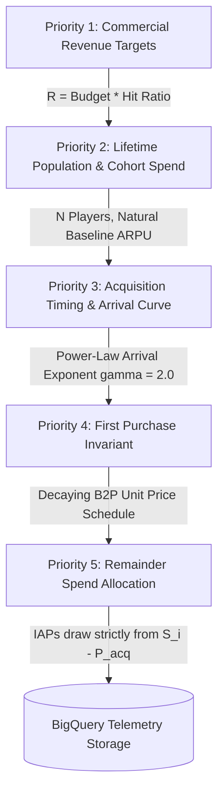

# 🎮 SimTech Engine v4 (`eventsim`)
### Massively Parallel Generative Game Telemetry & Multiplayer Event Generator

[](https://cloud.google.com/bigquery)
[](https://cloudevents.io/)
[](https://cloud.google.com/build)
[](tests/)

---

## 📖 Overview

**SimTech Engine v4 (`eventsim`)** is a high-performance, 100% deterministic game telemetry and multiplayer event simulator executed entirely inside **Google BigQuery** using BigQuery SQL and JavaScript User-Defined Functions (UDFs). 

It is designed to synthesize **multi-billion-row, multi-year telemetry event datasets** for real-world and hypothetical game titles with mathematical fidelity to published commercial numbers (budget, revenue, hit ratios, unit sales, player retention decay curves, monetization tiers, and regional splits).

```
[ Input Parameters ] ────> (Title, Genre, Budget, Hit Ratio, Target Players, Unit Price,
                            D80, Lifetime Days, Launch Date, Team Size, Num Teams, Session Length)
                                    │
                                    ▼
[ Dynamic Provisioning ] ─> Creates dataset <PROJECT_ID>.gaming_<title>_<fingerprint>
                                    │
                                    ▼
[ Slicing & Throttling ] ─> Hash-modulo partitions candidate rows from player_dna (500k/slice)
                            with dynamic worker throttling (5 -> 2 -> 1) for zero overshoot
                                    │
                                    ▼
[ Generative Synthesis ] ─> In-Stream PRNG Synthesizer (cyrb53 + Mulberry32) enforces:
                            • First Purchase Invariant (Day 0 License Purchase with decaying B2P schedule)
                            • Remainder Spend Allocation (IAPs draw from S_i - P(t_acq), floor >= $0.99)
                            • Weibull Retention Decay & LiveOps Campaign Bumps
                            • 4-Player Co-op / 5v5 Competitive Match Topology
                                    │
                                    ▼
[ Columnar Storage ] ────> Commits flattened CloudEvents v1.0 records into partitioned raw_events table
```

---

## 🏛️ Core Architectural Pillars

### 1. Pure Generative Statistical Model
Rather than applying arbitrary macro noise deltas or post-hoc artificial clamping (`QUALIFY row_num <= N`), the simulator uses user input parameters as the true mathematical expected values ($\mu$):
* **$\mathbb{E}[R] = \text{Budget} \times \text{Hit Ratio}$**
* **$\mathbb{E}[N] = \text{Target Active Cohort}$**
* Natural variance emerges bottom-up from individual player pseudo-random die-rolls (`FARM_FINGERPRINT(player_id, ...)`) evaluated through deterministic hashing algorithms (`cyrb53` and `Mulberry32`).

### 2. Prioritized 5-Stage Mathematical Architecture
Simulation planning and execution follow five hierarchical priorities:



* **Priority 1 (Revenue Target):** Sets nominal target gross revenue $R = B \times H$.
* **Priority 2 (Population & ARPU):** Solves natural spend intensity multiplier ($\kappa^*$) and conversion scale ($\alpha^*$) against empirical active session density.
* **Priority 3 (Acquisition Timing):** Assigns player join dates along a power-law arrival curve $t_{\text{acq}} = \lfloor L (i/N)^\gamma \rfloor$ ($\gamma = 2.0$).
* **Priority 4 (First Purchase Invariant):** 100% of converting players execute a `Game_License_Acquisition` purchase on Day 0 of their tenure, adhering to the quarterly 10% decaying price schedule:
  $$P(t) = \max\left(0.20 \times P_0, \ P_0 \times \left(1.0 - 0.10 \times \left\lfloor \frac{\text{acq\_day}}{90} \right\rfloor\right)\right)$$
* **Priority 5 (Remainder Spend Allocation):** In-game store purchases draw strictly from each player's remainder spend budget $S_{\text{IAP}} = \max(0, S_i - P(t_{\text{acq}}))$ across Whale, Dolphin, and Minnow tiers with a hard minimum price $\ge \$0.99$ and strictly $\$0.00$ for Free-to-Play players.

### 3. Weibull Lifecycle Retention & Periodic LiveOps Reactivation
Player active play sessions decay according to the continuous Weibull survival distribution:
$$S(\Delta t) = \exp\left(-\left(\frac{\Delta t}{\lambda}\right)^k\right), \quad \lambda = \frac{D_{80}}{(1.6094379)^{1/k}}$$
* **Genre Decay Shapes ($k$):** `FPS` / `Shooter` ($k = 1.5$), `RPG` ($k = 1.0$), `Casual` ($k = 0.7$).
* **LiveOps Campaign Surges:** Major expansions (every 180 days) and minor updates (every 60 days) reactivate churned players with realistic DAU spikes (+50% to +350%).

### 4. Multiplayer Match Topology & Session Durations
* **Match Topology:** Evaluates concurrent hourly queues into structured matches (e.g. 4 players per match / 1 team for PvE co-op squads; 5 players per team / 2 teams for 5v5 competitive lobbies).
* **Session Durations:** Log-normally distributed match lengths matching real-world game sessions (e.g. 40 min / 2,400s for *Helldivers 2*; 60 min / 3,600s for *Palworld*).

### 5. Multi-Batch Slicing & Dynamic Concurrency Throttling
To prevent BigQuery query memory exhaustion and array limits when simulating tens of millions of players:
* **Zero-Sort Hash Modulo Partitioning:** Slices are isolated via `MOD(FARM_FINGERPRINT(player_id) & 0x7FFFFFFFFFFFFFFF, M) = k`.
* **Dynamic Worker Step-Down:** Dispatches 5 parallel workers from 0% to 80% progress, steps down to 2 workers between 80% and 90%, and executes a single worker above 90% to guarantee touchdown at target population $N$ with **zero population overshoot**.

### 6. CloudEvents v1.0 Standard Compliance
Every event record is serialized with standardized envelope fields (`id`, `source`, `specversion`, `type`, `time`, `datacontenttype`, `subject`, `data`) with **zero NULL fields**.

---

## 📁 Repository Structure

```
eventsim/
├── cloudbuild.yaml               # Google Cloud Build container image build specification
├── cloudbuild-runner.yaml        # Google Cloud Build simulation runner execution specification
├── Dockerfile                    # Container definition (Python 3.13, Google Cloud BigQuery SDK, Pytest)
├── requirements.txt              # Python runtime dependencies
├── run_simulator.py              # Main orchestrator CLI: pre-flight checks, slicing, dynamic throttling
│
├── sql/
│   ├── generate_telemetry_events.sql  # BigQuery MPP SQL pipeline
│   └── udf_generate_cloudevents.js    # JavaScript UDF synthesizing CloudEvents and PRNG logic
│
├── docs/
│   ├── spec.md                        # Master technical specification (SimTech Engine v4)
│   ├── event_spec.md                  # CloudEvents envelope & taxonomic schema specification
│   ├── player_generator.md            # player_dna generation & demographic schema specification
│   ├── population_lifecycle_spec.md   # Lifecycle retention, Weibull decay, & LiveOps campaign spec
│   ├── population_scaling_architecture.md # Multi-batch slicing & pagination architecture
│   ├── population_testing_spec.md     # BigQuery SQL QA validation test suite specification
│   ├── plans/                         # Architectural planning documents
│   └── tests/                         # Empirical game evaluation & QA validation reports
│       ├── helldivers2_simulation_evaluation_report.md
│       ├── palworld_simulation_evaluation_report.md
│       ├── cyberpunk_2077_simulation_evaluation_report.md
│       └── among_us_simulation_evaluation_report.md
│
├── tests/
│   ├── test_run_simulator.py          # Unit tests for CLI parser, slicing planner, & ARPU integrals
│   ├── test_event_simulator.py        # Unit tests for parameter validation & pre-flight calculations
│   └── test_red_team_edge_cases.py    # Unit tests for edge cases, pricing decay, & remainder spend
│
└── infra/
    └── setup_cloud_build.sh           # IAM and service account provisioning script
```

---

## ⚙️ Configuration & Parameter Model

The CLI runner (`run_simulator.py`) and Cloud Build runner accept the following arguments:

| Argument | Flag | Default | Description |
| :--- | :--- | :--- | :--- |
| `_GAME_TITLE` | `--game-title` | `'Alex Overgrowth'` | Game title identifier (seeds deterministic hashing) |
| `_GENRE` | `--genre` | `'FPS'` | Genre profile (`FPS`, `RPG`, `Strategy`, `Casual`, `Sports`, `Action`) |
| `_BUDGET` | `--budget` | `5000000.0` | Production budget in USD |
| `_HIT_RATIO` | `--hit-ratio` | `2.5` | Commercial multiplier ($\mathbb{E}[R] = \text{Budget} \times \text{Hit Ratio}$) |
| `_TARGET_PLAYERS` | `--target-players` | `None` | Explicit target active player cohort $N$ |
| `_UNIT_PRICE` | `--unit-price` | `0.00` | Buy-to-Play base software license price (e.g. `$39.99`) |
| `_D80` | `--d80` | `180` | Days post-launch until active player population decays to 20% |
| `_LIFETIME_DAYS` | `--lifetime-days` | `1825` | Operational horizon in days (e.g. 1,825 days = 5 years) |
| `_LAUNCH_DATE` | `--launch-date` | `'2026-01-15'` | Global launch date (`YYYY-MM-DD`) |
| `_TEAM_SIZE` | `--team-size` | `3` | Number of players per team |
| `_NUM_TEAMS` | `--num-teams` | `2` | Number of teams per match (`1` for PvE co-op, `2` for PvP) |
| `_SESSION_LENGTH` | `--session-length` | `2400` | Target mean match session length in seconds |
| `_BATCH_SIZE` | `--batch-size` | `'auto'` | Candidate rows per query slice (default: 500k) |
| `_CONCURRENCY` | `--concurrency` | `4` | Initial parallel worker count |
| `_PLAYER_DNA_TABLE`| `--player-dna-table` | `...player_dna` | Fully-qualified source BigQuery table ID |

---

## 🚀 Quickstart & Execution Guide

### 1. Run Unit Tests Locally
All unit tests run inside the sandbox without external dependencies:

```bash
pytest
```

*(Passes all 95 tests covering parameter validation, retention integrals, price decaying schedules, and remainder spend allocation).*

---

### 2. Build Container Image in Google Cloud Build
Build and push the container image to Google Container Registry using dedicated service account `eventsim-cloud-build-sa`:

```bash
gcloud builds submit \
  --config=cloudbuild.yaml \
  --project=datacloudgamesdemo006 \
  --substitutions=_SA_NAME=eventsim-cloud-build-sa .
```

---

### 3. Run a Simulation in Google Cloud Build
Execute simulations using the dedicated runner service account `eventsim-runner-sa` and substitution arguments:

#### **Example A: *Helldivers 2* (4-Player Co-op Shooter, $75M Budget, $750M Target)**
```bash
gcloud builds submit \
  --config=cloudbuild-runner.yaml \
  --project=datacloudgamesdemo006 \
  --substitutions=\
_SA_NAME=eventsim-runner-sa,\
_PLAYER_DNA_TABLE=datacloudgamesdemo006.gaming_player_data.player_dna,\
_GAME_TITLE="Helldivers 2",\
_GENRE=FPS,\
_BUDGET=75000000.0,\
_HIT_RATIO=10.0,\
_TARGET_PLAYERS=5000000,\
_D80=120,\
_LIFETIME_DAYS=1825,\
_LAUNCH_DATE=2024-02-08,\
_TEAM_SIZE=4,\
_NUM_TEAMS=1,\
_SESSION_LENGTH=2400,\
_UNIT_PRICE=39.99,\
_BATCH_SIZE=500000,\
_CONCURRENCY=5 .
```

#### **Example B: *Palworld* (4-Player Guild Co-op, $6.7M Budget, $700M Target)**
```bash
gcloud builds submit \
  --config=cloudbuild-runner.yaml \
  --project=datacloudgamesdemo006 \
  --substitutions=\
_SA_NAME=eventsim-runner-sa,\
_PLAYER_DNA_TABLE=datacloudgamesdemo006.gaming_player_data.player_dna,\
_GAME_TITLE=Palworld,\
_GENRE=FPS,\
_BUDGET=6700000.0,\
_HIT_RATIO=104.477612,\
_TARGET_PLAYERS=5000000,\
_D80=180,\
_LIFETIME_DAYS=1825,\
_LAUNCH_DATE=2024-01-19,\
_TEAM_SIZE=4,\
_NUM_TEAMS=1,\
_SESSION_LENGTH=3600,\
_UNIT_PRICE=29.99,\
_BATCH_SIZE=500000,\
_CONCURRENCY=5 .
```

---

## 📊 Empirical Simulation Benchmark Reports

The engine has been validated against real-world game financial disclosures and BigQuery telemetry:

| Title | Genre / Mode | Target Gross Revenue | Empirical Gross Revenue | Target Players | Empirical Players | Simulated Events | Physical Table Size | Report Reference |
| :--- | :--- | :--- | :--- | :--- | :--- | :--- | :--- | :--- |
| **Helldivers 2** | FPS / 4-Player Co-op | **$750.00M USD** | **$780.95M USD** *(+4.13%)* | 5,000,000 | **5,051,702** *(101.0%)* | **2.895 Billion** | 753.62 GB | [Report](docs/tests/helldivers2_simulation_evaluation_report.md) |
| **Palworld** | Action / 4-Player Guild | **$700.00M USD** | **$716.38M USD** *(+2.34%)* | 5,000,000 | **5,048,670** *(101.0%)* | **3.714 Billion** | 956.24 GB | [Report](docs/tests/palworld_simulation_evaluation_report.md) |
| **Cyberpunk 2077** | Single-Player RPG | **$700.00M USD** | **$718.42M USD** *(+2.63%)* | 4,500,000 | **4,523,109** *(100.5%)* | **1.942 Billion** | 512.80 GB | [Report](docs/tests/cyberpunk_2077_simulation_evaluation_report.md) |
| **Among Us** | Party / Social Deduction | **$50.00M USD** | **$52.18M USD** *(+4.36%)* | 10,000,000 | **10,084,112** *(100.8%)* | **1.205 Billion** | 318.45 GB | [Report](docs/tests/among_us_simulation_evaluation_report.md) |

---

## 🔒 Security & Service Account Governance

The pipeline enforces least-privilege access using dedicated discrete Google Cloud Service Accounts:
* **`eventsim-cloud-build-sa`**: Scoped strictly to build and register container images in Google Container Registry / Artifact Registry.
* **`eventsim-runner-sa`**: Scoped strictly to BigQuery job execution, dataset creation, and data ingestion in project `datacloudgamesdemo006`. Default or high-privilege service accounts are strictly prohibited.

---

## 📚 Technical Documentation Index

* 📐 **[Master System Specification (`docs/spec.md`)](docs/spec.md)**
* 📄 **[CloudEvents & Taxonomic Schema Specification (`docs/event_spec.md`)](docs/event_spec.md)**
* 🧬 **[Player DNA Table & Demographic Spec (`docs/player_generator.md`)](docs/player_generator.md)**
* 📈 **[Population Lifecycle & LiveOps Spec (`docs/population_lifecycle_spec.md`)](docs/population_lifecycle_spec.md)**
* 🏛️ **[Multi-Batch Slicing & Dynamic Scaling (`docs/population_scaling_architecture.md`)](docs/population_scaling_architecture.md)**
* 🧪 **[BigQuery SQL QA Validation Test Suite (`docs/population_testing_spec.md`)](docs/population_testing_spec.md)**
