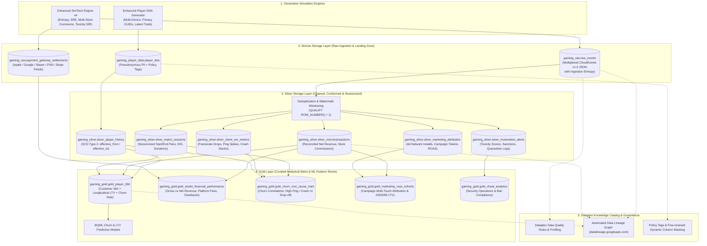

# 🎮 SimTech Engine v4 (`eventsim`)
### Massively Parallel Generative Game Telemetry & Event Simulator

[](https://cloud.google.com/bigquery)
[](https://cloudevents.io/)
[](https://cloud.google.com/build)
[](tests/)

---

## 🎯 Architectural Boundary & Repository Scope

> [!IMPORTANT]
> **Core Repository Boundary**:
> * **What this repository DOES**: `eventsim` is strictly responsible for generating synthetic game telemetry events (multiplexed CloudEvents v1.0 streams in `raw_events`) and local simulation parameters (such as `sku_catalog` definitions).
> * **Upstream Player Profiles (`player_dna`)**: This repository is **NOT** responsible for generating or managing `player_dna`. A **separate, dedicated upstream generator program** creates `player_dna`. `eventsim` strictly consumes `player_dna` as a read-only input dataset.
> * **Format Adherence**: `eventsim` guarantees 100% adherence to schema formats, field types, and CloudEvents specifications expected by downstream consumers.
> * **Downstream Medallion & Governance Exclusions**: This repository is **NOT** responsible for deploying, executing, managing, or setting up downstream Medallion data pipelines (`gaming_silver.*`, `gaming_gold.*`), analytical data marts, Google Cloud Dataplex, Knowledge Catalog taxonomies, policy tags, dynamic column masking rules, or automated Data Quality scans. All setup and operational responsibility for the Medallion architecture and data governance belong exclusively to downstream projects.

---

## 📖 Overview

**SimTech Engine v4 (`eventsim`)** is an enterprise-grade, 100% deterministic game telemetry and multiplayer simulator executed entirely inside **Google BigQuery** using BigQuery SQL and JavaScript User-Defined Functions (UDFs).

It synthesizes **multi-billion-row, multi-year raw telemetry event streams** formatted for downstream Lakehouse architectures with controlled ingestion entropy, multi-store digital commerce, client SRE metrics, marketing attribution, toxicity contagion, hybrid anomaly injection (HARE), dynamic schema evolution (`dataschema` semantic versioning), and a centralized ground-truth simulation parameters & provenance registry.



---

## 🏛️ Core Architectural Pillars

### 1. Pure Generative Statistical Model
User input parameters act as true mathematical expected values ($\mu$):
* $\mathbb{E}[R] = \text{Budget} \times \text{Hit Ratio}$
* $\mathbb{E}[N] = \text{Target Active Cohort}$
* Bottom-up variance emerges from deterministic hashing (`FARM_FINGERPRINT`, `cyrb53`, and `Mulberry32`).

### 2. Prioritized 5-Stage Mathematical Architecture
1. **Priority 1 (Revenue Target):** Sets nominal target gross revenue $R = B \times H$.
2. **Priority 2 (Population & ARPU):** Solves natural spend multiplier ($\kappa^*$) and conversion scale ($\alpha^*$).
3. **Priority 3 (Acquisition Timing):** Assigns join dates along a power-law arrival curve $t_{\text{acq}} = \lfloor L (i/N)^\gamma \rfloor$.
4. **Priority 4 (First Purchase Invariant):** 100% of converting players execute a `Game_License_Acquisition` on Day 0 adhering to the quarterly 10% decaying price schedule:
   $$P(t) = \max\left(0.20 \times P_0, \ P_0 \times \left(1.0 - 0.10 \times \left\lfloor \frac{\text{acq\_day}}{90} \right\rfloor\right)\right)$$
5. **Priority 5 (Remainder Spend Allocation):** In-game IAPs draw strictly from remainder spend budget $S_{\text{IAP}} = \max(0, S_i - P(t_{\text{acq}}))$ with a minimum price $\ge \$0.99$ and strictly $\$0.00$ for Free-to-Play.

### 3. 5-Layer High-Performance Optimization Stack
* **Layer 1:** BigQuery SQL Columnar Clustering Pushdown (`CLUSTER BY region, platform` - skips 80% scan IO).
* **Layer 2:** UDF Spatial Blast Radius Check (1 check per player, 95% fast path).
* **Layer 3:** Sparse Session Day Jumping (Weibull geometric inter-arrivals skip inactive days).
* **Layer 4:** Timeline Interval / Phase Chunking (Pre/During/Post anomaly intervals).
* **Layer 5:** Catastrophic Churn & Early Exit (aborts future loops for churned/banned players).

### 4. Controlled Ingestion Entropy & Anomaly Injection
* **Duplicate Retries ($P_{\text{dup}} = 0.015$):** Emits duplicate CloudEvents with identical IDs to validate Silver deduplication (`QUALIFY ROW_NUMBER() = 1`).
* **Late Arrivals ($P_{\text{late}} = 0.030$):** $6\text{h}–72\text{h}$ delayed timestamps to test partition watermark merges.
* **Dirty Sentinels ($P_{\text{dirty}} = 0.005$):** Corrupted values to trigger Dataplex Data Quality rule scans.

### 5. Multi-Store Digital Commerce & Dispute Cascades
* **Storefront Matrix:** Models commissions and settlement cycles across Apple (30%/15%), Google (15%/30%), Steam (30%/25%/20%), PSN (30%), and Direct Web ($2.9\% + \$0.30$).
* **Hierarchical 2-Level Chargeback Pruning:** Level 1 boolean `has_chargeback_risk` ($0.6\%$ filter); Level 2 purchase threshold $\ge \$10.00$.
* **Dispute Resolution Paths:** Path A (Fraudster Ghost 35%), Path B (Angry Churner 50%), Path C (Debt Repayment 15% via `commerce.debt_repayment.settled`).
* **Payment Gateway Settlement Feeds (`sql/generate_payment_settlements.sql`):** Synthesizes asynchronous third-party banking settlement payout feeds into `gaming_raw.payment_gateway_settlements` with Net 2 to Net 45 day cycle horizons, chargeback clawbacks, and $15 Stripe bank penalty fee modeling.

### 6. Multi-Modal Telemetry & Toxicity SIR Dynamics
* **SRE Performance:** Emits `sre.client.performance_tick` for Root-Cause Churn analysis in Gold.
* **Marketing Attribution:** Emits `marketing.attribution.install` for D30/D90 Cohort ROAS.
* **Toxicity Contagion SIR:** Teammates of toxic players suffer a tilt surge ($+0.40(1-R_j)$), $35\%$ propagation chance, and collateral churn ($\lambda_{\text{churn}} \times 3.5$). Strike 3 triggers a 7-day quarantine mute cutting transmission to 0.0.

### 7. Slowly Changing Dimensions (SCD Type 2) & Privacy Compliance
* **Demographic History (`silver_player_history`):** Point-in-time tracking for monetization tier promotions ($F2P \to Minnow \to Dolphin \to Whale$ at $\$50$ and $\$500$), skill ranks, and sanctions.
* **Privacy Bridge-Burning:** Post-churn 30-day purge (`privacy.compliance.erasure_requested`) destroys PII links while preserving historical facts and co-op topology in Bronze.

### 8. Hybrid Anomaly Resolution Engine (HARE)
* **Strict User Precedence:** User-specified anomaly scenarios (`--user-anomalies`, JSON array or file) deterministically anchor the execution timeline with zero perturbations to predefined dates, blast radii, and durations.
* **Temporal Non-Interference Exclusion Buffers:** Dynamically generated stochastic anomalies are strictly prohibited within $[t_{\text{start}} - W, \ t_{\text{end}} + W]$ (buffer $W = 14$ days by default) of any user-defined anomaly, preventing interference with controlled test windows.
* **Annual Capacity & Saturation Guard:** Dynamic anomaly capacity is capped at $\lfloor R_{\text{dyn}} \times (T / 365) \rfloor$. When user scenarios meet or exceed capacity, dynamic sampling gracefully halts.
* **Deterministic PRNG Sampling:** Samples anomaly categories (`INFRASTRUCTURE_OUTAGE`, `PAYMENT_GATEWAY_DEGRADATION`, `LATENCY_SPIKE`, `ECONOMY_EXPLOIT`), blast radius, and perturbations deterministically from game title fingerprint.

### 9. Dynamic Schema Evolution & Semantic Versioning
* **Staged Client Rollouts:** Models progressive client patch adoption over 3–5 day migration windows across multi-year lifecycles, reflecting realistic gradual client fleet updates.
* **Semantic Versioning via CloudEvents `dataschema`:** Emits versioned schema URIs (`/schemas/v1.0.0`, `/schemas/v1.1.0`, `/schemas/v2.0.0`) tracking field renames (e.g. `ping_ms` $\to$ `latency_rtt_ms`), nested telemetry objects, and new gameplay signals.
* **100% Cross-Slice Determinism:** Evaluates closed-form schema states derived strictly from game seed and calendar day offset, ensuring parallel BigQuery slices agree on active schemas without inter-query state.
* **Lobby Instance Coherence:** Synchronizes all teammates and opponents in a match instance to emit compatible schema versions.

### 10. Simulation Parameters Registry & Ground-Truth Provenance Engine
* **Immutable Registry Table (`gaming_player_data.simulation_parameters`):** Partitioned by date and clustered by simulator name and validation status to provide centralized ground truth for Lakehouse testing.
* **Read Mode (Dynamic Ingestion & Replay):** Automatically reads upstream Player DNA ground truth (`v_latest_simulation_parameters`), verifies candidate pool feasibility, and enables bitwise exact simulation replay (`--from-run-id=<UUID>`).
* **Write Mode (Lineage & Empirical Metrics):** Automatically logs execution durations, target table metadata, typed metric evaluation arrays (`metrics`), and native `empirical_results` JSON upon run completion.
* **Zero-Tolerance Mathematical Invariants:** Evaluates structural invariants (CloudEvents GUID compliance, ISO-8601 timestamps, non-negative revenues) with strict zero tolerance (`invariants_verified = TRUE`, status: `PASSED`, `WARNING`, `FAILED`).
* **Automated ASCII Diagnostics:** Generates and displays comprehensive post-run telemetry diagnostics tables detailing expected targets, observed values, deltas, and tolerance status.

---

## 📁 Repository Structure

```
eventsim/
├── cloudbuild.yaml                    # Cloud Build container compilation & test specification
├── cloudbuild-runner.yaml             # Cloud Build simulation runner execution specification
├── Dockerfile                         # Container definition (Python 3.13, Google Cloud BigQuery SDK)
├── requirements.txt                   # Python runtime dependencies
├── run_simulator.py                   # Main orchestrator CLI: pre-flight checks, slicing, dynamic throttling
├── simulation_registry.py             # Ground-truth registry module: evaluation, lineage logging, ASCII reports
│
├── sql/
│   ├── generate_telemetry_events.sql  # BigQuery MPP SQL pipeline
│   ├── generate_payment_settlements.sql # Standalone BigQuery SQL batch settlement generator
│   ├── create_simulation_parameters_table.sql # DDL for simulation_parameters registry & helper views
│   ├── validate_eventsim_empirical.sql # Empirical diagnostics & invariant validation query suite
│   ├── medallion_silver_views.sql     # Silver Medallion conformance and deduplication views
│   ├── medallion_gold_marts.sql       # Gold analytical marts and BQML feature stores
│   ├── verify_medallion_pipeline.sql  # 13-point BigQuery verification suite
│   └── udf_generate_cloudevents.js    # JavaScript UDF synthesizing CloudEvents and PRNG logic
│
├── docs/
│   ├── spec.md                        # Master technical specification (SimTech Engine v4)
│   ├── event_spec.md                  # CloudEvents envelope & taxonomic schema specification
│   ├── hybrid_anomaly_simulation_spec.md # HARE hybrid anomaly simulation specification
│   ├── schema_evolution_spec.md       # Dynamic schema evolution & semantic versioning spec
│   ├── eventsim_simulation_parameters_spec.md # Ground-truth registry & provenance engine spec
│   ├── player_generator.md            # player_dna generation & multi-device demographic specification
│   ├── population_lifecycle_spec.md   # Lifecycle retention, Weibull decay, & LiveOps campaign spec
│   ├── population_testing_spec.md     # Medallion lakehouse QA validation test suite specification
│   ├── population_scaling_architecture.md # Multi-batch slicing & pagination architecture
│   ├── plans/                         # Architectural planning & design documents
│   │   ├── eventsim_generator_enhancement_plan.md
│   │   ├── hybrid_anomaly_simulation_plan.md
│   │   ├── schema_evolution_enhancement_plan.md
│   │   └── eventsim_simulation_parameters_plan.md
│   ├── downstream/                    # Downstream integration specifications
│   │   └── eventsim-generator-enhancement-spec.md
│   └── tests/                         # Empirical game evaluation & QA validation reports
│       ├── helldivers2_simulation_evaluation_report.md
│       ├── palworld_simulation_evaluation_report.md
│       ├── cyberpunk_2077_simulation_evaluation_report.md
│       └── among_us_simulation_evaluation_report.md
│
├── tests/
│   ├── test_dataplex_dq_rules.py      # Unit tests for Dataplex Data Quality rules & dirty sentinels
│   ├── test_payment_settlements.py    # Unit tests for payment gateway settlements & fee matrices
│   ├── test_run_simulator.py          # Unit tests for CLI parser, slicing planner, & ARPU integrals
│   ├── test_event_simulator.py        # Unit tests for parameter validation & pre-flight calculations
│   ├── test_red_team_edge_cases.py    # Unit tests for edge cases, pricing decay, & remainder spend
│   ├── test_simulation_registry.py    # Unit tests for metrics evaluation, strict invariants, & lineage
│   └── scenarios/                     # Reference test scenario fixtures (HARE DSL JSONs)
│       └── hare_test_scenario.json
│
└── infra/
    ├── dataplex_dq_rules.yaml         # Declarative Dataplex Auto Data Quality scan specifications
    ├── deploy_dataplex_scans.sh       # Dataplex DQ scans provisioning & deployment script
    └── setup_cloud_build.sh           # IAM and discrete service account provisioning script
```

---

## ⚙️ Configuration & Parameter Model

The CLI runner (`run_simulator.py`) and Cloud Build triggers accept the following arguments:

### Core Simulation Parameters
| Cloud Build Variable | CLI Flag | Default | Description |
| :--- | :--- | :--- | :--- |
| `_GAME_TITLE` | `--game-title` | `'Strike Force 2026'` | Game title identifier (seeds deterministic hashing) |
| `_INPUT_BUILD_VERSION` | `--build-version` | `'v1.4.2'` | Client build version string |
| `_GENRE` | `--genre` | `'RPG'` | Genre profile (`FPS`, `RPG`, `Strategy`, `Casual`, `Sports`, `Action`) |
| `_BUDGET` | `--budget` | `10000000.0` | Production budget in USD |
| `_HIT_RATIO` | `--hit-ratio` | `2.5` | Commercial multiplier ($\mathbb{E}[R] = \text{Budget} \times \text{Hit Ratio}$) |
| `_TARGET_PLAYERS` | `--target-players` | `None` | Explicit target active player cohort $N$ (overrides ARPU calculation) |
| `_CANDIDATE_POOL_SIZE` | `--candidate-pool-size` | `8744842` | Available candidate pool genre candidate count $M$ |
| `_UNIT_PRICE` | `--unit-price` | `0.00` | Buy-to-Play base software license price (e.g. `$39.99`, `$0.00` for F2P) |
| `_D80` | `--d80` | `180` | Days post-launch until active player population decays to 20% |
| `_LIFETIME_DAYS` | `--lifetime-days` | `1825` | Operational horizon in days (e.g. 1,825 days = 5 years) |
| `_LAUNCH_DATE` | `--launch-date` | `'2026-07-19'` | Global launch date (`YYYY-MM-DD`) |
| `_TEAM_SIZE` | `--team-size` | `5` | Number of players per team |
| `_NUM_TEAMS` | `--num-teams` | `2` | Number of teams per match (`1` for PvE co-op, `2` for PvP) |
| `_SESSION_LENGTH` | `--session-length` | `2700` | Target mean match session length in seconds |
| `_BATCH_SIZE` | `--batch-size` | `'auto'` | Candidate rows per query slice (default: `'auto'` ~500k) |
| `_CONCURRENCY` | `--concurrency` | `4` | Simultaneous BigQuery parallel query slices |
| `_PLAYER_DNA_TABLE` | `--player-dna-table` | `...player_dna` | Fully-qualified source BigQuery Player DNA table ID |

### Telemetry Stream & Ingestion Entropy Flags
| Cloud Build Variable | CLI Flag | Default | Description |
| :--- | :--- | :--- | :--- |
| `_ENABLE_ENTROPY` | `--enable-entropy` | `true` | Toggles controlled network & ingestion entropy |
| `_ENTROPY_DUP_RATE` | `--entropy-duplicate-rate` | `0.015` | Probability of at-least-once duplicate events ($P_{\text{dup}}$) |
| `_ENTROPY_LATE_RATE` | `--entropy-late-arrival-rate` | `0.030` | Probability of late-arriving telemetry ($P_{\text{late}}$) |
| `_ENTROPY_DIRTY_RATE` | `--entropy-dirty-data-rate` | `0.005` | Probability of corrupted payload sentinels ($P_{\text{dirty}}$) |
| `_ENABLE_COMMERCE` | `--enable-multi-store-commerce` | `true` | Toggles multi-store fee matrices & chargebacks |
| `_ENABLE_SRE` | `--enable-sre-telemetry` | `true` | Toggles client SRE performance ticks & crash dumps |
| `_ENABLE_ATTRIBUTION` | `--enable-marketing-attribution` | `true` | Toggles marketing UA install attribution |
| `_ENABLE_PRIVACY` | `--enable-privacy-tombstones` | `true` | Toggles post-churn GDPR/CCPA erasure tombstones |
| `_ENABLE_MULTI_DEVICE` | `--enable-multi-device-profiles` | `true` | Toggles multi-device hardware ownership profiles |

### Dynamic Schema Evolution Flags
| Cloud Build Variable | CLI Flag | Default | Description |
| :--- | :--- | :--- | :--- |
| — | `--enable-schema-evolution` | `true` | Toggles dynamic game patch schema evolution and semantic versioning |
| — | `--schema-evolve-major-prob` | `0.60` | Probability of schema evolution at each 60-day major update |
| — | `--schema-evolve-minor-prob` | `0.20` | Probability of schema evolution at each 30-day minor update |

### Hybrid Anomaly Simulation Engine (HARE) Flags
| Cloud Build Variable | CLI Flag | Default | Description |
| :--- | :--- | :--- | :--- |
| `_USER_ANOMALIES` | `--user-anomalies` | `None` | Path to JSON file or raw JSON array of user-specified anomaly scenarios |
| `_ENABLE_DYNAMIC_ANOMALIES` | `--enable-dynamic-anomalies` | `true` | Toggles dynamic stochastic anomaly generation across timeline |
| `_DYNAMIC_ANOMALY_RATE` | `--dynamic-anomaly-rate` | `1.0` | Nominal dynamic anomaly generation rate per 365 operational days |
| `_ANOMALY_EXCLUSION_WINDOW_DAYS` | `--anomaly-exclusion-window-days` | `14` | Temporal exclusion buffer in days around user anomalies |

### Simulation Parameters Registry & Provenance Flags
| Cloud Build Variable | CLI Flag | Default | Description |
| :--- | :--- | :--- | :--- |
| — | `--record-metadata` | `true` | Record simulation provenance and empirical metrics to BigQuery registry |
| — | `--metadata-table` | `'gaming_player_data.simulation_parameters'` | Fully qualified table ID for the simulation registry |
| — | `--from-run-id` | `None` | Replay previous simulation run by UUIDv4 run ID |
| — | `--tags` | `None` | Comma-separated searchable tags (e.g. `ci,v4.0,release_candidate`) |
| — | `--skip-empirical-report` | `false` | Suppress printing ASCII empirical report to stdout |

### Execution Control Flags
| Flag | Default | Description |
| :--- | :--- | :--- |
| `--yes`, `-y`, `--auto-approve` | `false` | Skip pre-flight execution confirmation prompt and auto-approve execution |
| `--dry-run` | `false` | Perform dry-run BigQuery validation without executing or billing |
| `--force`, `-f` | `false` | Skip pre-flight population feasibility checks and force execution |

---

## 🚀 Quickstart & Execution Guide

### 1. Run Unit Tests Locally
```bash
pytest
```
*(Passes all **202 tests** covering parameter validation, retention integrals, price decay schedules, remainder spend, entropy limits, HARE hybrid anomaly scheduling, dynamic schema evolution, and the simulation parameters registry).*

---

### 2. Build Container Image in Google Cloud Build
Build and push the container image to Google Container Registry using dedicated service account `eventsim-cloud-build-sa`:

```bash
gcloud builds submit \
  --config=cloudbuild.yaml \
  --project=datacloudgamesdemo006 \
  --substitutions=_SA_NAME=eventsim-cloud-build-sa .
```

---

### 3. Run a Simulation in Google Cloud Build
Execute simulations using dedicated runner service account `eventsim-runner-sa`:

#### **Example A: *Tactical Strike Ops* (4-Player Co-op Shooter with Entropy & Multi-Store Commerce)**
```bash
gcloud builds submit \
  --config=cloudbuild-runner.yaml \
  --project=datacloudgamesdemo006 \
  --substitutions=\
_SA_NAME=eventsim-runner-sa,\
_PLAYER_DNA_TABLE=datacloudgamesdemo006.gaming_player_data.player_dna,\
_GAME_TITLE="Tactical Strike Ops",\
_GENRE=FPS,\
_BUDGET=50000000.0,\
_HIT_RATIO=3.0,\
_TARGET_PLAYERS=2000000,\
_D80=180,\
_LIFETIME_DAYS=1095,\
_LAUNCH_DATE=2026-01-15,\
_TEAM_SIZE=4,\
_NUM_TEAMS=1,\
_SESSION_LENGTH=2400,\
_UNIT_PRICE=39.99,\
_BATCH_SIZE=500000,\
_CONCURRENCY=5 .
```

#### **Example B: *Helldivers 2* (4-Player Co-op Shooter, $75M Budget, $750M Target)**
```bash
gcloud builds submit \
  --config=cloudbuild-runner.yaml \
  --project=datacloudgamesdemo006 \
  --substitutions=\
_SA_NAME=eventsim-runner-sa,\
_PLAYER_DNA_TABLE=datacloudgamesdemo006.gaming_player_data.player_dna,\
_GAME_TITLE="Helldivers 2",\
_GENRE=FPS,\
_BUDGET=75000000.0,\
_HIT_RATIO=10.0,\
_TARGET_PLAYERS=5000000,\
_D80=120,\
_LIFETIME_DAYS=1825,\
_LAUNCH_DATE=2024-02-08,\
_TEAM_SIZE=4,\
_NUM_TEAMS=1,\
_SESSION_LENGTH=2400,\
_UNIT_PRICE=39.99,\
_BATCH_SIZE=500000,\
_CONCURRENCY=5 .
```

#### **Example C: *Apex Overdrive* (with HARE User Anomalies & Dynamic Stochastic Scheduling)**
```bash
gcloud builds submit \
  --config=cloudbuild-runner.yaml \
  --project=datacloudgamesdemo006 \
  --substitutions=\
_SA_NAME=eventsim-runner-sa,\
_PLAYER_DNA_TABLE=datacloudgamesdemo006.gaming_player_data.player_dna,\
_GAME_TITLE="Apex Overdrive",\
_GENRE=FPS,\
_BUDGET=25000000.0,\
_HIT_RATIO=4.0,\
_TARGET_PLAYERS=3000000,\
_D80=180,\
_LIFETIME_DAYS=1825,\
_LAUNCH_DATE=2026-03-01,\
_TEAM_SIZE=3,\
_NUM_TEAMS=2,\
_SESSION_LENGTH=1800,\
_UNIT_PRICE=0.0,\
_USER_ANOMALIES="tests/scenarios/hare_test_scenario.json",\
_ENABLE_DYNAMIC_ANOMALIES=true,\
_DYNAMIC_ANOMALY_RATE=1.0,\
_ANOMALY_EXCLUSION_WINDOW_DAYS=14,\
_BATCH_SIZE=500000,\
_CONCURRENCY=4 .
```

#### **Example D: Simulation Replay from Historical Run ID**
Replays an exact prior simulation run by fetching its parameter configuration from `gaming_player_data.simulation_parameters`:
```bash
python3 run_simulator.py \
  --project-id=datacloudgamesdemo006 \
  --from-run-id=550e8400-e29b-41d4-a716-446655440000 \
  --metadata-table=gaming_player_data.simulation_parameters \
  --tags=replay,ci_regression \
  --yes
```

---

## 📊 Empirical Simulation Benchmark Reports

| Title | Genre / Mode | Target Gross Revenue | Empirical Gross Revenue | Target Players | Empirical Players | Simulated Events | Physical Table Size | Report Reference |
| :--- | :--- | :--- | :--- | :--- | :--- | :--- | :--- | :--- |
| **Helldivers 2** | FPS / 4-Player Co-op | **$750.00M USD** | **$780.95M USD** *(+4.13%)* | 5,000,000 | **5,051,702** *(101.0%)* | **2.895 Billion** | 753.62 GB | [`docs/tests/helldivers2_simulation_evaluation_report.md`](docs/tests/helldivers2_simulation_evaluation_report.md) |
| **Palworld** | Action / 4-Player Guild | **$700.00M USD** | **$716.38M USD** *(+2.34%)* | 5,000,000 | **5,048,670** *(101.0%)* | **3.714 Billion** | 956.24 GB | [`docs/tests/palworld_simulation_evaluation_report.md`](docs/tests/palworld_simulation_evaluation_report.md) |
| **Cyberpunk 2077** | Single-Player RPG | **$700.00M USD** | **$718.42M USD** *(+2.63%)* | 4,500,000 | **4,523,109** *(100.5%)* | **1.942 Billion** | 512.80 GB | [`docs/tests/cyberpunk_2077_simulation_evaluation_report.md`](docs/tests/cyberpunk_2077_simulation_evaluation_report.md) |
| **Among Us** | Party / Social Deduction | **$50.00M USD** | **$52.18M USD** *(+4.36%)* | 10,000,000 | **10,084,112** *(100.8%)* | **1.205 Billion** | 318.45 GB | [`docs/tests/among_us_simulation_evaluation_report.md`](docs/tests/among_us_simulation_evaluation_report.md) |

---

## 🔒 Security & Service Account Governance

The pipeline enforces least-privilege security using discrete Google Cloud Service Accounts:
* **`eventsim-cloud-build-sa`**: Scoped strictly to compile container layers and push images to Google Container Registry.
* **`eventsim-runner-sa`**: Scoped strictly to BigQuery job execution, dataset creation, and data ingestion in project `datacloudgamesdemo006`. Default high-privilege service accounts are strictly prohibited.

---

## 📚 Technical Documentation Index

* 📐 **[Master System Specification (`docs/spec.md`)](docs/spec.md)**
* 📄 **[CloudEvents & Taxonomic Schema Specification (`docs/event_spec.md`)](docs/event_spec.md)**
* 🧬 **[Player DNA Table & Multi-Device Spec (`docs/player_generator.md`)](docs/player_generator.md)**
* 📈 **[Population Lifecycle & LiveOps Spec (`docs/population_lifecycle_spec.md`)](docs/population_lifecycle_spec.md)**
* 🏛️ **[Multi-Batch Slicing & Dynamic Scaling (`docs/population_scaling_architecture.md`)](docs/population_scaling_architecture.md)**
* 🧪 **[Medallion Lakehouse QA Validation Test Suite (`docs/population_testing_spec.md`)](docs/population_testing_spec.md)**
* ⚡ **[Hybrid Anomaly Simulation Engine Spec (`docs/hybrid_anomaly_simulation_spec.md`)](docs/hybrid_anomaly_simulation_spec.md)**
* 🔄 **[Dynamic Schema Evolution & Semantic Versioning Spec (`docs/schema_evolution_spec.md`)](docs/schema_evolution_spec.md)**
* 📊 **[Simulation Parameters & Ground-Truth Registry Spec (`docs/eventsim_simulation_parameters_spec.md`)](docs/eventsim_simulation_parameters_spec.md)**
* 📑 **[Simulation Parameters Cross-System Spec (`docs/simulation_parameters_spec.md`)](docs/simulation_parameters_spec.md)**
* 📋 **[Master Hybrid Anomaly Simulation Plan (`docs/plans/hybrid_anomaly_simulation_plan.md`)](docs/plans/hybrid_anomaly_simulation_plan.md)**
* 📋 **[Master Schema Evolution Plan (`docs/plans/schema_evolution_enhancement_plan.md`)](docs/plans/schema_evolution_enhancement_plan.md)**
* 📋 **[Master Simulation Parameters Registry Plan (`docs/plans/eventsim_simulation_parameters_plan.md`)](docs/plans/eventsim_simulation_parameters_plan.md)**
* 📋 **[Master Telemetry Generator Plan (`docs/plans/eventsim_generator_enhancement_plan.md`)](docs/plans/eventsim_generator_enhancement_plan.md)**
* 📋 **[Formulaic Population Lifecycle Plan (`docs/plans/formulaic_population_lifecycle_plan.md`)](docs/plans/formulaic_population_lifecycle_plan.md)**
* 📋 **[LiveOps Population Bumps Plan (`docs/plans/liveops_population_bumps_plan.md`)](docs/plans/liveops_population_bumps_plan.md)**
* 📋 **[Revenue Constraint Calibration Plan (`docs/plans/revenue_constraint_calibration_plan.md`)](docs/plans/revenue_constraint_calibration_plan.md)**
* 📋 **[SKU Catalog Simulation Plan (`docs/plans/sku_catalog_simulation_plan.md`)](docs/plans/sku_catalog_simulation_plan.md)**
* 🔬 **[Downstream Telemetry Architecture Spec (`docs/downstream/eventsim-generator-enhancement-spec.md`)](docs/downstream/eventsim-generator-enhancement-spec.md)**

