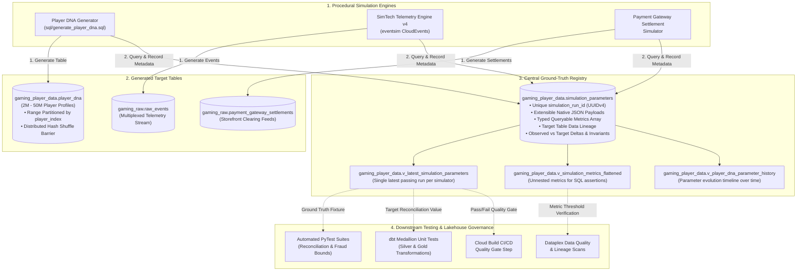

# Deterministic Nested Player Population Generator & Simulation Registry (v3.1)

[](https://cloud.google.com/bigquery)
[](cloudbuild.yaml)
[](tests/test_simulation_parameters.py)
[](docs/simulation_parameters_spec.md)

A stateless, procedural population generator and ground-truth metadata registry built for **Google BigQuery** (MPP Engine) and **Python 3.10+ Reference Runtime**. It dynamically synthesizes reproducible, high-fidelity player demographics, multi-device hardware profiles, latent safety genetics, and nested 7-genre behavioral profiles without static storage overhead, while automatically logging empirical validation metrics and historical run lineage into an append-only registry.

> [!NOTE]
> ### 🎮 In Plain English: What Does This Do & Why Is It Useful?
> Building large-scale data analytics demos for the gaming industry usually requires generating, storing, and loading massive datasets containing millions of synthetic player profiles. This tool solves that problem by:
> 1. **Procedurally Generating Millions of Realistic Player Profiles**: Directly inside Google BigQuery on demand with 100% bitwise determinism and zero static storage bloat.
> 2. **Capturing Ground-Truth Metadata & History**: Automatically running post-generation empirical validation queries and logging the exact input parameters, observed distributions, statistical deltas, and invariant checks to an immutable `simulation_parameters` registry.
> 3. **Powering Downstream Automated Testing**: Downstream Medallion Lakehouse ETL pipelines (Silver/Gold), dbt reconciliation models, and automated CI test suites query dynamic ground truth from the registry rather than relying on brittle hardcoded values.

---

## 💡 System Architecture



---

## ✨ Key Features

### 1. Deterministic Nested Player DNA (v3.1)
* 🚀 **Zero Storage Bloat**: Procedurally compute billions of player profiles on-demand.
* 🛡️ **Mathematical Reproducibility**: 100% bitwise reproducible population across environments using deterministic hash seeds (`FARM_FINGERPRINT` / SHA-256).
* 🔒 **Privacy by Design & RFC-4122 UUIDv4**: Ingestion-time pseudonymization (`telemetry_guid`, `hashed_email`, `client_ip`, `device_advertising_id`).
* 📱 **Multi-Device Ecosystem**: 1 to 3 owned platforms per player with device tiers and payment processor bindings (`apple_app_store`, `google_play`, `steam_store`, `playstation_network`, etc.).
* 🧬 **Latent Behavioral & Safety Genetics**: Mixture Beta toxicity distribution, toxicity resilience, cheat propensities ($r=0.65$), and chargeback risk flags ($0.6\%$).
* 🎮 **7-Genre Taxonomy**: Full coverage of `RPG`, `FPS`, `MOBA`, `Casual`, `Sports`, `Survival`, and `Other` (fallback).
* ⚡ **High-Throughput MPP Slot Saturation**: Ephemeral partitioned driver table architecture (`PARTITION BY RANGE_BUCKET`) and dynamic slice allocation (`--slices=50..100`) force BigQuery Dremel to saturate 50–100+ parallel mapper slots directly across physical Colossus storage splits, generating **50M players in 10 minutes** (down from 1.5+ hours on single-slot in-memory generation).

### 2. Simulation Parameters Registry (`simulation_parameters`)
* 🏛️ **Extensible Hybrid Schema**: Stores unconstrained native BigQuery `JSON` configurations (`input_parameters`, `empirical_results`) alongside typed top-level provenance columns and an unnested queryable struct array (`metrics`).
* 📜 **Immutable Append-Only History**: When re-running the generator with new parameters or pre-clearing data tables, **previous simulation run history is strictly preserved**.
* 📸 **Complete Run Snapshots**: Every record is a self-contained snapshot containing provenance, target table lineage, input configs, empirical distributions, invariant statuses, and ASCII diagnostics text.
* 📈 **Longitudinal Parameter & Metric Tracking**: Dedicated views and SQL queries to track how any specific parameter has changed across runs over time.

### 3. Post-Generation Empirical Validation & Telemetry Reporting
* 🔍 **Vectorized Pure-SQL Diagnostics** ([`sql/validate_player_dna_empirical.sql`](file:///usr/local/google/home/joeholley/Documents/repos/git/github.com/joeholley/generator/sql/validate_player_dna_empirical.sql)): Aggregates full BigQuery populations and verifies demographic shares, multi-device distributions, UA channels, and latent genetics.
* 📐 **Strict Mathematical Invariants**: Enforces 0 violations across 6 structural constraints (UUIDv4 regex format, 7-genre array completeness, device usage normalization sums $= 1.0$, genre preference weight sums $= 1.0$, platform affinity sums $= 1.0$, and F2P spend `NULL` safeguards).
* 🖥️ **Post-Run ASCII Report**: Automatically renders formatted diagnostics tables to `stdout` upon generation completion.

### 4. Architectural Scope & PII Philosophy: Post-Hoc Governance by Design
* 🎯 **Realistic Game Studio Simulation**: In commercial gaming environments, operational player registries and raw telemetry landing tables frequently contain unmasked identifiers (`hashed_email`, `client_ip`, `device_advertising_id`). This repository deliberately generates raw synthetic PII attributes directly in `player_dna` to replicate that real-world state.
* 🛡️ **Post-Hoc Governance Demonstration**: Upstream identity vault segregation, pre-baked DDL policy tags, and table-level dynamic data masking are **strictly out of scope** for this generator. This enables downstream Medallion lakehouses (Bronze $\to$ Silver $\to$ Gold), Dataplex Knowledge Catalog scans, and dbt models to provide guidance on how to discover, anonymize, mask, and purge player PII (such as GDPR Article 17 "Right to be Forgotten" workflows) **strictly after the fact on pre-existing data**.
* ⚡ **Preserved High-Throughput & Immutability**: Keeping `player_dna` immutable and partitioned strictly by `player_index` preserves peak generation throughput (50M players in 10 minutes) and eliminates distributed reduce shuffles.

---

## 📁 Repository Structure

```
.
├── README.md                                # Project overview & operations guide
├── Dockerfile                               # Container build definition with layer caching
├── cloudbuild.yaml                          # Google Cloud Build container build pipeline
├── cloudbuild-runner.yaml                   # Google Cloud Build generator execution target
├── run_generator.py                         # CLI runner with validation & metadata recording
├── simulation_parameters.py                 # Contracts, delta evaluators & BigQuery handlers
├── requirements.txt                         # Python dependencies
├── docs/
│   ├── simulation_parameters_spec.md        # Technical spec: Simulation Parameters Registry
│   ├── player_generator_spec.md             # Technical spec: Player DNA population generator
│   ├── player-generator-enhancement-spec.md # v3.1 enhancement specification
│   ├── plans/
│   │   └── simulation-parameters-table-design.md # Full architecture & implementation plan
│   └── downstream/
│       └── eventsim-generator-enhancement-spec.md # SimTech Telemetry Engine v4 spec
├── infra/
│   └── setup_cloud_build.sh                 # Cloud Build IAM and API setup script
├── sql/
│   ├── generate_player_dna.sql              # Vectorized Player DNA generation SQL
│   ├── create_simulation_parameters_table.sql # Registry table DDL & 4 helper views
│   └── validate_player_dna_empirical.sql    # Pure-SQL empirical diagnostics query
└── tests/
    ├── test_player_generator.py             # 10 tests for procedural math & determinism
    └── test_simulation_parameters.py        # 28 tests for validation, schemas, history & sampling
```

---

## 🚀 Quick Start & CLI Usage

### 1. Cloud Build Container Execution (Recommended)

```bash
# Build container image
gcloud builds submit --config=cloudbuild.yaml .

# Execute 2M / 50M player generation in BigQuery
gcloud builds submit --config=cloudbuild-runner.yaml \
  --substitutions=_NUM_PLAYERS=50000000,_SLICES=100 .
```

### 2. Run Generator via CLI in BigQuery Mode

```bash
python3 run_generator.py \
  --mode=bigquery \
  --project-id=my-gaming-project \
  --dataset=gaming_player_data \
  --table=player_dna \
  --num-players=2000000 \
  --slices=50 \
  --tags="prod,release_v3.1"
```

### 3. Fast Validation on Huge Datasets (Sampling Mode)

```bash
python3 run_generator.py \
  --mode=bigquery \
  --num-players=50000000 \
  --slices=100 \
  --validation-sample-pct=0.01 \
  --tags="scale-50m,sampled"
```

### 4. CLI Arguments Reference

| Flag | Type | Default | Description |
| :--- | :--- | :--- | :--- |
| `--mode` | `STRING` | `"bigquery"` | Execution mode (`bigquery` or `python`). |
| `--num-players` | `INT` | `2000000` | Number of players to generate. |
| `--slices` | `INT` | `50` | Number of parallel worker slices/shards. |
| `--chunk-size` | `INT` | `None` | Optional manual override for chunk size (max 1,000,000). |
| `--validation-sample-pct` | `FLOAT` | `None` | Sample percentage (0.01 to 100.0) for fast post-generation validation. |
| `--validation-sample-size`| `INT` | `None` | Target sample row count for validation. |
| `--project-id` | `STRING` | `None` (Env) | GCP Project ID. |
| `--dataset` | `STRING` | `"gaming_player_data"` | Destination BigQuery dataset. |
| `--table` | `STRING` | `"player_dna"` | Target BigQuery table. |
| `--record-metadata` | `BOOL` | `True` | Writes run ground truth to `simulation_parameters`. |
| `--no-record-metadata` | `FLAG` | `False` | Disables writing to registry. |
| `--metadata-table` | `STRING` | `"simulation_parameters"` | BigQuery table ID for the metadata registry. |
| `--tags` | `STRING` | `None` | Comma-separated tags (e.g. `--tags ci,scale-50m,v3.1`). |
| `--skip-empirical-report`| `FLAG` | `False` | Bypasses printing the ASCII diagnostics table to stdout. |
| `--ddl-file` | `STRING` | `"sql/create_simulation_parameters_table.sql"` | Custom path to registry table DDL. |
| `--validation-sql-file` | `STRING` | `"sql/validate_player_dna_empirical.sql"` | Custom path to empirical validation SQL query. |

---

## 🔍 Ground-Truth Querying & Historical Tracking

### Helper Views

The registry automatically provisions 4 views:
1. `v_latest_simulation_parameters`: Returns the single latest passing run per simulator.
2. `v_simulation_metrics_flattened`: Unnests the `metrics` array across all historical runs for SQL joins.
3. `v_simulation_run_history`: High-level executive timeline of all runs over time.
4. `v_player_dna_parameter_history`: Relational parameter timeline tracking Player DNA configuration changes over time.

---

## 🧪 Test Suite & Quality Verification

Run the complete test suite across all 38 tests:

```bash
python3 -m pytest -v
```

```text
tests/test_player_generator.py (10 Tests)
  ✅ test_determinism
  ✅ test_extreme_player_indices
  ✅ test_f2p_spend_null_safeguard
  ✅ test_genre_profiles_completeness_and_order
  ✅ test_normalization_invariants
  ✅ test_numerical_clamping_and_domain_integrity
  ✅ test_property_based_invariants_large_sample
  ✅ test_session_length_parameters_across_genres
  ✅ test_statistical_distributions_and_covariances
  ✅ test_zero_nulls_and_formats

tests/test_simulation_parameters.py (28 Tests)
  ✅ test_delta_computation_signs_and_precision
  ✅ test_tolerance_tier_transitions_pass_warn_fail
  ✅ test_invariant_metric_status_strict_zero
  ✅ test_overall_validation_status_aggregation
  ✅ test_guid_regex_invariant_detection
  ✅ test_genre_count_and_array_length_invariant_detection
  ✅ test_device_usage_share_sum_invariant_detection
  ✅ test_genre_preference_weight_sum_invariant_detection
  ✅ test_platform_affinity_sum_invariant_detection
  ✅ test_f2p_spend_null_safeguard_invariant_detection
  ✅ test_verify_invariants_clean_and_violating_dicts
  ✅ test_default_input_parameters_contract_compliance
  ✅ test_empirical_results_contract_compliance
  ✅ test_eventsim_input_parameters_contract_compliance
  ✅ test_full_simulation_parameters_payload_builder_and_validation
  ✅ test_metrics_array_schema_compliance_and_negatives
  ✅ test_ascii_report_passed_rendering
  ✅ test_ascii_report_failed_rendering_with_error_summary
  ✅ test_evaluate_bigquery_empirical_results_mock_success
  ✅ test_record_simulation_parameters_successful_insert
  ✅ test_record_simulation_parameters_handles_insertion_error
  ✅ test_fetch_latest_simulation_parameters_downstream_fixture
  ✅ test_multiple_runs_history_preservation_and_isolation
  ✅ test_single_parameter_evolution_tracking_across_history
  ✅ test_complete_run_snapshot_grouping_and_integrity
  ✅ test_slices_and_chunk_size_dynamic_allocation
  ✅ test_driver_table_sql_dynamic_partitioning
  ✅ test_validation_sampling_query_filter_injection

============================== 38 passed in 16.67s ==============================
```

---

## 📜 Documentation Index

* [`docs/simulation_parameters_spec.md`](file:///usr/local/google/home/joeholley/Documents/repos/git/github.com/joeholley/generator/docs/simulation_parameters_spec.md): Comprehensive technical specification for the BigQuery Simulation Parameters & Ground Truth Registry.
* [`docs/player_generator_spec.md`](file:///usr/local/google/home/joeholley/Documents/repos/git/github.com/joeholley/generator/docs/player_generator_spec.md): Mathematical specification for the Player DNA generator.
* [`docs/player-generator-enhancement-spec.md`](file:///usr/local/google/home/joeholley/Documents/repos/git/github.com/joeholley/generator/docs/player-generator-enhancement-spec.md): v3.1 enhancement specification and execution roadmap.
* [`docs/plans/simulation-parameters-table-design.md`](file:///usr/local/google/home/joeholley/Documents/repos/git/github.com/joeholley/generator/docs/plans/simulation-parameters-table-design.md): Architectural design and multi-agent implementation plan.
* [`docs/downstream/eventsim-generator-enhancement-spec.md`](file:///usr/local/google/home/joeholley/Documents/repos/git/github.com/joeholley/generator/docs/downstream/eventsim-generator-enhancement-spec.md): SimTech CloudEvents Telemetry Engine v4 spec.
